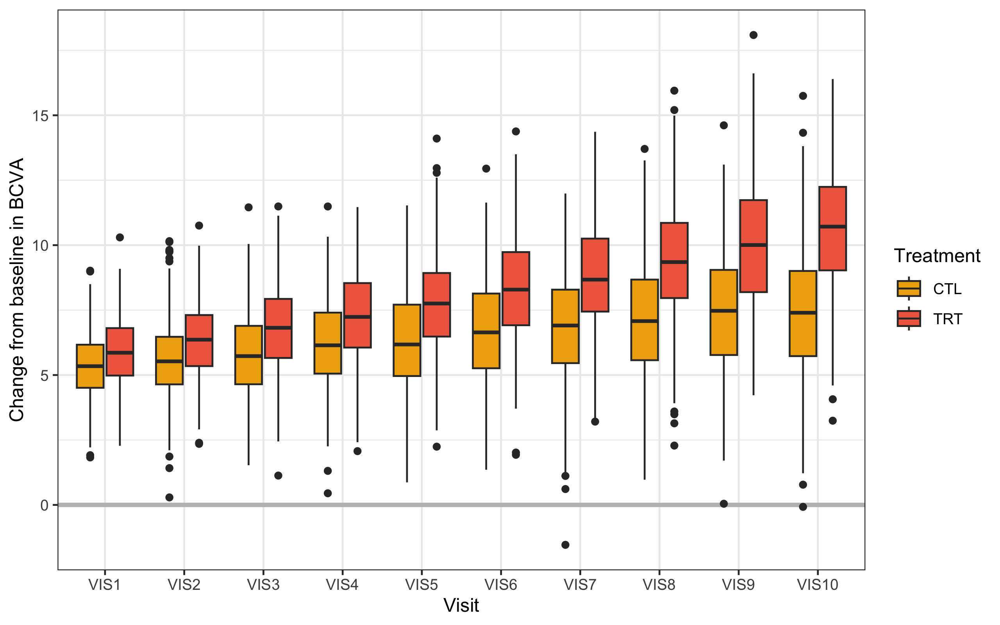

# About {.unnumbered}

This vignette uses the `bcva_data` dataset from the `mmrm` package to compare a Bayesian MMRM fit, obtained by `brms.mmrm::brm_model()`, and a frequentist MMRM fit, 
obtained by `mmrm::mmrm()`. An overview of parameter estimates and 
differences by type of MMRM is given in the [summary (Tables 4 and 5)](#Summary) 
at the end.

# Prerequisites

This comparison workflow requires the following packages.


``` r
> packages <- c(
+   "dplyr",
+   "tidyr",
+   "ggplot2",
+   "gt",
+   "gtsummary",
+   "purrr",
+   "parallel",
+   "brms.mmrm",
+   "mmrm",
+   "posterior"
+ )
> invisible(lapply(packages, library, character.only = TRUE))
```

We set a seed for the random number generator to ensure statistical reproducibility.


``` r
> set.seed(123L)
```

# Data

## Pre-processing

This analysis exercise uses the `bcva_data` dataset contained in the `mmrm` package:


``` r
> data(bcva_data, package = "mmrm")
```

According to <https://openpharma.github.io/mmrm/latest-tag/articles/mmrm_review_methods.html>:

> The BCVA dataset contains data from a randomized longitudinal ophthalmology trial evaluating the change in baseline corrected visual acuity (BCVA) over the course of 10 visits. BCVA corresponds to the number of letters read from a visual acuity chart.

The dataset is a `tibble` with 8605 rows and the following notable variables.

* `USUBJID` (subject ID)
* `AVISIT` (visit number, factor)
* `VISITN` (visit number, numeric)
* `ARMCD` (treatment, `TRT` or `CTL`)
* `RACE` (3-category race)
* `BCVA_BL` (BCVA at baseline)
* `BCVA_CHG` (BCVA change from baseline, primary endpoint for the analysis)

The rest of the pre-processing steps create factors for the study arm and visit and apply the usual checking and standardization steps of `brms.mmrm::brm_data()`.


``` r
> bcva_data <- bcva_data |>
+   mutate(AVISIT = gsub("VIS0*", "VIS", as.character(AVISIT))) |>
+   brm_data(
+     outcome = "BCVA_CHG",
+     group = "ARMCD",
+     time = "AVISIT",
+     patient = "USUBJID",
+     baseline = "BCVA_BL",
+     reference_group = "CTL",
+     covariates = "RACE"
+   ) |>
+   brm_data_chronologize(order = "VISITN")
```

The following table shows the first rows of the dataset.


``` r
> head(bcva_data) |>
+   gt() |>
+   tab_caption(caption = md("Table 1. First rows of the pre-processed `bcva_data` dataset."))
```

<!--html_preserve--><div id="osncjrvket" style="padding-left:0px;padding-right:0px;padding-top:10px;padding-bottom:10px;overflow-x:auto;overflow-y:auto;width:auto;height:auto;">
<style>#osncjrvket table {
  font-family: system-ui, 'Segoe UI', Roboto, Helvetica, Arial, sans-serif, 'Apple Color Emoji', 'Segoe UI Emoji', 'Segoe UI Symbol', 'Noto Color Emoji';
  -webkit-font-smoothing: antialiased;
  -moz-osx-font-smoothing: grayscale;
}

#osncjrvket thead, #osncjrvket tbody, #osncjrvket tfoot, #osncjrvket tr, #osncjrvket td, #osncjrvket th {
  border-style: none;
}

#osncjrvket p {
  margin: 0;
  padding: 0;
}

#osncjrvket .gt_table {
  display: table;
  border-collapse: collapse;
  line-height: normal;
  margin-left: auto;
  margin-right: auto;
  color: #333333;
  font-size: 16px;
  font-weight: normal;
  font-style: normal;
  background-color: #FFFFFF;
  width: auto;
  border-top-style: solid;
  border-top-width: 2px;
  border-top-color: #A8A8A8;
  border-right-style: none;
  border-right-width: 2px;
  border-right-color: #D3D3D3;
  border-bottom-style: solid;
  border-bottom-width: 2px;
  border-bottom-color: #A8A8A8;
  border-left-style: none;
  border-left-width: 2px;
  border-left-color: #D3D3D3;
}

#osncjrvket .gt_caption {
  padding-top: 4px;
  padding-bottom: 4px;
}

#osncjrvket .gt_title {
  color: #333333;
  font-size: 125%;
  font-weight: initial;
  padding-top: 4px;
  padding-bottom: 4px;
  padding-left: 5px;
  padding-right: 5px;
  border-bottom-color: #FFFFFF;
  border-bottom-width: 0;
}

#osncjrvket .gt_subtitle {
  color: #333333;
  font-size: 85%;
  font-weight: initial;
  padding-top: 3px;
  padding-bottom: 5px;
  padding-left: 5px;
  padding-right: 5px;
  border-top-color: #FFFFFF;
  border-top-width: 0;
}

#osncjrvket .gt_heading {
  background-color: #FFFFFF;
  text-align: center;
  border-bottom-color: #FFFFFF;
  border-left-style: none;
  border-left-width: 1px;
  border-left-color: #D3D3D3;
  border-right-style: none;
  border-right-width: 1px;
  border-right-color: #D3D3D3;
}

#osncjrvket .gt_bottom_border {
  border-bottom-style: solid;
  border-bottom-width: 2px;
  border-bottom-color: #D3D3D3;
}

#osncjrvket .gt_col_headings {
  border-top-style: solid;
  border-top-width: 2px;
  border-top-color: #D3D3D3;
  border-bottom-style: solid;
  border-bottom-width: 2px;
  border-bottom-color: #D3D3D3;
  border-left-style: none;
  border-left-width: 1px;
  border-left-color: #D3D3D3;
  border-right-style: none;
  border-right-width: 1px;
  border-right-color: #D3D3D3;
}

#osncjrvket .gt_col_heading {
  color: #333333;
  background-color: #FFFFFF;
  font-size: 100%;
  font-weight: normal;
  text-transform: inherit;
  border-left-style: none;
  border-left-width: 1px;
  border-left-color: #D3D3D3;
  border-right-style: none;
  border-right-width: 1px;
  border-right-color: #D3D3D3;
  vertical-align: bottom;
  padding-top: 5px;
  padding-bottom: 6px;
  padding-left: 5px;
  padding-right: 5px;
  overflow-x: hidden;
}

#osncjrvket .gt_column_spanner_outer {
  color: #333333;
  background-color: #FFFFFF;
  font-size: 100%;
  font-weight: normal;
  text-transform: inherit;
  padding-top: 0;
  padding-bottom: 0;
  padding-left: 4px;
  padding-right: 4px;
}

#osncjrvket .gt_column_spanner_outer:first-child {
  padding-left: 0;
}

#osncjrvket .gt_column_spanner_outer:last-child {
  padding-right: 0;
}

#osncjrvket .gt_column_spanner {
  border-bottom-style: solid;
  border-bottom-width: 2px;
  border-bottom-color: #D3D3D3;
  vertical-align: bottom;
  padding-top: 5px;
  padding-bottom: 5px;
  overflow-x: hidden;
  display: inline-block;
  width: 100%;
}

#osncjrvket .gt_spanner_row {
  border-bottom-style: hidden;
}

#osncjrvket .gt_group_heading {
  padding-top: 8px;
  padding-bottom: 8px;
  padding-left: 5px;
  padding-right: 5px;
  color: #333333;
  background-color: #FFFFFF;
  font-size: 100%;
  font-weight: initial;
  text-transform: inherit;
  border-top-style: solid;
  border-top-width: 2px;
  border-top-color: #D3D3D3;
  border-bottom-style: solid;
  border-bottom-width: 2px;
  border-bottom-color: #D3D3D3;
  border-left-style: none;
  border-left-width: 1px;
  border-left-color: #D3D3D3;
  border-right-style: none;
  border-right-width: 1px;
  border-right-color: #D3D3D3;
  vertical-align: middle;
  text-align: left;
}

#osncjrvket .gt_empty_group_heading {
  padding: 0.5px;
  color: #333333;
  background-color: #FFFFFF;
  font-size: 100%;
  font-weight: initial;
  border-top-style: solid;
  border-top-width: 2px;
  border-top-color: #D3D3D3;
  border-bottom-style: solid;
  border-bottom-width: 2px;
  border-bottom-color: #D3D3D3;
  vertical-align: middle;
}

#osncjrvket .gt_from_md > :first-child {
  margin-top: 0;
}

#osncjrvket .gt_from_md > :last-child {
  margin-bottom: 0;
}

#osncjrvket .gt_row {
  padding-top: 8px;
  padding-bottom: 8px;
  padding-left: 5px;
  padding-right: 5px;
  margin: 10px;
  border-top-style: solid;
  border-top-width: 1px;
  border-top-color: #D3D3D3;
  border-left-style: none;
  border-left-width: 1px;
  border-left-color: #D3D3D3;
  border-right-style: none;
  border-right-width: 1px;
  border-right-color: #D3D3D3;
  vertical-align: middle;
  overflow-x: hidden;
}

#osncjrvket .gt_stub {
  color: #333333;
  background-color: #FFFFFF;
  font-size: 100%;
  font-weight: initial;
  text-transform: inherit;
  border-right-style: solid;
  border-right-width: 2px;
  border-right-color: #D3D3D3;
  padding-left: 5px;
  padding-right: 5px;
}

#osncjrvket .gt_stub_row_group {
  color: #333333;
  background-color: #FFFFFF;
  font-size: 100%;
  font-weight: initial;
  text-transform: inherit;
  border-right-style: solid;
  border-right-width: 2px;
  border-right-color: #D3D3D3;
  padding-left: 5px;
  padding-right: 5px;
  vertical-align: top;
}

#osncjrvket .gt_row_group_first td {
  border-top-width: 2px;
}

#osncjrvket .gt_row_group_first th {
  border-top-width: 2px;
}

#osncjrvket .gt_summary_row {
  color: #333333;
  background-color: #FFFFFF;
  text-transform: inherit;
  padding-top: 8px;
  padding-bottom: 8px;
  padding-left: 5px;
  padding-right: 5px;
}

#osncjrvket .gt_first_summary_row {
  border-top-style: solid;
  border-top-color: #D3D3D3;
}

#osncjrvket .gt_first_summary_row.thick {
  border-top-width: 2px;
}

#osncjrvket .gt_last_summary_row {
  padding-top: 8px;
  padding-bottom: 8px;
  padding-left: 5px;
  padding-right: 5px;
  border-bottom-style: solid;
  border-bottom-width: 2px;
  border-bottom-color: #D3D3D3;
}

#osncjrvket .gt_grand_summary_row {
  color: #333333;
  background-color: #FFFFFF;
  text-transform: inherit;
  padding-top: 8px;
  padding-bottom: 8px;
  padding-left: 5px;
  padding-right: 5px;
}

#osncjrvket .gt_first_grand_summary_row {
  padding-top: 8px;
  padding-bottom: 8px;
  padding-left: 5px;
  padding-right: 5px;
  border-top-style: double;
  border-top-width: 6px;
  border-top-color: #D3D3D3;
}

#osncjrvket .gt_last_grand_summary_row_top {
  padding-top: 8px;
  padding-bottom: 8px;
  padding-left: 5px;
  padding-right: 5px;
  border-bottom-style: double;
  border-bottom-width: 6px;
  border-bottom-color: #D3D3D3;
}

#osncjrvket .gt_striped {
  background-color: rgba(128, 128, 128, 0.05);
}

#osncjrvket .gt_table_body {
  border-top-style: solid;
  border-top-width: 2px;
  border-top-color: #D3D3D3;
  border-bottom-style: solid;
  border-bottom-width: 2px;
  border-bottom-color: #D3D3D3;
}

#osncjrvket .gt_footnotes {
  color: #333333;
  background-color: #FFFFFF;
  border-bottom-style: none;
  border-bottom-width: 2px;
  border-bottom-color: #D3D3D3;
  border-left-style: none;
  border-left-width: 2px;
  border-left-color: #D3D3D3;
  border-right-style: none;
  border-right-width: 2px;
  border-right-color: #D3D3D3;
}

#osncjrvket .gt_footnote {
  margin: 0px;
  font-size: 90%;
  padding-top: 4px;
  padding-bottom: 4px;
  padding-left: 5px;
  padding-right: 5px;
}

#osncjrvket .gt_sourcenotes {
  color: #333333;
  background-color: #FFFFFF;
  border-bottom-style: none;
  border-bottom-width: 2px;
  border-bottom-color: #D3D3D3;
  border-left-style: none;
  border-left-width: 2px;
  border-left-color: #D3D3D3;
  border-right-style: none;
  border-right-width: 2px;
  border-right-color: #D3D3D3;
}

#osncjrvket .gt_sourcenote {
  font-size: 90%;
  padding-top: 4px;
  padding-bottom: 4px;
  padding-left: 5px;
  padding-right: 5px;
}

#osncjrvket .gt_left {
  text-align: left;
}

#osncjrvket .gt_center {
  text-align: center;
}

#osncjrvket .gt_right {
  text-align: right;
  font-variant-numeric: tabular-nums;
}

#osncjrvket .gt_font_normal {
  font-weight: normal;
}

#osncjrvket .gt_font_bold {
  font-weight: bold;
}

#osncjrvket .gt_font_italic {
  font-style: italic;
}

#osncjrvket .gt_super {
  font-size: 65%;
}

#osncjrvket .gt_footnote_marks {
  font-size: 75%;
  vertical-align: 0.4em;
  position: initial;
}

#osncjrvket .gt_asterisk {
  font-size: 100%;
  vertical-align: 0;
}

#osncjrvket .gt_indent_1 {
  text-indent: 5px;
}

#osncjrvket .gt_indent_2 {
  text-indent: 10px;
}

#osncjrvket .gt_indent_3 {
  text-indent: 15px;
}

#osncjrvket .gt_indent_4 {
  text-indent: 20px;
}

#osncjrvket .gt_indent_5 {
  text-indent: 25px;
}

#osncjrvket .katex-display {
  display: inline-flex !important;
  margin-bottom: 0.75em !important;
}

#osncjrvket div.Reactable > div.rt-table > div.rt-thead > div.rt-tr.rt-tr-group-header > div.rt-th-group:after {
  height: 0px !important;
}
</style>
<table class="gt_table" data-quarto-disable-processing="false" data-quarto-bootstrap="false">
  <!--/html_preserve--><caption class='gt_caption'><span class='gt_from_md'>Table 1. First rows of the pre-processed <code>bcva_data</code> dataset.</span></caption><!--html_preserve-->
  <thead>
    <tr class="gt_col_headings">
      <th class="gt_col_heading gt_columns_bottom_border gt_center" rowspan="1" colspan="1" scope="col" id="USUBJID">USUBJID</th>
      <th class="gt_col_heading gt_columns_bottom_border gt_center" rowspan="1" colspan="1" scope="col" id="AVISIT">AVISIT</th>
      <th class="gt_col_heading gt_columns_bottom_border gt_right" rowspan="1" colspan="1" scope="col" id="VISITN">VISITN</th>
      <th class="gt_col_heading gt_columns_bottom_border gt_left" rowspan="1" colspan="1" scope="col" id="ARMCD">ARMCD</th>
      <th class="gt_col_heading gt_columns_bottom_border gt_left" rowspan="1" colspan="1" scope="col" id="RACE">RACE</th>
      <th class="gt_col_heading gt_columns_bottom_border gt_right" rowspan="1" colspan="1" scope="col" id="BCVA_BL">BCVA_BL</th>
      <th class="gt_col_heading gt_columns_bottom_border gt_right" rowspan="1" colspan="1" scope="col" id="BCVA_CHG">BCVA_CHG</th>
    </tr>
  </thead>
  <tbody class="gt_table_body">
    <tr><td headers="USUBJID" class="gt_row gt_center">3</td>
<td headers="AVISIT" class="gt_row gt_center">VIS1</td>
<td headers="VISITN" class="gt_row gt_right">1</td>
<td headers="ARMCD" class="gt_row gt_left">CTL</td>
<td headers="RACE" class="gt_row gt_left">Asian</td>
<td headers="BCVA_BL" class="gt_row gt_right">71.70881</td>
<td headers="BCVA_CHG" class="gt_row gt_right">5.058546</td></tr>
    <tr><td headers="USUBJID" class="gt_row gt_center">3</td>
<td headers="AVISIT" class="gt_row gt_center">VIS10</td>
<td headers="VISITN" class="gt_row gt_right">10</td>
<td headers="ARMCD" class="gt_row gt_left">CTL</td>
<td headers="RACE" class="gt_row gt_left">Asian</td>
<td headers="BCVA_BL" class="gt_row gt_right">71.70881</td>
<td headers="BCVA_CHG" class="gt_row gt_right">10.152565</td></tr>
    <tr><td headers="USUBJID" class="gt_row gt_center">3</td>
<td headers="AVISIT" class="gt_row gt_center">VIS2</td>
<td headers="VISITN" class="gt_row gt_right">2</td>
<td headers="ARMCD" class="gt_row gt_left">CTL</td>
<td headers="RACE" class="gt_row gt_left">Asian</td>
<td headers="BCVA_BL" class="gt_row gt_right">71.70881</td>
<td headers="BCVA_CHG" class="gt_row gt_right">4.018582</td></tr>
    <tr><td headers="USUBJID" class="gt_row gt_center">3</td>
<td headers="AVISIT" class="gt_row gt_center">VIS3</td>
<td headers="VISITN" class="gt_row gt_right">3</td>
<td headers="ARMCD" class="gt_row gt_left">CTL</td>
<td headers="RACE" class="gt_row gt_left">Asian</td>
<td headers="BCVA_BL" class="gt_row gt_right">71.70881</td>
<td headers="BCVA_CHG" class="gt_row gt_right">3.572535</td></tr>
    <tr><td headers="USUBJID" class="gt_row gt_center">3</td>
<td headers="AVISIT" class="gt_row gt_center">VIS4</td>
<td headers="VISITN" class="gt_row gt_right">4</td>
<td headers="ARMCD" class="gt_row gt_left">CTL</td>
<td headers="RACE" class="gt_row gt_left">Asian</td>
<td headers="BCVA_BL" class="gt_row gt_right">71.70881</td>
<td headers="BCVA_CHG" class="gt_row gt_right">4.822669</td></tr>
    <tr><td headers="USUBJID" class="gt_row gt_center">3</td>
<td headers="AVISIT" class="gt_row gt_center">VIS5</td>
<td headers="VISITN" class="gt_row gt_right">5</td>
<td headers="ARMCD" class="gt_row gt_left">CTL</td>
<td headers="RACE" class="gt_row gt_left">Asian</td>
<td headers="BCVA_BL" class="gt_row gt_right">71.70881</td>
<td headers="BCVA_CHG" class="gt_row gt_right">7.348768</td></tr>
  </tbody>
  
</table>
</div><!--/html_preserve-->

## Descriptive statistics

Table of baseline characteristics:


```{.r .fold-hide}
> bcva_data |>
+   select(ARMCD, USUBJID, RACE, BCVA_BL) |>
+   distinct() |>
+   select(-USUBJID) |>
+   tbl_summary(
+     by = c(ARMCD),
+     statistic = list(
+       all_continuous() ~ "{mean} ({sd})",
+       all_categorical() ~ "{n} / {N} ({p}%)"
+     )
+   ) |>
+   modify_caption("Table 2. Baseline characteristics.")
```

<!--html_preserve--><div id="chzgjisdnq" style="padding-left:0px;padding-right:0px;padding-top:10px;padding-bottom:10px;overflow-x:auto;overflow-y:auto;width:auto;height:auto;">
<style>#chzgjisdnq table {
  font-family: system-ui, 'Segoe UI', Roboto, Helvetica, Arial, sans-serif, 'Apple Color Emoji', 'Segoe UI Emoji', 'Segoe UI Symbol', 'Noto Color Emoji';
  -webkit-font-smoothing: antialiased;
  -moz-osx-font-smoothing: grayscale;
}

#chzgjisdnq thead, #chzgjisdnq tbody, #chzgjisdnq tfoot, #chzgjisdnq tr, #chzgjisdnq td, #chzgjisdnq th {
  border-style: none;
}

#chzgjisdnq p {
  margin: 0;
  padding: 0;
}

#chzgjisdnq .gt_table {
  display: table;
  border-collapse: collapse;
  line-height: normal;
  margin-left: auto;
  margin-right: auto;
  color: #333333;
  font-size: 16px;
  font-weight: normal;
  font-style: normal;
  background-color: #FFFFFF;
  width: auto;
  border-top-style: solid;
  border-top-width: 2px;
  border-top-color: #A8A8A8;
  border-right-style: none;
  border-right-width: 2px;
  border-right-color: #D3D3D3;
  border-bottom-style: solid;
  border-bottom-width: 2px;
  border-bottom-color: #A8A8A8;
  border-left-style: none;
  border-left-width: 2px;
  border-left-color: #D3D3D3;
}

#chzgjisdnq .gt_caption {
  padding-top: 4px;
  padding-bottom: 4px;
}

#chzgjisdnq .gt_title {
  color: #333333;
  font-size: 125%;
  font-weight: initial;
  padding-top: 4px;
  padding-bottom: 4px;
  padding-left: 5px;
  padding-right: 5px;
  border-bottom-color: #FFFFFF;
  border-bottom-width: 0;
}

#chzgjisdnq .gt_subtitle {
  color: #333333;
  font-size: 85%;
  font-weight: initial;
  padding-top: 3px;
  padding-bottom: 5px;
  padding-left: 5px;
  padding-right: 5px;
  border-top-color: #FFFFFF;
  border-top-width: 0;
}

#chzgjisdnq .gt_heading {
  background-color: #FFFFFF;
  text-align: center;
  border-bottom-color: #FFFFFF;
  border-left-style: none;
  border-left-width: 1px;
  border-left-color: #D3D3D3;
  border-right-style: none;
  border-right-width: 1px;
  border-right-color: #D3D3D3;
}

#chzgjisdnq .gt_bottom_border {
  border-bottom-style: solid;
  border-bottom-width: 2px;
  border-bottom-color: #D3D3D3;
}

#chzgjisdnq .gt_col_headings {
  border-top-style: solid;
  border-top-width: 2px;
  border-top-color: #D3D3D3;
  border-bottom-style: solid;
  border-bottom-width: 2px;
  border-bottom-color: #D3D3D3;
  border-left-style: none;
  border-left-width: 1px;
  border-left-color: #D3D3D3;
  border-right-style: none;
  border-right-width: 1px;
  border-right-color: #D3D3D3;
}

#chzgjisdnq .gt_col_heading {
  color: #333333;
  background-color: #FFFFFF;
  font-size: 100%;
  font-weight: normal;
  text-transform: inherit;
  border-left-style: none;
  border-left-width: 1px;
  border-left-color: #D3D3D3;
  border-right-style: none;
  border-right-width: 1px;
  border-right-color: #D3D3D3;
  vertical-align: bottom;
  padding-top: 5px;
  padding-bottom: 6px;
  padding-left: 5px;
  padding-right: 5px;
  overflow-x: hidden;
}

#chzgjisdnq .gt_column_spanner_outer {
  color: #333333;
  background-color: #FFFFFF;
  font-size: 100%;
  font-weight: normal;
  text-transform: inherit;
  padding-top: 0;
  padding-bottom: 0;
  padding-left: 4px;
  padding-right: 4px;
}

#chzgjisdnq .gt_column_spanner_outer:first-child {
  padding-left: 0;
}

#chzgjisdnq .gt_column_spanner_outer:last-child {
  padding-right: 0;
}

#chzgjisdnq .gt_column_spanner {
  border-bottom-style: solid;
  border-bottom-width: 2px;
  border-bottom-color: #D3D3D3;
  vertical-align: bottom;
  padding-top: 5px;
  padding-bottom: 5px;
  overflow-x: hidden;
  display: inline-block;
  width: 100%;
}

#chzgjisdnq .gt_spanner_row {
  border-bottom-style: hidden;
}

#chzgjisdnq .gt_group_heading {
  padding-top: 8px;
  padding-bottom: 8px;
  padding-left: 5px;
  padding-right: 5px;
  color: #333333;
  background-color: #FFFFFF;
  font-size: 100%;
  font-weight: initial;
  text-transform: inherit;
  border-top-style: solid;
  border-top-width: 2px;
  border-top-color: #D3D3D3;
  border-bottom-style: solid;
  border-bottom-width: 2px;
  border-bottom-color: #D3D3D3;
  border-left-style: none;
  border-left-width: 1px;
  border-left-color: #D3D3D3;
  border-right-style: none;
  border-right-width: 1px;
  border-right-color: #D3D3D3;
  vertical-align: middle;
  text-align: left;
}

#chzgjisdnq .gt_empty_group_heading {
  padding: 0.5px;
  color: #333333;
  background-color: #FFFFFF;
  font-size: 100%;
  font-weight: initial;
  border-top-style: solid;
  border-top-width: 2px;
  border-top-color: #D3D3D3;
  border-bottom-style: solid;
  border-bottom-width: 2px;
  border-bottom-color: #D3D3D3;
  vertical-align: middle;
}

#chzgjisdnq .gt_from_md > :first-child {
  margin-top: 0;
}

#chzgjisdnq .gt_from_md > :last-child {
  margin-bottom: 0;
}

#chzgjisdnq .gt_row {
  padding-top: 8px;
  padding-bottom: 8px;
  padding-left: 5px;
  padding-right: 5px;
  margin: 10px;
  border-top-style: solid;
  border-top-width: 1px;
  border-top-color: #D3D3D3;
  border-left-style: none;
  border-left-width: 1px;
  border-left-color: #D3D3D3;
  border-right-style: none;
  border-right-width: 1px;
  border-right-color: #D3D3D3;
  vertical-align: middle;
  overflow-x: hidden;
}

#chzgjisdnq .gt_stub {
  color: #333333;
  background-color: #FFFFFF;
  font-size: 100%;
  font-weight: initial;
  text-transform: inherit;
  border-right-style: solid;
  border-right-width: 2px;
  border-right-color: #D3D3D3;
  padding-left: 5px;
  padding-right: 5px;
}

#chzgjisdnq .gt_stub_row_group {
  color: #333333;
  background-color: #FFFFFF;
  font-size: 100%;
  font-weight: initial;
  text-transform: inherit;
  border-right-style: solid;
  border-right-width: 2px;
  border-right-color: #D3D3D3;
  padding-left: 5px;
  padding-right: 5px;
  vertical-align: top;
}

#chzgjisdnq .gt_row_group_first td {
  border-top-width: 2px;
}

#chzgjisdnq .gt_row_group_first th {
  border-top-width: 2px;
}

#chzgjisdnq .gt_summary_row {
  color: #333333;
  background-color: #FFFFFF;
  text-transform: inherit;
  padding-top: 8px;
  padding-bottom: 8px;
  padding-left: 5px;
  padding-right: 5px;
}

#chzgjisdnq .gt_first_summary_row {
  border-top-style: solid;
  border-top-color: #D3D3D3;
}

#chzgjisdnq .gt_first_summary_row.thick {
  border-top-width: 2px;
}

#chzgjisdnq .gt_last_summary_row {
  padding-top: 8px;
  padding-bottom: 8px;
  padding-left: 5px;
  padding-right: 5px;
  border-bottom-style: solid;
  border-bottom-width: 2px;
  border-bottom-color: #D3D3D3;
}

#chzgjisdnq .gt_grand_summary_row {
  color: #333333;
  background-color: #FFFFFF;
  text-transform: inherit;
  padding-top: 8px;
  padding-bottom: 8px;
  padding-left: 5px;
  padding-right: 5px;
}

#chzgjisdnq .gt_first_grand_summary_row {
  padding-top: 8px;
  padding-bottom: 8px;
  padding-left: 5px;
  padding-right: 5px;
  border-top-style: double;
  border-top-width: 6px;
  border-top-color: #D3D3D3;
}

#chzgjisdnq .gt_last_grand_summary_row_top {
  padding-top: 8px;
  padding-bottom: 8px;
  padding-left: 5px;
  padding-right: 5px;
  border-bottom-style: double;
  border-bottom-width: 6px;
  border-bottom-color: #D3D3D3;
}

#chzgjisdnq .gt_striped {
  background-color: rgba(128, 128, 128, 0.05);
}

#chzgjisdnq .gt_table_body {
  border-top-style: solid;
  border-top-width: 2px;
  border-top-color: #D3D3D3;
  border-bottom-style: solid;
  border-bottom-width: 2px;
  border-bottom-color: #D3D3D3;
}

#chzgjisdnq .gt_footnotes {
  color: #333333;
  background-color: #FFFFFF;
  border-bottom-style: none;
  border-bottom-width: 2px;
  border-bottom-color: #D3D3D3;
  border-left-style: none;
  border-left-width: 2px;
  border-left-color: #D3D3D3;
  border-right-style: none;
  border-right-width: 2px;
  border-right-color: #D3D3D3;
}

#chzgjisdnq .gt_footnote {
  margin: 0px;
  font-size: 90%;
  padding-top: 4px;
  padding-bottom: 4px;
  padding-left: 5px;
  padding-right: 5px;
}

#chzgjisdnq .gt_sourcenotes {
  color: #333333;
  background-color: #FFFFFF;
  border-bottom-style: none;
  border-bottom-width: 2px;
  border-bottom-color: #D3D3D3;
  border-left-style: none;
  border-left-width: 2px;
  border-left-color: #D3D3D3;
  border-right-style: none;
  border-right-width: 2px;
  border-right-color: #D3D3D3;
}

#chzgjisdnq .gt_sourcenote {
  font-size: 90%;
  padding-top: 4px;
  padding-bottom: 4px;
  padding-left: 5px;
  padding-right: 5px;
}

#chzgjisdnq .gt_left {
  text-align: left;
}

#chzgjisdnq .gt_center {
  text-align: center;
}

#chzgjisdnq .gt_right {
  text-align: right;
  font-variant-numeric: tabular-nums;
}

#chzgjisdnq .gt_font_normal {
  font-weight: normal;
}

#chzgjisdnq .gt_font_bold {
  font-weight: bold;
}

#chzgjisdnq .gt_font_italic {
  font-style: italic;
}

#chzgjisdnq .gt_super {
  font-size: 65%;
}

#chzgjisdnq .gt_footnote_marks {
  font-size: 75%;
  vertical-align: 0.4em;
  position: initial;
}

#chzgjisdnq .gt_asterisk {
  font-size: 100%;
  vertical-align: 0;
}

#chzgjisdnq .gt_indent_1 {
  text-indent: 5px;
}

#chzgjisdnq .gt_indent_2 {
  text-indent: 10px;
}

#chzgjisdnq .gt_indent_3 {
  text-indent: 15px;
}

#chzgjisdnq .gt_indent_4 {
  text-indent: 20px;
}

#chzgjisdnq .gt_indent_5 {
  text-indent: 25px;
}

#chzgjisdnq .katex-display {
  display: inline-flex !important;
  margin-bottom: 0.75em !important;
}

#chzgjisdnq div.Reactable > div.rt-table > div.rt-thead > div.rt-tr.rt-tr-group-header > div.rt-th-group:after {
  height: 0px !important;
}
</style>
<table class="gt_table" data-quarto-disable-processing="false" data-quarto-bootstrap="false">
  <!--/html_preserve--><caption class='gt_caption'><span class='gt_from_md'>Table 2. Baseline characteristics.</span></caption><!--html_preserve-->
  <thead>
    <tr class="gt_col_headings">
      <th class="gt_col_heading gt_columns_bottom_border gt_left" rowspan="1" colspan="1" scope="col" id="label"><span class='gt_from_md'><strong>Characteristic</strong></span></th>
      <th class="gt_col_heading gt_columns_bottom_border gt_center" rowspan="1" colspan="1" scope="col" id="stat_1"><span class='gt_from_md'><strong>CTL</strong><br />
N = 494</span><span class="gt_footnote_marks" style="white-space:nowrap;font-style:italic;font-weight:normal;line-height:0;"><sup>1</sup></span></th>
      <th class="gt_col_heading gt_columns_bottom_border gt_center" rowspan="1" colspan="1" scope="col" id="stat_2"><span class='gt_from_md'><strong>TRT</strong><br />
N = 506</span><span class="gt_footnote_marks" style="white-space:nowrap;font-style:italic;font-weight:normal;line-height:0;"><sup>1</sup></span></th>
    </tr>
  </thead>
  <tbody class="gt_table_body">
    <tr><td headers="label" class="gt_row gt_left">RACE</td>
<td headers="stat_1" class="gt_row gt_center"><br /></td>
<td headers="stat_2" class="gt_row gt_center"><br /></td></tr>
    <tr><td headers="label" class="gt_row gt_left">    Asian</td>
<td headers="stat_1" class="gt_row gt_center">151 / 494 (31%)</td>
<td headers="stat_2" class="gt_row gt_center">146 / 506 (29%)</td></tr>
    <tr><td headers="label" class="gt_row gt_left">    Black</td>
<td headers="stat_1" class="gt_row gt_center">149 / 494 (30%)</td>
<td headers="stat_2" class="gt_row gt_center">168 / 506 (33%)</td></tr>
    <tr><td headers="label" class="gt_row gt_left">    White</td>
<td headers="stat_1" class="gt_row gt_center">194 / 494 (39%)</td>
<td headers="stat_2" class="gt_row gt_center">192 / 506 (38%)</td></tr>
    <tr><td headers="label" class="gt_row gt_left">BCVA_BL</td>
<td headers="stat_1" class="gt_row gt_center">75 (10)</td>
<td headers="stat_2" class="gt_row gt_center">75 (10)</td></tr>
  </tbody>
  <tfoot>
    <tr class="gt_footnotes">
      <td class="gt_footnote" colspan="3"><span class="gt_footnote_marks" style="white-space:nowrap;font-style:italic;font-weight:normal;line-height:0;"><sup>1</sup></span> <span class='gt_from_md'>n / N (%); Mean (SD)</span></td>
    </tr>
  </tfoot>
</table>
</div><!--/html_preserve-->

Table of change from baseline in BCVA over 52 weeks:


```{.r .fold-hide}
> bcva_data |>
+   pull(AVISIT) |>
+   unique() |>
+   sort() |>
+   purrr::map(
+     .f = ~ bcva_data |>
+       filter(AVISIT %in% .x) |>
+       tbl_summary(
+         by = ARMCD,
+         include = BCVA_CHG,
+         type = BCVA_CHG ~ "continuous2",
+         statistic = BCVA_CHG ~ c(
+           "{mean} ({sd})",
+           "{median} ({p25}, {p75})",
+           "{min}, {max}"
+         ),
+         label = list(BCVA_CHG = paste("Visit ", .x))
+       )
+   ) |>
+   tbl_stack(quiet = TRUE) |>
+   modify_caption("Table 3. Change from baseline.")
```

<!--html_preserve--><div id="cngcwvzoue" style="padding-left:0px;padding-right:0px;padding-top:10px;padding-bottom:10px;overflow-x:auto;overflow-y:auto;width:auto;height:auto;">
<style>#cngcwvzoue table {
  font-family: system-ui, 'Segoe UI', Roboto, Helvetica, Arial, sans-serif, 'Apple Color Emoji', 'Segoe UI Emoji', 'Segoe UI Symbol', 'Noto Color Emoji';
  -webkit-font-smoothing: antialiased;
  -moz-osx-font-smoothing: grayscale;
}

#cngcwvzoue thead, #cngcwvzoue tbody, #cngcwvzoue tfoot, #cngcwvzoue tr, #cngcwvzoue td, #cngcwvzoue th {
  border-style: none;
}

#cngcwvzoue p {
  margin: 0;
  padding: 0;
}

#cngcwvzoue .gt_table {
  display: table;
  border-collapse: collapse;
  line-height: normal;
  margin-left: auto;
  margin-right: auto;
  color: #333333;
  font-size: 16px;
  font-weight: normal;
  font-style: normal;
  background-color: #FFFFFF;
  width: auto;
  border-top-style: solid;
  border-top-width: 2px;
  border-top-color: #A8A8A8;
  border-right-style: none;
  border-right-width: 2px;
  border-right-color: #D3D3D3;
  border-bottom-style: solid;
  border-bottom-width: 2px;
  border-bottom-color: #A8A8A8;
  border-left-style: none;
  border-left-width: 2px;
  border-left-color: #D3D3D3;
}

#cngcwvzoue .gt_caption {
  padding-top: 4px;
  padding-bottom: 4px;
}

#cngcwvzoue .gt_title {
  color: #333333;
  font-size: 125%;
  font-weight: initial;
  padding-top: 4px;
  padding-bottom: 4px;
  padding-left: 5px;
  padding-right: 5px;
  border-bottom-color: #FFFFFF;
  border-bottom-width: 0;
}

#cngcwvzoue .gt_subtitle {
  color: #333333;
  font-size: 85%;
  font-weight: initial;
  padding-top: 3px;
  padding-bottom: 5px;
  padding-left: 5px;
  padding-right: 5px;
  border-top-color: #FFFFFF;
  border-top-width: 0;
}

#cngcwvzoue .gt_heading {
  background-color: #FFFFFF;
  text-align: center;
  border-bottom-color: #FFFFFF;
  border-left-style: none;
  border-left-width: 1px;
  border-left-color: #D3D3D3;
  border-right-style: none;
  border-right-width: 1px;
  border-right-color: #D3D3D3;
}

#cngcwvzoue .gt_bottom_border {
  border-bottom-style: solid;
  border-bottom-width: 2px;
  border-bottom-color: #D3D3D3;
}

#cngcwvzoue .gt_col_headings {
  border-top-style: solid;
  border-top-width: 2px;
  border-top-color: #D3D3D3;
  border-bottom-style: solid;
  border-bottom-width: 2px;
  border-bottom-color: #D3D3D3;
  border-left-style: none;
  border-left-width: 1px;
  border-left-color: #D3D3D3;
  border-right-style: none;
  border-right-width: 1px;
  border-right-color: #D3D3D3;
}

#cngcwvzoue .gt_col_heading {
  color: #333333;
  background-color: #FFFFFF;
  font-size: 100%;
  font-weight: normal;
  text-transform: inherit;
  border-left-style: none;
  border-left-width: 1px;
  border-left-color: #D3D3D3;
  border-right-style: none;
  border-right-width: 1px;
  border-right-color: #D3D3D3;
  vertical-align: bottom;
  padding-top: 5px;
  padding-bottom: 6px;
  padding-left: 5px;
  padding-right: 5px;
  overflow-x: hidden;
}

#cngcwvzoue .gt_column_spanner_outer {
  color: #333333;
  background-color: #FFFFFF;
  font-size: 100%;
  font-weight: normal;
  text-transform: inherit;
  padding-top: 0;
  padding-bottom: 0;
  padding-left: 4px;
  padding-right: 4px;
}

#cngcwvzoue .gt_column_spanner_outer:first-child {
  padding-left: 0;
}

#cngcwvzoue .gt_column_spanner_outer:last-child {
  padding-right: 0;
}

#cngcwvzoue .gt_column_spanner {
  border-bottom-style: solid;
  border-bottom-width: 2px;
  border-bottom-color: #D3D3D3;
  vertical-align: bottom;
  padding-top: 5px;
  padding-bottom: 5px;
  overflow-x: hidden;
  display: inline-block;
  width: 100%;
}

#cngcwvzoue .gt_spanner_row {
  border-bottom-style: hidden;
}

#cngcwvzoue .gt_group_heading {
  padding-top: 8px;
  padding-bottom: 8px;
  padding-left: 5px;
  padding-right: 5px;
  color: #333333;
  background-color: #FFFFFF;
  font-size: 100%;
  font-weight: initial;
  text-transform: inherit;
  border-top-style: solid;
  border-top-width: 2px;
  border-top-color: #D3D3D3;
  border-bottom-style: solid;
  border-bottom-width: 2px;
  border-bottom-color: #D3D3D3;
  border-left-style: none;
  border-left-width: 1px;
  border-left-color: #D3D3D3;
  border-right-style: none;
  border-right-width: 1px;
  border-right-color: #D3D3D3;
  vertical-align: middle;
  text-align: left;
}

#cngcwvzoue .gt_empty_group_heading {
  padding: 0.5px;
  color: #333333;
  background-color: #FFFFFF;
  font-size: 100%;
  font-weight: initial;
  border-top-style: solid;
  border-top-width: 2px;
  border-top-color: #D3D3D3;
  border-bottom-style: solid;
  border-bottom-width: 2px;
  border-bottom-color: #D3D3D3;
  vertical-align: middle;
}

#cngcwvzoue .gt_from_md > :first-child {
  margin-top: 0;
}

#cngcwvzoue .gt_from_md > :last-child {
  margin-bottom: 0;
}

#cngcwvzoue .gt_row {
  padding-top: 8px;
  padding-bottom: 8px;
  padding-left: 5px;
  padding-right: 5px;
  margin: 10px;
  border-top-style: solid;
  border-top-width: 1px;
  border-top-color: #D3D3D3;
  border-left-style: none;
  border-left-width: 1px;
  border-left-color: #D3D3D3;
  border-right-style: none;
  border-right-width: 1px;
  border-right-color: #D3D3D3;
  vertical-align: middle;
  overflow-x: hidden;
}

#cngcwvzoue .gt_stub {
  color: #333333;
  background-color: #FFFFFF;
  font-size: 100%;
  font-weight: initial;
  text-transform: inherit;
  border-right-style: solid;
  border-right-width: 2px;
  border-right-color: #D3D3D3;
  padding-left: 5px;
  padding-right: 5px;
}

#cngcwvzoue .gt_stub_row_group {
  color: #333333;
  background-color: #FFFFFF;
  font-size: 100%;
  font-weight: initial;
  text-transform: inherit;
  border-right-style: solid;
  border-right-width: 2px;
  border-right-color: #D3D3D3;
  padding-left: 5px;
  padding-right: 5px;
  vertical-align: top;
}

#cngcwvzoue .gt_row_group_first td {
  border-top-width: 2px;
}

#cngcwvzoue .gt_row_group_first th {
  border-top-width: 2px;
}

#cngcwvzoue .gt_summary_row {
  color: #333333;
  background-color: #FFFFFF;
  text-transform: inherit;
  padding-top: 8px;
  padding-bottom: 8px;
  padding-left: 5px;
  padding-right: 5px;
}

#cngcwvzoue .gt_first_summary_row {
  border-top-style: solid;
  border-top-color: #D3D3D3;
}

#cngcwvzoue .gt_first_summary_row.thick {
  border-top-width: 2px;
}

#cngcwvzoue .gt_last_summary_row {
  padding-top: 8px;
  padding-bottom: 8px;
  padding-left: 5px;
  padding-right: 5px;
  border-bottom-style: solid;
  border-bottom-width: 2px;
  border-bottom-color: #D3D3D3;
}

#cngcwvzoue .gt_grand_summary_row {
  color: #333333;
  background-color: #FFFFFF;
  text-transform: inherit;
  padding-top: 8px;
  padding-bottom: 8px;
  padding-left: 5px;
  padding-right: 5px;
}

#cngcwvzoue .gt_first_grand_summary_row {
  padding-top: 8px;
  padding-bottom: 8px;
  padding-left: 5px;
  padding-right: 5px;
  border-top-style: double;
  border-top-width: 6px;
  border-top-color: #D3D3D3;
}

#cngcwvzoue .gt_last_grand_summary_row_top {
  padding-top: 8px;
  padding-bottom: 8px;
  padding-left: 5px;
  padding-right: 5px;
  border-bottom-style: double;
  border-bottom-width: 6px;
  border-bottom-color: #D3D3D3;
}

#cngcwvzoue .gt_striped {
  background-color: rgba(128, 128, 128, 0.05);
}

#cngcwvzoue .gt_table_body {
  border-top-style: solid;
  border-top-width: 2px;
  border-top-color: #D3D3D3;
  border-bottom-style: solid;
  border-bottom-width: 2px;
  border-bottom-color: #D3D3D3;
}

#cngcwvzoue .gt_footnotes {
  color: #333333;
  background-color: #FFFFFF;
  border-bottom-style: none;
  border-bottom-width: 2px;
  border-bottom-color: #D3D3D3;
  border-left-style: none;
  border-left-width: 2px;
  border-left-color: #D3D3D3;
  border-right-style: none;
  border-right-width: 2px;
  border-right-color: #D3D3D3;
}

#cngcwvzoue .gt_footnote {
  margin: 0px;
  font-size: 90%;
  padding-top: 4px;
  padding-bottom: 4px;
  padding-left: 5px;
  padding-right: 5px;
}

#cngcwvzoue .gt_sourcenotes {
  color: #333333;
  background-color: #FFFFFF;
  border-bottom-style: none;
  border-bottom-width: 2px;
  border-bottom-color: #D3D3D3;
  border-left-style: none;
  border-left-width: 2px;
  border-left-color: #D3D3D3;
  border-right-style: none;
  border-right-width: 2px;
  border-right-color: #D3D3D3;
}

#cngcwvzoue .gt_sourcenote {
  font-size: 90%;
  padding-top: 4px;
  padding-bottom: 4px;
  padding-left: 5px;
  padding-right: 5px;
}

#cngcwvzoue .gt_left {
  text-align: left;
}

#cngcwvzoue .gt_center {
  text-align: center;
}

#cngcwvzoue .gt_right {
  text-align: right;
  font-variant-numeric: tabular-nums;
}

#cngcwvzoue .gt_font_normal {
  font-weight: normal;
}

#cngcwvzoue .gt_font_bold {
  font-weight: bold;
}

#cngcwvzoue .gt_font_italic {
  font-style: italic;
}

#cngcwvzoue .gt_super {
  font-size: 65%;
}

#cngcwvzoue .gt_footnote_marks {
  font-size: 75%;
  vertical-align: 0.4em;
  position: initial;
}

#cngcwvzoue .gt_asterisk {
  font-size: 100%;
  vertical-align: 0;
}

#cngcwvzoue .gt_indent_1 {
  text-indent: 5px;
}

#cngcwvzoue .gt_indent_2 {
  text-indent: 10px;
}

#cngcwvzoue .gt_indent_3 {
  text-indent: 15px;
}

#cngcwvzoue .gt_indent_4 {
  text-indent: 20px;
}

#cngcwvzoue .gt_indent_5 {
  text-indent: 25px;
}

#cngcwvzoue .katex-display {
  display: inline-flex !important;
  margin-bottom: 0.75em !important;
}

#cngcwvzoue div.Reactable > div.rt-table > div.rt-thead > div.rt-tr.rt-tr-group-header > div.rt-th-group:after {
  height: 0px !important;
}
</style>
<table class="gt_table" data-quarto-disable-processing="false" data-quarto-bootstrap="false">
  <!--/html_preserve--><caption class='gt_caption'><span class='gt_from_md'>Table 3. Change from baseline.</span></caption><!--html_preserve-->
  <thead>
    <tr class="gt_col_headings">
      <th class="gt_col_heading gt_columns_bottom_border gt_left" rowspan="1" colspan="1" scope="col" id="label"><span class='gt_from_md'><strong>Characteristic</strong></span></th>
      <th class="gt_col_heading gt_columns_bottom_border gt_center" rowspan="1" colspan="1" scope="col" id="stat_1"><span class='gt_from_md'><strong>CTL</strong><br />
N = 494</span></th>
      <th class="gt_col_heading gt_columns_bottom_border gt_center" rowspan="1" colspan="1" scope="col" id="stat_2"><span class='gt_from_md'><strong>TRT</strong><br />
N = 506</span></th>
    </tr>
  </thead>
  <tbody class="gt_table_body">
    <tr><td headers="label" class="gt_row gt_left">Visit  VIS1</td>
<td headers="stat_1" class="gt_row gt_center"><br /></td>
<td headers="stat_2" class="gt_row gt_center"><br /></td></tr>
    <tr><td headers="label" class="gt_row gt_left">    Mean (SD)</td>
<td headers="stat_1" class="gt_row gt_center">5.32 (1.23)</td>
<td headers="stat_2" class="gt_row gt_center">5.86 (1.33)</td></tr>
    <tr><td headers="label" class="gt_row gt_left">    Median (Q1, Q3)</td>
<td headers="stat_1" class="gt_row gt_center">5.34 (4.51, 6.17)</td>
<td headers="stat_2" class="gt_row gt_center">5.86 (4.98, 6.81)</td></tr>
    <tr><td headers="label" class="gt_row gt_left">    Min, Max</td>
<td headers="stat_1" class="gt_row gt_center">1.83, 9.02</td>
<td headers="stat_2" class="gt_row gt_center">2.28, 10.30</td></tr>
    <tr><td headers="label" class="gt_row gt_left">    Unknown</td>
<td headers="stat_1" class="gt_row gt_center">12</td>
<td headers="stat_2" class="gt_row gt_center">5</td></tr>
    <tr><td headers="label" class="gt_row gt_left">Visit  VIS2</td>
<td headers="stat_1" class="gt_row gt_center"><br /></td>
<td headers="stat_2" class="gt_row gt_center"><br /></td></tr>
    <tr><td headers="label" class="gt_row gt_left">    Mean (SD)</td>
<td headers="stat_1" class="gt_row gt_center">5.59 (1.49)</td>
<td headers="stat_2" class="gt_row gt_center">6.33 (1.45)</td></tr>
    <tr><td headers="label" class="gt_row gt_left">    Median (Q1, Q3)</td>
<td headers="stat_1" class="gt_row gt_center">5.53 (4.64, 6.47)</td>
<td headers="stat_2" class="gt_row gt_center">6.36 (5.34, 7.31)</td></tr>
    <tr><td headers="label" class="gt_row gt_left">    Min, Max</td>
<td headers="stat_1" class="gt_row gt_center">0.29, 10.15</td>
<td headers="stat_2" class="gt_row gt_center">2.35, 10.75</td></tr>
    <tr><td headers="label" class="gt_row gt_left">    Unknown</td>
<td headers="stat_1" class="gt_row gt_center">13</td>
<td headers="stat_2" class="gt_row gt_center">7</td></tr>
    <tr><td headers="label" class="gt_row gt_left">Visit  VIS3</td>
<td headers="stat_1" class="gt_row gt_center"><br /></td>
<td headers="stat_2" class="gt_row gt_center"><br /></td></tr>
    <tr><td headers="label" class="gt_row gt_left">    Mean (SD)</td>
<td headers="stat_1" class="gt_row gt_center">5.79 (1.61)</td>
<td headers="stat_2" class="gt_row gt_center">6.79 (1.71)</td></tr>
    <tr><td headers="label" class="gt_row gt_left">    Median (Q1, Q3)</td>
<td headers="stat_1" class="gt_row gt_center">5.73 (4.64, 6.91)</td>
<td headers="stat_2" class="gt_row gt_center">6.82 (5.66, 7.93)</td></tr>
    <tr><td headers="label" class="gt_row gt_left">    Min, Max</td>
<td headers="stat_1" class="gt_row gt_center">1.53, 11.46</td>
<td headers="stat_2" class="gt_row gt_center">1.13, 11.49</td></tr>
    <tr><td headers="label" class="gt_row gt_left">    Unknown</td>
<td headers="stat_1" class="gt_row gt_center">23</td>
<td headers="stat_2" class="gt_row gt_center">17</td></tr>
    <tr><td headers="label" class="gt_row gt_left">Visit  VIS4</td>
<td headers="stat_1" class="gt_row gt_center"><br /></td>
<td headers="stat_2" class="gt_row gt_center"><br /></td></tr>
    <tr><td headers="label" class="gt_row gt_left">    Mean (SD)</td>
<td headers="stat_1" class="gt_row gt_center">6.18 (1.73)</td>
<td headers="stat_2" class="gt_row gt_center">7.29 (1.82)</td></tr>
    <tr><td headers="label" class="gt_row gt_left">    Median (Q1, Q3)</td>
<td headers="stat_1" class="gt_row gt_center">6.14 (5.05, 7.41)</td>
<td headers="stat_2" class="gt_row gt_center">7.24 (6.05, 8.54)</td></tr>
    <tr><td headers="label" class="gt_row gt_left">    Min, Max</td>
<td headers="stat_1" class="gt_row gt_center">0.45, 11.49</td>
<td headers="stat_2" class="gt_row gt_center">2.07, 11.47</td></tr>
    <tr><td headers="label" class="gt_row gt_left">    Unknown</td>
<td headers="stat_1" class="gt_row gt_center">36</td>
<td headers="stat_2" class="gt_row gt_center">18</td></tr>
    <tr><td headers="label" class="gt_row gt_left">Visit  VIS5</td>
<td headers="stat_1" class="gt_row gt_center"><br /></td>
<td headers="stat_2" class="gt_row gt_center"><br /></td></tr>
    <tr><td headers="label" class="gt_row gt_left">    Mean (SD)</td>
<td headers="stat_1" class="gt_row gt_center">6.28 (1.97)</td>
<td headers="stat_2" class="gt_row gt_center">7.68 (1.94)</td></tr>
    <tr><td headers="label" class="gt_row gt_left">    Median (Q1, Q3)</td>
<td headers="stat_1" class="gt_row gt_center">6.18 (4.96, 7.71)</td>
<td headers="stat_2" class="gt_row gt_center">7.75 (6.48, 8.95)</td></tr>
    <tr><td headers="label" class="gt_row gt_left">    Min, Max</td>
<td headers="stat_1" class="gt_row gt_center">0.87, 11.53</td>
<td headers="stat_2" class="gt_row gt_center">2.24, 14.10</td></tr>
    <tr><td headers="label" class="gt_row gt_left">    Unknown</td>
<td headers="stat_1" class="gt_row gt_center">40</td>
<td headers="stat_2" class="gt_row gt_center">35</td></tr>
    <tr><td headers="label" class="gt_row gt_left">Visit  VIS6</td>
<td headers="stat_1" class="gt_row gt_center"><br /></td>
<td headers="stat_2" class="gt_row gt_center"><br /></td></tr>
    <tr><td headers="label" class="gt_row gt_left">    Mean (SD)</td>
<td headers="stat_1" class="gt_row gt_center">6.69 (1.97)</td>
<td headers="stat_2" class="gt_row gt_center">8.31 (1.98)</td></tr>
    <tr><td headers="label" class="gt_row gt_left">    Median (Q1, Q3)</td>
<td headers="stat_1" class="gt_row gt_center">6.64 (5.26, 8.14)</td>
<td headers="stat_2" class="gt_row gt_center">8.29 (6.92, 9.74)</td></tr>
    <tr><td headers="label" class="gt_row gt_left">    Min, Max</td>
<td headers="stat_1" class="gt_row gt_center">1.35, 12.95</td>
<td headers="stat_2" class="gt_row gt_center">1.93, 14.38</td></tr>
    <tr><td headers="label" class="gt_row gt_left">    Unknown</td>
<td headers="stat_1" class="gt_row gt_center">84</td>
<td headers="stat_2" class="gt_row gt_center">48</td></tr>
    <tr><td headers="label" class="gt_row gt_left">Visit  VIS7</td>
<td headers="stat_1" class="gt_row gt_center"><br /></td>
<td headers="stat_2" class="gt_row gt_center"><br /></td></tr>
    <tr><td headers="label" class="gt_row gt_left">    Mean (SD)</td>
<td headers="stat_1" class="gt_row gt_center">6.78 (2.09)</td>
<td headers="stat_2" class="gt_row gt_center">8.78 (2.11)</td></tr>
    <tr><td headers="label" class="gt_row gt_left">    Median (Q1, Q3)</td>
<td headers="stat_1" class="gt_row gt_center">6.91 (5.46, 8.29)</td>
<td headers="stat_2" class="gt_row gt_center">8.67 (7.44, 10.26)</td></tr>
    <tr><td headers="label" class="gt_row gt_left">    Min, Max</td>
<td headers="stat_1" class="gt_row gt_center">-1.54, 11.99</td>
<td headers="stat_2" class="gt_row gt_center">3.21, 14.36</td></tr>
    <tr><td headers="label" class="gt_row gt_left">    Unknown</td>
<td headers="stat_1" class="gt_row gt_center">106</td>
<td headers="stat_2" class="gt_row gt_center">78</td></tr>
    <tr><td headers="label" class="gt_row gt_left">Visit  VIS8</td>
<td headers="stat_1" class="gt_row gt_center"><br /></td>
<td headers="stat_2" class="gt_row gt_center"><br /></td></tr>
    <tr><td headers="label" class="gt_row gt_left">    Mean (SD)</td>
<td headers="stat_1" class="gt_row gt_center">7.08 (2.25)</td>
<td headers="stat_2" class="gt_row gt_center">9.40 (2.26)</td></tr>
    <tr><td headers="label" class="gt_row gt_left">    Median (Q1, Q3)</td>
<td headers="stat_1" class="gt_row gt_center">7.08 (5.55, 8.68)</td>
<td headers="stat_2" class="gt_row gt_center">9.35 (7.96, 10.86)</td></tr>
    <tr><td headers="label" class="gt_row gt_left">    Min, Max</td>
<td headers="stat_1" class="gt_row gt_center">0.97, 13.71</td>
<td headers="stat_2" class="gt_row gt_center">2.28, 15.95</td></tr>
    <tr><td headers="label" class="gt_row gt_left">    Unknown</td>
<td headers="stat_1" class="gt_row gt_center">123</td>
<td headers="stat_2" class="gt_row gt_center">86</td></tr>
    <tr><td headers="label" class="gt_row gt_left">Visit  VIS9</td>
<td headers="stat_1" class="gt_row gt_center"><br /></td>
<td headers="stat_2" class="gt_row gt_center"><br /></td></tr>
    <tr><td headers="label" class="gt_row gt_left">    Mean (SD)</td>
<td headers="stat_1" class="gt_row gt_center">7.39 (2.33)</td>
<td headers="stat_2" class="gt_row gt_center">10.01 (2.50)</td></tr>
    <tr><td headers="label" class="gt_row gt_left">    Median (Q1, Q3)</td>
<td headers="stat_1" class="gt_row gt_center">7.47 (5.76, 9.05)</td>
<td headers="stat_2" class="gt_row gt_center">10.01 (8.19, 11.74)</td></tr>
    <tr><td headers="label" class="gt_row gt_left">    Min, Max</td>
<td headers="stat_1" class="gt_row gt_center">0.04, 14.61</td>
<td headers="stat_2" class="gt_row gt_center">4.22, 18.09</td></tr>
    <tr><td headers="label" class="gt_row gt_left">    Unknown</td>
<td headers="stat_1" class="gt_row gt_center">167</td>
<td headers="stat_2" class="gt_row gt_center">114</td></tr>
    <tr><td headers="label" class="gt_row gt_left">Visit  VIS10</td>
<td headers="stat_1" class="gt_row gt_center"><br /></td>
<td headers="stat_2" class="gt_row gt_center"><br /></td></tr>
    <tr><td headers="label" class="gt_row gt_left">    Mean (SD)</td>
<td headers="stat_1" class="gt_row gt_center">7.49 (2.58)</td>
<td headers="stat_2" class="gt_row gt_center">10.59 (2.36)</td></tr>
    <tr><td headers="label" class="gt_row gt_left">    Median (Q1, Q3)</td>
<td headers="stat_1" class="gt_row gt_center">7.40 (5.73, 9.01)</td>
<td headers="stat_2" class="gt_row gt_center">10.71 (9.03, 12.25)</td></tr>
    <tr><td headers="label" class="gt_row gt_left">    Min, Max</td>
<td headers="stat_1" class="gt_row gt_center">-0.08, 15.75</td>
<td headers="stat_2" class="gt_row gt_center">3.24, 16.40</td></tr>
    <tr><td headers="label" class="gt_row gt_left">    Unknown</td>
<td headers="stat_1" class="gt_row gt_center">213</td>
<td headers="stat_2" class="gt_row gt_center">170</td></tr>
  </tbody>
  
</table>
</div><!--/html_preserve-->

The following figure shows the primary endpoint over the four study visits in the data.


``` r
> bcva_data |>
+   group_by(ARMCD) |>
+   ggplot(aes(x = AVISIT, y = BCVA_CHG, fill = factor(ARMCD))) +
+   geom_hline(yintercept = 0, col = "grey", linewidth = 1.2) +
+   geom_boxplot(na.rm = TRUE) +
+   labs(
+     x = "Visit",
+     y = "Change from baseline in BCVA",
+     fill = "Treatment"
+   ) +
+   scale_fill_manual(values = c("darkgoldenrod2", "coral2")) +
+   theme_bw()
```

<div class="figure" style="text-align: center">

<p class="caption">Figure 1. Change from baseline in BCVA over 4 visit time points.</p>
</div>

# Fitting MMRMs

## Bayesian model

The formula for the Bayesian model includes additive effects for baseline, study visit, race, and study-arm-by-visit interaction.


```{.r .fold-hide}
> b_mmrm_formula <- brm_formula(
+   data = bcva_data,
+   intercept = TRUE,
+   baseline = TRUE,
+   group = FALSE,
+   time = TRUE,
+   baseline_time = FALSE,
+   group_time = TRUE,
+   correlation = "unstructured"
+ )
> print(b_mmrm_formula)
#> BCVA_CHG ~ BCVA_BL + ARMCD:AVISIT + AVISIT + RACE + unstr(time = AVISIT, gr = USUBJID) 
#> sigma ~ 0 + AVISIT
```

We fit the model using `brms.mmrm::brm_model()`. The computation takes several minutes because of the size of the dataset. To ensure a good basis of comparison with the frequentist model, we put an extremely diffuse prior on the intercept. The parameters already have diffuse flexible priors by default.


```{.r .fold-hide}
> b_mmrm_fit <- brm_model(
+   data = filter(bcva_data, !is.na(BCVA_CHG)),
+   formula = b_mmrm_formula,
+   prior = brms::prior(class = "Intercept", prior = "student_t(3, 0, 1000)"),
+   iter = 10000,
+   warmup = 2000,
+   chains = 4,
+   cores = 4,
+   seed = 1,
+   refresh = 0
+ )
#> Running MCMC with 4 parallel chains...
#> 
#> Chain 4 finished in 321.6 seconds.
#> Chain 1 finished in 323.9 seconds.
#> Chain 2 finished in 324.1 seconds.
#> Chain 3 finished in 324.8 seconds.
#> 
#> All 4 chains finished successfully.
#> Mean chain execution time: 323.6 seconds.
#> Total execution time: 325.1 seconds.
```

Here is a posterior summary of model parameters, including fixed effects and pairwise correlation among visits within patients.


```{.r .fold-hide}
> summary(b_mmrm_fit)
#>  Family: gaussian 
#>   Links: mu = identity; sigma = log 
#> Formula: BCVA_CHG ~ BCVA_BL + ARMCD:AVISIT + AVISIT + RACE + unstr(time = AVISIT, gr = USUBJID) 
#>          sigma ~ 0 + AVISIT
#>    Data: modeled_data (Number of observations: 8605) 
#>   Draws: 4 chains, each with iter = 10000; warmup = 2000; thin = 1;
#>          total post-warmup draws = 32000
#> 
#> Correlation Structures:
#>                     Estimate Est.Error l-95% CI u-95% CI Rhat Bulk_ESS Tail_ESS
#> cortime(VIS1,VIS2)      0.05      0.03    -0.01     0.11 1.00    70766    23698
#> cortime(VIS1,VIS3)      0.31      0.03     0.25     0.37 1.00    68979    25441
#> cortime(VIS2,VIS3)      0.05      0.03    -0.02     0.11 1.00    71865    23449
#> cortime(VIS1,VIS4)      0.21      0.03     0.15     0.27 1.00    45833    26729
#> cortime(VIS2,VIS4)      0.13      0.03     0.07     0.20 1.00    51270    27527
#> cortime(VIS3,VIS4)     -0.01      0.03    -0.07     0.05 1.00    51927    27434
#> cortime(VIS1,VIS5)      0.17      0.03     0.11     0.23 1.00    48586    27126
#> cortime(VIS2,VIS5)      0.12      0.03     0.05     0.18 1.00    53272    26189
#> cortime(VIS3,VIS5)     -0.01      0.03    -0.07     0.06 1.00    51985    26968
#> cortime(VIS4,VIS5)      0.38      0.03     0.32     0.43 1.00    55081    27007
#> cortime(VIS1,VIS6)      0.26      0.03     0.20     0.32 1.00    44987    28229
#> cortime(VIS2,VIS6)      0.20      0.03     0.14     0.27 1.00    48180    26585
#> cortime(VIS3,VIS6)      0.04      0.03    -0.02     0.11 1.00    52986    27088
#> cortime(VIS4,VIS6)      0.40      0.03     0.35     0.46 1.00    49218    26558
#> cortime(VIS5,VIS6)      0.39      0.03     0.34     0.45 1.00    56414    27573
#> cortime(VIS1,VIS7)      0.07      0.03    -0.00     0.13 1.00    70294    24615
#> cortime(VIS2,VIS7)      0.09      0.03     0.02     0.15 1.00    66725    24883
#> cortime(VIS3,VIS7)     -0.00      0.03    -0.07     0.07 1.00    73097    24926
#> cortime(VIS4,VIS7)      0.15      0.04     0.08     0.21 1.00    66204    24580
#> cortime(VIS5,VIS7)      0.19      0.03     0.13     0.26 1.00    67064    24648
#> cortime(VIS6,VIS7)      0.21      0.04     0.14     0.28 1.00    63628    24809
#> cortime(VIS1,VIS8)      0.05      0.04    -0.02     0.12 1.00    65076    24590
#> cortime(VIS2,VIS8)      0.10      0.04     0.03     0.17 1.00    61541    23411
#> cortime(VIS3,VIS8)     -0.03      0.04    -0.10     0.04 1.00    68915    23642
#> cortime(VIS4,VIS8)      0.17      0.03     0.10     0.24 1.00    66513    24426
#> cortime(VIS5,VIS8)      0.17      0.04     0.10     0.24 1.00    72143    24001
#> cortime(VIS6,VIS8)      0.16      0.04     0.09     0.23 1.00    68019    22354
#> cortime(VIS7,VIS8)      0.05      0.04    -0.02     0.13 1.00    69488    22490
#> cortime(VIS1,VIS9)      0.03      0.04    -0.04     0.10 1.00    72596    22632
#> cortime(VIS2,VIS9)     -0.01      0.04    -0.08     0.07 1.00    72117    23400
#> cortime(VIS3,VIS9)     -0.04      0.04    -0.12     0.03 1.00    71950    23830
#> cortime(VIS4,VIS9)      0.12      0.04     0.04     0.19 1.00    71100    24051
#> cortime(VIS5,VIS9)      0.09      0.04     0.02     0.16 1.00    65967    24435
#> cortime(VIS6,VIS9)      0.17      0.04     0.09     0.24 1.00    70889    23582
#> cortime(VIS7,VIS9)      0.02      0.04    -0.06     0.09 1.00    68516    23451
#> cortime(VIS8,VIS9)      0.06      0.04    -0.02     0.14 1.00    68542    24109
#> cortime(VIS1,VIS10)     0.02      0.04    -0.06     0.10 1.00    59437    23707
#> cortime(VIS2,VIS10)     0.13      0.04     0.05     0.20 1.00    61864    26343
#> cortime(VIS3,VIS10)     0.02      0.04    -0.06     0.10 1.00    59350    25346
#> cortime(VIS4,VIS10)     0.31      0.04     0.24     0.38 1.00    61632    25167
#> cortime(VIS5,VIS10)     0.24      0.04     0.16     0.31 1.00    69597    24322
#> cortime(VIS6,VIS10)     0.30      0.04     0.22     0.37 1.00    67204    25575
#> cortime(VIS7,VIS10)     0.06      0.05    -0.03     0.15 1.00    71232    23677
#> cortime(VIS8,VIS10)     0.09      0.04     0.01     0.18 1.00    70814    22786
#> cortime(VIS9,VIS10)     0.08      0.05    -0.01     0.17 1.00    68742    24036
#> 
#> Regression Coefficients:
#>                      Estimate Est.Error l-95% CI u-95% CI Rhat Bulk_ESS Tail_ESS
#> Intercept                4.29      0.17     3.95     4.63 1.00    54294    24172
#> BCVA_BL                 -0.00      0.00    -0.01     0.00 1.00    56220    21798
#> AVISIT2                  0.28      0.07     0.14     0.42 1.00    30102    26502
#> AVISIT3                  0.46      0.07     0.32     0.59 1.00    44737    25450
#> AVISIT4                  0.86      0.08     0.71     1.01 1.00    27721    26054
#> AVISIT5                  0.96      0.09     0.80     1.13 1.00    28468    26157
#> AVISIT6                  1.33      0.09     1.16     1.50 1.00    27615    26450
#> AVISIT7                  1.42      0.11     1.20     1.63 1.00    33029    25926
#> AVISIT8                  1.71      0.12     1.49     1.94 1.00    36166    26846
#> AVISIT9                  2.00      0.13     1.75     2.25 1.00    38164    26071
#> AVISIT10                 2.10      0.14     1.82     2.38 1.00    31477    25593
#> RACEBlack                1.04      0.06     0.93     1.15 1.00    54357    26552
#> RACEWhite                2.01      0.05     1.90     2.11 1.00    51242    26367
#> AVISITVIS1:ARMCDTRT      0.54      0.06     0.42     0.66 1.00    35064    27718
#> AVISITVIS2:ARMCDTRT      0.72      0.08     0.57     0.88 1.00    49014    24890
#> AVISITVIS3:ARMCDTRT      1.01      0.09     0.83     1.19 1.00    45317    25013
#> AVISITVIS4:ARMCDTRT      1.10      0.10     0.91     1.30 1.00    36685    26405
#> AVISITVIS5:ARMCDTRT      1.38      0.11     1.16     1.61 1.00    35636    25859
#> AVISITVIS6:ARMCDTRT      1.63      0.12     1.40     1.86 1.00    34644    26364
#> AVISITVIS7:ARMCDTRT      2.02      0.14     1.74     2.29 1.00    43038    25191
#> AVISITVIS8:ARMCDTRT      2.35      0.15     2.06     2.64 1.00    44068    25411
#> AVISITVIS9:ARMCDTRT      2.66      0.16     2.33     2.98 1.00    46208    24464
#> AVISITVIS10:ARMCDTRT     3.07      0.18     2.72     3.43 1.00    38130    25317
#> sigma_AVISITVIS1        -0.01      0.02    -0.06     0.03 1.00    65722    24173
#> sigma_AVISITVIS2         0.23      0.02     0.18     0.27 1.00    77511    23552
#> sigma_AVISITVIS3         0.36      0.02     0.31     0.40 1.00    70583    26227
#> sigma_AVISITVIS4         0.44      0.02     0.40     0.49 1.00    55766    26867
#> sigma_AVISITVIS5         0.57      0.02     0.52     0.61 1.00    62540    25935
#> sigma_AVISITVIS6         0.58      0.02     0.53     0.63 1.00    55298    26419
#> sigma_AVISITVIS7         0.69      0.03     0.64     0.74 1.00    68520    22417
#> sigma_AVISITVIS8         0.74      0.03     0.69     0.79 1.00    71145    24432
#> sigma_AVISITVIS9         0.80      0.03     0.75     0.85 1.00    76082    23123
#> sigma_AVISITVIS10        0.84      0.03     0.79     0.90 1.00    65551    24406
#> 
#> Draws were sampled using sample(hmc). For each parameter, Bulk_ESS
#> and Tail_ESS are effective sample size measures, and Rhat is the potential
#> scale reduction factor on split chains (at convergence, Rhat = 1).
```

## Frequentist model

The formula for the frequentist model is the same, except for the different syntax for specifying the covariance structure of the MMRM. We fit the model below.


```{.r .fold-hide}
> f_mmrm_fit <- mmrm::mmrm(
+   formula = BCVA_CHG ~ BCVA_BL + ARMCD:AVISIT + AVISIT + RACE +
+     us(AVISIT | USUBJID),
+   data = mutate(
+     bcva_data,
+     AVISIT = factor(as.character(AVISIT), ordered = FALSE)
+   )
+ )
```

The parameter summaries of the frequentist model are below.


```{.r .fold-hide}
> summary(f_mmrm_fit)
#> mmrm fit
#> 
#> Formula:     BCVA_CHG ~ BCVA_BL + ARMCD:AVISIT + AVISIT + RACE + us(AVISIT |      USUBJID)
#> Data:        mutate(bcva_data, AVISIT = factor(as.character(AVISIT), ordered = FALSE)) (used 8605 
#> observations from 1000 subjects with maximum 10 timepoints)
#> Covariance:  unstructured (55 variance parameters)
#> Method:      Satterthwaite
#> Vcov Method: Asymptotic
#> Inference:   REML
#> 
#> Model selection criteria:
#>      AIC      BIC   logLik deviance 
#>  32181.0  32451.0 -16035.5  32071.0 
#> 
#> Coefficients: 
#>                        Estimate Std. Error         df t value Pr(>|t|)    
#> (Intercept)           4.288e+00  1.709e-01  1.065e+03  25.085  < 2e-16 ***
#> BCVA_BL              -9.935e-04  2.156e-03  9.905e+02  -0.461    0.645    
#> AVISITVIS10           2.101e+00  1.400e-01  7.025e+02  15.003  < 2e-16 ***
#> AVISITVIS2            2.810e-01  7.067e-02  9.995e+02   3.976 7.51e-05 ***
#> AVISITVIS3            4.573e-01  6.716e-02  9.747e+02   6.809 1.71e-11 ***
#> AVISITVIS4            8.570e-01  7.636e-02  9.796e+02  11.222  < 2e-16 ***
#> AVISITVIS5            9.638e-01  8.634e-02  9.630e+02  11.163  < 2e-16 ***
#> AVISITVIS6            1.334e+00  8.650e-02  9.451e+02  15.421  < 2e-16 ***
#> AVISITVIS7            1.417e+00  1.071e-01  8.698e+02  13.233  < 2e-16 ***
#> AVISITVIS8            1.711e+00  1.145e-01  8.467e+02  14.944  < 2e-16 ***
#> AVISITVIS9            1.996e+00  1.283e-01  7.784e+02  15.549  < 2e-16 ***
#> RACEBlack             1.038e+00  5.496e-02  1.011e+03  18.891  < 2e-16 ***
#> RACEWhite             2.005e+00  5.198e-02  9.768e+02  38.573  < 2e-16 ***
#> AVISITVIS1:ARMCDTRT   5.391e-01  6.282e-02  9.859e+02   8.582  < 2e-16 ***
#> AVISITVIS10:ARMCDTRT  3.072e+00  1.815e-01  6.620e+02  16.929  < 2e-16 ***
#> AVISITVIS2:ARMCDTRT   7.248e-01  7.984e-02  9.803e+02   9.078  < 2e-16 ***
#> AVISITVIS3:ARMCDTRT   1.012e+00  9.163e-02  9.638e+02  11.039  < 2e-16 ***
#> AVISITVIS4:ARMCDTRT   1.104e+00  1.004e-01  9.653e+02  11.003  < 2e-16 ***
#> AVISITVIS5:ARMCDTRT   1.383e+00  1.147e-01  9.505e+02  12.065  < 2e-16 ***
#> AVISITVIS6:ARMCDTRT   1.630e+00  1.189e-01  9.157e+02  13.715  < 2e-16 ***
#> AVISITVIS7:ARMCDTRT   2.016e+00  1.382e-01  8.262e+02  14.592  < 2e-16 ***
#> AVISITVIS8:ARMCDTRT   2.347e+00  1.474e-01  8.041e+02  15.924  < 2e-16 ***
#> AVISITVIS9:ARMCDTRT   2.658e+00  1.644e-01  7.277e+02  16.172  < 2e-16 ***
#> ---
#> Signif. codes:  0 '***' 0.001 '**' 0.01 '*' 0.05 '.' 0.1 ' ' 1
#> 
#> Covariance estimate:
#>         VIS1  VIS10    VIS2    VIS3    VIS4    VIS5   VIS6    VIS7    VIS8    VIS9
#> VIS1  0.9713 0.0587  0.0630  0.4371  0.3315  0.3056 0.4688  0.1325  0.1020  0.0611
#> VIS10 0.0587 5.3519  0.3761  0.0719  1.1478  0.9997 1.2558  0.3021  0.4658  0.4141
#> VIS2  0.0630 0.3761  1.5618  0.0871  0.2684  0.2635 0.4636  0.2180  0.2776 -0.0153
#> VIS3  0.4371 0.0719  0.0871  2.0221 -0.0216 -0.0189 0.1102 -0.0048 -0.0993 -0.1321
#> VIS4  0.3315 1.1478  0.2684 -0.0216  2.4113  1.0475 1.1409  0.4625  0.5659  0.4085
#> VIS5  0.3056 0.9997  0.2635 -0.0189  1.0475  3.0916 1.2593  0.6911  0.6308  0.3594
#> VIS6  0.4688 1.2558  0.4636  0.1102  1.1409  1.2593 3.1853  0.7540  0.6094  0.6823
#> VIS7  0.1325 0.3021  0.2180 -0.0048  0.4625  0.6911 0.7540  3.9272  0.2306  0.0723
#> VIS8  0.1020 0.4658  0.2776 -0.0993  0.5659  0.6308 0.6094  0.2306  4.3272  0.2683
#> VIS9  0.0611 0.4141 -0.0153 -0.1321  0.4085  0.3594 0.6823  0.0723  0.2683  4.8635
```

# Comparison 

This section compares the Bayesian posterior parameter estimates from `brms.mmrm` to the frequentist parameter estimates of the `mmrm` package.

## Extract estimates from Bayesian model

We extract and standardize the Bayesian estimates.


```{.r .fold-hide}
> b_mmrm_draws <- b_mmrm_fit |>
+   as_draws_df()
> visit_levels <- sort(unique(as.character(bcva_data$AVISIT)))
> for (level in visit_levels) {
+   name <- paste0("b_sigma_AVISIT", level)
+   b_mmrm_draws[[name]] <- exp(b_mmrm_draws[[name]])
+ }
> b_mmrm_summary <- b_mmrm_draws |>
+   summarize_draws() |>
+   select(variable, mean, sd) |>
+   filter(!(variable %in% c("Intercept", "lprior", "lp__"))) |>
+   rename(bayes_estimate = mean, bayes_se = sd) |>
+   mutate(
+     variable = variable |>
+       tolower() |>
+       gsub(pattern = "b_", replacement = "") |>
+       gsub(pattern = "b_sigma_AVISIT", replacement = "sigma_") |>
+       gsub(pattern = "cortime", replacement = "correlation") |>
+       gsub(pattern = "__", replacement = "_") |>
+       gsub(pattern = "avisitvis", replacement = "avisit")
+   )
```

## Extract estimates from frequentist model

We extract and standardize the frequentist estimates.


```{.r .fold-hide}
> f_mmrm_fixed <- summary(f_mmrm_fit)$coefficients |>
+   as_tibble(rownames = "variable") |>
+   mutate(variable = tolower(variable)) |>
+   mutate(variable = gsub("(", "", variable, fixed = TRUE)) |>
+   mutate(variable = gsub(")", "", variable, fixed = TRUE)) |>
+   mutate(variable = gsub("avisitvis", "avisit", variable)) |>
+   rename(freq_estimate = Estimate, freq_se = `Std. Error`) |>
+   select(variable, freq_estimate, freq_se)
```


```{.r .fold-hide}
> f_mmrm_variance <- tibble(
+   variable = paste0("sigma_AVISIT", visit_levels) |>
+     tolower() |>
+     gsub(pattern = "avisitvis", replacement = "avisit"),
+   freq_estimate = sqrt(diag(f_mmrm_fit$cov))
+ )
```


```{.r .fold-hide}
> f_diagonal_factor <- diag(1 / sqrt(diag(f_mmrm_fit$cov)))
> f_corr_matrix <- f_diagonal_factor %*% f_mmrm_fit$cov %*% f_diagonal_factor
> colnames(f_corr_matrix) <- visit_levels
```


```{.r .fold-hide}
> f_mmrm_correlation <- f_corr_matrix |>
+   as.data.frame() |>
+   as_tibble() |>
+   mutate(x1 = visit_levels) |>
+   pivot_longer(
+     cols = -any_of("x1"),
+     names_to = "x2",
+     values_to = "freq_estimate"
+   ) |>
+   filter(
+     as.numeric(gsub("[^0-9]", "", x1)) < as.numeric(gsub("[^0-9]", "", x2))
+   ) |>
+   mutate(variable = sprintf("correlation_%s_%s", x1, x2)) |>
+   select(variable, freq_estimate)
```


```{.r .fold-hide}
> f_mmrm_summary <- bind_rows(
+   f_mmrm_fixed,
+   f_mmrm_variance,
+   f_mmrm_correlation
+ ) |>
+   mutate(variable = gsub("\\s+", "", variable) |> tolower())
```

## Summary {#Summary}

The first table below summarizes the parameter estimates from each model and the differences between estimates (Bayesian minus frequentist). The second table shows the standard errors of these estimates and differences between standard errors. In each table, the "Relative" column shows the relative difference (the difference divided by the frequentist quantity).

Because of the different statistical paradigms and estimation procedures, especially regarding the covariance parameters, it would not be realistic to expect the Bayesian and frequentist approaches to yield virtually identical results. Nevertheless, the absolute and relative differences in the table below show strong agreement between `brms.mmrm` and `mmrm`.


```{.r .fold-hide}
> b_f_comparison <- full_join(
+   x = b_mmrm_summary,
+   y = f_mmrm_summary,
+   by = "variable"
+ ) |>
+   mutate(
+     diff_estimate = bayes_estimate - freq_estimate,
+     diff_relative_estimate = diff_estimate / freq_estimate,
+     diff_se = bayes_se - freq_se,
+     diff_relative_se = diff_se / freq_se
+   ) |>
+   select(variable, ends_with("estimate"), ends_with("se"))
```


```{.r .fold-hide}
> table_estimates <- b_f_comparison |>
+   select(variable, ends_with("estimate"))
> gt(table_estimates) |>
+   fmt_number(decimals = 4) |>
+   tab_caption(
+     caption = md(
+       paste(
+         "Table 4. Comparison of parameter estimates between",
+         "Bayesian and frequentist MMRMs."
+       )
+     )
+   ) |>
+   cols_label(
+     variable = "Variable",
+     bayes_estimate = "Bayesian",
+     freq_estimate = "Frequentist",
+     diff_estimate = "Difference",
+     diff_relative_estimate = "Relative"
+   )
```

<!--html_preserve--><div id="anzvdiqozb" style="padding-left:0px;padding-right:0px;padding-top:10px;padding-bottom:10px;overflow-x:auto;overflow-y:auto;width:auto;height:auto;">
<style>#anzvdiqozb table {
  font-family: system-ui, 'Segoe UI', Roboto, Helvetica, Arial, sans-serif, 'Apple Color Emoji', 'Segoe UI Emoji', 'Segoe UI Symbol', 'Noto Color Emoji';
  -webkit-font-smoothing: antialiased;
  -moz-osx-font-smoothing: grayscale;
}

#anzvdiqozb thead, #anzvdiqozb tbody, #anzvdiqozb tfoot, #anzvdiqozb tr, #anzvdiqozb td, #anzvdiqozb th {
  border-style: none;
}

#anzvdiqozb p {
  margin: 0;
  padding: 0;
}

#anzvdiqozb .gt_table {
  display: table;
  border-collapse: collapse;
  line-height: normal;
  margin-left: auto;
  margin-right: auto;
  color: #333333;
  font-size: 16px;
  font-weight: normal;
  font-style: normal;
  background-color: #FFFFFF;
  width: auto;
  border-top-style: solid;
  border-top-width: 2px;
  border-top-color: #A8A8A8;
  border-right-style: none;
  border-right-width: 2px;
  border-right-color: #D3D3D3;
  border-bottom-style: solid;
  border-bottom-width: 2px;
  border-bottom-color: #A8A8A8;
  border-left-style: none;
  border-left-width: 2px;
  border-left-color: #D3D3D3;
}

#anzvdiqozb .gt_caption {
  padding-top: 4px;
  padding-bottom: 4px;
}

#anzvdiqozb .gt_title {
  color: #333333;
  font-size: 125%;
  font-weight: initial;
  padding-top: 4px;
  padding-bottom: 4px;
  padding-left: 5px;
  padding-right: 5px;
  border-bottom-color: #FFFFFF;
  border-bottom-width: 0;
}

#anzvdiqozb .gt_subtitle {
  color: #333333;
  font-size: 85%;
  font-weight: initial;
  padding-top: 3px;
  padding-bottom: 5px;
  padding-left: 5px;
  padding-right: 5px;
  border-top-color: #FFFFFF;
  border-top-width: 0;
}

#anzvdiqozb .gt_heading {
  background-color: #FFFFFF;
  text-align: center;
  border-bottom-color: #FFFFFF;
  border-left-style: none;
  border-left-width: 1px;
  border-left-color: #D3D3D3;
  border-right-style: none;
  border-right-width: 1px;
  border-right-color: #D3D3D3;
}

#anzvdiqozb .gt_bottom_border {
  border-bottom-style: solid;
  border-bottom-width: 2px;
  border-bottom-color: #D3D3D3;
}

#anzvdiqozb .gt_col_headings {
  border-top-style: solid;
  border-top-width: 2px;
  border-top-color: #D3D3D3;
  border-bottom-style: solid;
  border-bottom-width: 2px;
  border-bottom-color: #D3D3D3;
  border-left-style: none;
  border-left-width: 1px;
  border-left-color: #D3D3D3;
  border-right-style: none;
  border-right-width: 1px;
  border-right-color: #D3D3D3;
}

#anzvdiqozb .gt_col_heading {
  color: #333333;
  background-color: #FFFFFF;
  font-size: 100%;
  font-weight: normal;
  text-transform: inherit;
  border-left-style: none;
  border-left-width: 1px;
  border-left-color: #D3D3D3;
  border-right-style: none;
  border-right-width: 1px;
  border-right-color: #D3D3D3;
  vertical-align: bottom;
  padding-top: 5px;
  padding-bottom: 6px;
  padding-left: 5px;
  padding-right: 5px;
  overflow-x: hidden;
}

#anzvdiqozb .gt_column_spanner_outer {
  color: #333333;
  background-color: #FFFFFF;
  font-size: 100%;
  font-weight: normal;
  text-transform: inherit;
  padding-top: 0;
  padding-bottom: 0;
  padding-left: 4px;
  padding-right: 4px;
}

#anzvdiqozb .gt_column_spanner_outer:first-child {
  padding-left: 0;
}

#anzvdiqozb .gt_column_spanner_outer:last-child {
  padding-right: 0;
}

#anzvdiqozb .gt_column_spanner {
  border-bottom-style: solid;
  border-bottom-width: 2px;
  border-bottom-color: #D3D3D3;
  vertical-align: bottom;
  padding-top: 5px;
  padding-bottom: 5px;
  overflow-x: hidden;
  display: inline-block;
  width: 100%;
}

#anzvdiqozb .gt_spanner_row {
  border-bottom-style: hidden;
}

#anzvdiqozb .gt_group_heading {
  padding-top: 8px;
  padding-bottom: 8px;
  padding-left: 5px;
  padding-right: 5px;
  color: #333333;
  background-color: #FFFFFF;
  font-size: 100%;
  font-weight: initial;
  text-transform: inherit;
  border-top-style: solid;
  border-top-width: 2px;
  border-top-color: #D3D3D3;
  border-bottom-style: solid;
  border-bottom-width: 2px;
  border-bottom-color: #D3D3D3;
  border-left-style: none;
  border-left-width: 1px;
  border-left-color: #D3D3D3;
  border-right-style: none;
  border-right-width: 1px;
  border-right-color: #D3D3D3;
  vertical-align: middle;
  text-align: left;
}

#anzvdiqozb .gt_empty_group_heading {
  padding: 0.5px;
  color: #333333;
  background-color: #FFFFFF;
  font-size: 100%;
  font-weight: initial;
  border-top-style: solid;
  border-top-width: 2px;
  border-top-color: #D3D3D3;
  border-bottom-style: solid;
  border-bottom-width: 2px;
  border-bottom-color: #D3D3D3;
  vertical-align: middle;
}

#anzvdiqozb .gt_from_md > :first-child {
  margin-top: 0;
}

#anzvdiqozb .gt_from_md > :last-child {
  margin-bottom: 0;
}

#anzvdiqozb .gt_row {
  padding-top: 8px;
  padding-bottom: 8px;
  padding-left: 5px;
  padding-right: 5px;
  margin: 10px;
  border-top-style: solid;
  border-top-width: 1px;
  border-top-color: #D3D3D3;
  border-left-style: none;
  border-left-width: 1px;
  border-left-color: #D3D3D3;
  border-right-style: none;
  border-right-width: 1px;
  border-right-color: #D3D3D3;
  vertical-align: middle;
  overflow-x: hidden;
}

#anzvdiqozb .gt_stub {
  color: #333333;
  background-color: #FFFFFF;
  font-size: 100%;
  font-weight: initial;
  text-transform: inherit;
  border-right-style: solid;
  border-right-width: 2px;
  border-right-color: #D3D3D3;
  padding-left: 5px;
  padding-right: 5px;
}

#anzvdiqozb .gt_stub_row_group {
  color: #333333;
  background-color: #FFFFFF;
  font-size: 100%;
  font-weight: initial;
  text-transform: inherit;
  border-right-style: solid;
  border-right-width: 2px;
  border-right-color: #D3D3D3;
  padding-left: 5px;
  padding-right: 5px;
  vertical-align: top;
}

#anzvdiqozb .gt_row_group_first td {
  border-top-width: 2px;
}

#anzvdiqozb .gt_row_group_first th {
  border-top-width: 2px;
}

#anzvdiqozb .gt_summary_row {
  color: #333333;
  background-color: #FFFFFF;
  text-transform: inherit;
  padding-top: 8px;
  padding-bottom: 8px;
  padding-left: 5px;
  padding-right: 5px;
}

#anzvdiqozb .gt_first_summary_row {
  border-top-style: solid;
  border-top-color: #D3D3D3;
}

#anzvdiqozb .gt_first_summary_row.thick {
  border-top-width: 2px;
}

#anzvdiqozb .gt_last_summary_row {
  padding-top: 8px;
  padding-bottom: 8px;
  padding-left: 5px;
  padding-right: 5px;
  border-bottom-style: solid;
  border-bottom-width: 2px;
  border-bottom-color: #D3D3D3;
}

#anzvdiqozb .gt_grand_summary_row {
  color: #333333;
  background-color: #FFFFFF;
  text-transform: inherit;
  padding-top: 8px;
  padding-bottom: 8px;
  padding-left: 5px;
  padding-right: 5px;
}

#anzvdiqozb .gt_first_grand_summary_row {
  padding-top: 8px;
  padding-bottom: 8px;
  padding-left: 5px;
  padding-right: 5px;
  border-top-style: double;
  border-top-width: 6px;
  border-top-color: #D3D3D3;
}

#anzvdiqozb .gt_last_grand_summary_row_top {
  padding-top: 8px;
  padding-bottom: 8px;
  padding-left: 5px;
  padding-right: 5px;
  border-bottom-style: double;
  border-bottom-width: 6px;
  border-bottom-color: #D3D3D3;
}

#anzvdiqozb .gt_striped {
  background-color: rgba(128, 128, 128, 0.05);
}

#anzvdiqozb .gt_table_body {
  border-top-style: solid;
  border-top-width: 2px;
  border-top-color: #D3D3D3;
  border-bottom-style: solid;
  border-bottom-width: 2px;
  border-bottom-color: #D3D3D3;
}

#anzvdiqozb .gt_footnotes {
  color: #333333;
  background-color: #FFFFFF;
  border-bottom-style: none;
  border-bottom-width: 2px;
  border-bottom-color: #D3D3D3;
  border-left-style: none;
  border-left-width: 2px;
  border-left-color: #D3D3D3;
  border-right-style: none;
  border-right-width: 2px;
  border-right-color: #D3D3D3;
}

#anzvdiqozb .gt_footnote {
  margin: 0px;
  font-size: 90%;
  padding-top: 4px;
  padding-bottom: 4px;
  padding-left: 5px;
  padding-right: 5px;
}

#anzvdiqozb .gt_sourcenotes {
  color: #333333;
  background-color: #FFFFFF;
  border-bottom-style: none;
  border-bottom-width: 2px;
  border-bottom-color: #D3D3D3;
  border-left-style: none;
  border-left-width: 2px;
  border-left-color: #D3D3D3;
  border-right-style: none;
  border-right-width: 2px;
  border-right-color: #D3D3D3;
}

#anzvdiqozb .gt_sourcenote {
  font-size: 90%;
  padding-top: 4px;
  padding-bottom: 4px;
  padding-left: 5px;
  padding-right: 5px;
}

#anzvdiqozb .gt_left {
  text-align: left;
}

#anzvdiqozb .gt_center {
  text-align: center;
}

#anzvdiqozb .gt_right {
  text-align: right;
  font-variant-numeric: tabular-nums;
}

#anzvdiqozb .gt_font_normal {
  font-weight: normal;
}

#anzvdiqozb .gt_font_bold {
  font-weight: bold;
}

#anzvdiqozb .gt_font_italic {
  font-style: italic;
}

#anzvdiqozb .gt_super {
  font-size: 65%;
}

#anzvdiqozb .gt_footnote_marks {
  font-size: 75%;
  vertical-align: 0.4em;
  position: initial;
}

#anzvdiqozb .gt_asterisk {
  font-size: 100%;
  vertical-align: 0;
}

#anzvdiqozb .gt_indent_1 {
  text-indent: 5px;
}

#anzvdiqozb .gt_indent_2 {
  text-indent: 10px;
}

#anzvdiqozb .gt_indent_3 {
  text-indent: 15px;
}

#anzvdiqozb .gt_indent_4 {
  text-indent: 20px;
}

#anzvdiqozb .gt_indent_5 {
  text-indent: 25px;
}

#anzvdiqozb .katex-display {
  display: inline-flex !important;
  margin-bottom: 0.75em !important;
}

#anzvdiqozb div.Reactable > div.rt-table > div.rt-thead > div.rt-tr.rt-tr-group-header > div.rt-th-group:after {
  height: 0px !important;
}
</style>
<table class="gt_table" data-quarto-disable-processing="false" data-quarto-bootstrap="false">
  <!--/html_preserve--><caption class='gt_caption'><span class='gt_from_md'>Table 4. Comparison of parameter estimates between Bayesian and frequentist MMRMs.</span></caption><!--html_preserve-->
  <thead>
    <tr class="gt_col_headings">
      <th class="gt_col_heading gt_columns_bottom_border gt_left" rowspan="1" colspan="1" scope="col" id="variable">Variable</th>
      <th class="gt_col_heading gt_columns_bottom_border gt_right" rowspan="1" colspan="1" scope="col" id="bayes_estimate">Bayesian</th>
      <th class="gt_col_heading gt_columns_bottom_border gt_right" rowspan="1" colspan="1" scope="col" id="freq_estimate">Frequentist</th>
      <th class="gt_col_heading gt_columns_bottom_border gt_right" rowspan="1" colspan="1" scope="col" id="diff_estimate">Difference</th>
      <th class="gt_col_heading gt_columns_bottom_border gt_right" rowspan="1" colspan="1" scope="col" id="diff_relative_estimate">Relative</th>
    </tr>
  </thead>
  <tbody class="gt_table_body">
    <tr><td headers="variable" class="gt_row gt_left">intercept</td>
<td headers="bayes_estimate" class="gt_row gt_right">4.2874</td>
<td headers="freq_estimate" class="gt_row gt_right">4.2881</td>
<td headers="diff_estimate" class="gt_row gt_right">−0.0007</td>
<td headers="diff_relative_estimate" class="gt_row gt_right">−0.0002</td></tr>
    <tr><td headers="variable" class="gt_row gt_left">bcva_bl</td>
<td headers="bayes_estimate" class="gt_row gt_right">−0.0010</td>
<td headers="freq_estimate" class="gt_row gt_right">−0.0010</td>
<td headers="diff_estimate" class="gt_row gt_right">0.0000</td>
<td headers="diff_relative_estimate" class="gt_row gt_right">0.0008</td></tr>
    <tr><td headers="variable" class="gt_row gt_left">avisit2</td>
<td headers="bayes_estimate" class="gt_row gt_right">0.2810</td>
<td headers="freq_estimate" class="gt_row gt_right">0.2810</td>
<td headers="diff_estimate" class="gt_row gt_right">0.0000</td>
<td headers="diff_relative_estimate" class="gt_row gt_right">0.0001</td></tr>
    <tr><td headers="variable" class="gt_row gt_left">avisit3</td>
<td headers="bayes_estimate" class="gt_row gt_right">0.4574</td>
<td headers="freq_estimate" class="gt_row gt_right">0.4573</td>
<td headers="diff_estimate" class="gt_row gt_right">0.0001</td>
<td headers="diff_relative_estimate" class="gt_row gt_right">0.0002</td></tr>
    <tr><td headers="variable" class="gt_row gt_left">avisit4</td>
<td headers="bayes_estimate" class="gt_row gt_right">0.8565</td>
<td headers="freq_estimate" class="gt_row gt_right">0.8570</td>
<td headers="diff_estimate" class="gt_row gt_right">−0.0005</td>
<td headers="diff_relative_estimate" class="gt_row gt_right">−0.0006</td></tr>
    <tr><td headers="variable" class="gt_row gt_left">avisit5</td>
<td headers="bayes_estimate" class="gt_row gt_right">0.9638</td>
<td headers="freq_estimate" class="gt_row gt_right">0.9638</td>
<td headers="diff_estimate" class="gt_row gt_right">0.0000</td>
<td headers="diff_relative_estimate" class="gt_row gt_right">0.0000</td></tr>
    <tr><td headers="variable" class="gt_row gt_left">avisit6</td>
<td headers="bayes_estimate" class="gt_row gt_right">1.3345</td>
<td headers="freq_estimate" class="gt_row gt_right">1.3339</td>
<td headers="diff_estimate" class="gt_row gt_right">0.0006</td>
<td headers="diff_relative_estimate" class="gt_row gt_right">0.0005</td></tr>
    <tr><td headers="variable" class="gt_row gt_left">avisit7</td>
<td headers="bayes_estimate" class="gt_row gt_right">1.4164</td>
<td headers="freq_estimate" class="gt_row gt_right">1.4167</td>
<td headers="diff_estimate" class="gt_row gt_right">−0.0003</td>
<td headers="diff_relative_estimate" class="gt_row gt_right">−0.0002</td></tr>
    <tr><td headers="variable" class="gt_row gt_left">avisit8</td>
<td headers="bayes_estimate" class="gt_row gt_right">1.7113</td>
<td headers="freq_estimate" class="gt_row gt_right">1.7107</td>
<td headers="diff_estimate" class="gt_row gt_right">0.0006</td>
<td headers="diff_relative_estimate" class="gt_row gt_right">0.0003</td></tr>
    <tr><td headers="variable" class="gt_row gt_left">avisit9</td>
<td headers="bayes_estimate" class="gt_row gt_right">1.9958</td>
<td headers="freq_estimate" class="gt_row gt_right">1.9956</td>
<td headers="diff_estimate" class="gt_row gt_right">0.0003</td>
<td headers="diff_relative_estimate" class="gt_row gt_right">0.0001</td></tr>
    <tr><td headers="variable" class="gt_row gt_left">avisit10</td>
<td headers="bayes_estimate" class="gt_row gt_right">2.0997</td>
<td headers="freq_estimate" class="gt_row gt_right">2.1005</td>
<td headers="diff_estimate" class="gt_row gt_right">−0.0008</td>
<td headers="diff_relative_estimate" class="gt_row gt_right">−0.0004</td></tr>
    <tr><td headers="variable" class="gt_row gt_left">raceblack</td>
<td headers="bayes_estimate" class="gt_row gt_right">1.0389</td>
<td headers="freq_estimate" class="gt_row gt_right">1.0382</td>
<td headers="diff_estimate" class="gt_row gt_right">0.0006</td>
<td headers="diff_relative_estimate" class="gt_row gt_right">0.0006</td></tr>
    <tr><td headers="variable" class="gt_row gt_left">racewhite</td>
<td headers="bayes_estimate" class="gt_row gt_right">2.0058</td>
<td headers="freq_estimate" class="gt_row gt_right">2.0051</td>
<td headers="diff_estimate" class="gt_row gt_right">0.0007</td>
<td headers="diff_relative_estimate" class="gt_row gt_right">0.0004</td></tr>
    <tr><td headers="variable" class="gt_row gt_left">avisit1:armcdtrt</td>
<td headers="bayes_estimate" class="gt_row gt_right">0.5391</td>
<td headers="freq_estimate" class="gt_row gt_right">0.5391</td>
<td headers="diff_estimate" class="gt_row gt_right">0.0000</td>
<td headers="diff_relative_estimate" class="gt_row gt_right">0.0001</td></tr>
    <tr><td headers="variable" class="gt_row gt_left">avisit2:armcdtrt</td>
<td headers="bayes_estimate" class="gt_row gt_right">0.7250</td>
<td headers="freq_estimate" class="gt_row gt_right">0.7248</td>
<td headers="diff_estimate" class="gt_row gt_right">0.0002</td>
<td headers="diff_relative_estimate" class="gt_row gt_right">0.0003</td></tr>
    <tr><td headers="variable" class="gt_row gt_left">avisit3:armcdtrt</td>
<td headers="bayes_estimate" class="gt_row gt_right">1.0121</td>
<td headers="freq_estimate" class="gt_row gt_right">1.0115</td>
<td headers="diff_estimate" class="gt_row gt_right">0.0006</td>
<td headers="diff_relative_estimate" class="gt_row gt_right">0.0006</td></tr>
    <tr><td headers="variable" class="gt_row gt_left">avisit4:armcdtrt</td>
<td headers="bayes_estimate" class="gt_row gt_right">1.1045</td>
<td headers="freq_estimate" class="gt_row gt_right">1.1042</td>
<td headers="diff_estimate" class="gt_row gt_right">0.0003</td>
<td headers="diff_relative_estimate" class="gt_row gt_right">0.0003</td></tr>
    <tr><td headers="variable" class="gt_row gt_left">avisit5:armcdtrt</td>
<td headers="bayes_estimate" class="gt_row gt_right">1.3832</td>
<td headers="freq_estimate" class="gt_row gt_right">1.3834</td>
<td headers="diff_estimate" class="gt_row gt_right">−0.0002</td>
<td headers="diff_relative_estimate" class="gt_row gt_right">−0.0001</td></tr>
    <tr><td headers="variable" class="gt_row gt_left">avisit6:armcdtrt</td>
<td headers="bayes_estimate" class="gt_row gt_right">1.6303</td>
<td headers="freq_estimate" class="gt_row gt_right">1.6301</td>
<td headers="diff_estimate" class="gt_row gt_right">0.0002</td>
<td headers="diff_relative_estimate" class="gt_row gt_right">0.0001</td></tr>
    <tr><td headers="variable" class="gt_row gt_left">avisit7:armcdtrt</td>
<td headers="bayes_estimate" class="gt_row gt_right">2.0166</td>
<td headers="freq_estimate" class="gt_row gt_right">2.0160</td>
<td headers="diff_estimate" class="gt_row gt_right">0.0006</td>
<td headers="diff_relative_estimate" class="gt_row gt_right">0.0003</td></tr>
    <tr><td headers="variable" class="gt_row gt_left">avisit8:armcdtrt</td>
<td headers="bayes_estimate" class="gt_row gt_right">2.3472</td>
<td headers="freq_estimate" class="gt_row gt_right">2.3469</td>
<td headers="diff_estimate" class="gt_row gt_right">0.0003</td>
<td headers="diff_relative_estimate" class="gt_row gt_right">0.0001</td></tr>
    <tr><td headers="variable" class="gt_row gt_left">avisit9:armcdtrt</td>
<td headers="bayes_estimate" class="gt_row gt_right">2.6585</td>
<td headers="freq_estimate" class="gt_row gt_right">2.6585</td>
<td headers="diff_estimate" class="gt_row gt_right">0.0001</td>
<td headers="diff_relative_estimate" class="gt_row gt_right">0.0000</td></tr>
    <tr><td headers="variable" class="gt_row gt_left">avisit10:armcdtrt</td>
<td headers="bayes_estimate" class="gt_row gt_right">3.0742</td>
<td headers="freq_estimate" class="gt_row gt_right">3.0723</td>
<td headers="diff_estimate" class="gt_row gt_right">0.0019</td>
<td headers="diff_relative_estimate" class="gt_row gt_right">0.0006</td></tr>
    <tr><td headers="variable" class="gt_row gt_left">sigma_avisit1</td>
<td headers="bayes_estimate" class="gt_row gt_right">0.9892</td>
<td headers="freq_estimate" class="gt_row gt_right">0.9855</td>
<td headers="diff_estimate" class="gt_row gt_right">0.0037</td>
<td headers="diff_relative_estimate" class="gt_row gt_right">0.0038</td></tr>
    <tr><td headers="variable" class="gt_row gt_left">sigma_avisit2</td>
<td headers="bayes_estimate" class="gt_row gt_right">1.2556</td>
<td headers="freq_estimate" class="gt_row gt_right">1.2497</td>
<td headers="diff_estimate" class="gt_row gt_right">0.0059</td>
<td headers="diff_relative_estimate" class="gt_row gt_right">0.0047</td></tr>
    <tr><td headers="variable" class="gt_row gt_left">sigma_avisit3</td>
<td headers="bayes_estimate" class="gt_row gt_right">1.4287</td>
<td headers="freq_estimate" class="gt_row gt_right">1.4220</td>
<td headers="diff_estimate" class="gt_row gt_right">0.0067</td>
<td headers="diff_relative_estimate" class="gt_row gt_right">0.0047</td></tr>
    <tr><td headers="variable" class="gt_row gt_left">sigma_avisit4</td>
<td headers="bayes_estimate" class="gt_row gt_right">1.5565</td>
<td headers="freq_estimate" class="gt_row gt_right">1.5528</td>
<td headers="diff_estimate" class="gt_row gt_right">0.0036</td>
<td headers="diff_relative_estimate" class="gt_row gt_right">0.0023</td></tr>
    <tr><td headers="variable" class="gt_row gt_left">sigma_avisit5</td>
<td headers="bayes_estimate" class="gt_row gt_right">1.7632</td>
<td headers="freq_estimate" class="gt_row gt_right">1.7583</td>
<td headers="diff_estimate" class="gt_row gt_right">0.0049</td>
<td headers="diff_relative_estimate" class="gt_row gt_right">0.0028</td></tr>
    <tr><td headers="variable" class="gt_row gt_left">sigma_avisit6</td>
<td headers="bayes_estimate" class="gt_row gt_right">1.7882</td>
<td headers="freq_estimate" class="gt_row gt_right">1.7847</td>
<td headers="diff_estimate" class="gt_row gt_right">0.0035</td>
<td headers="diff_relative_estimate" class="gt_row gt_right">0.0020</td></tr>
    <tr><td headers="variable" class="gt_row gt_left">sigma_avisit7</td>
<td headers="bayes_estimate" class="gt_row gt_right">1.9929</td>
<td headers="freq_estimate" class="gt_row gt_right">1.9817</td>
<td headers="diff_estimate" class="gt_row gt_right">0.0111</td>
<td headers="diff_relative_estimate" class="gt_row gt_right">0.0056</td></tr>
    <tr><td headers="variable" class="gt_row gt_left">sigma_avisit8</td>
<td headers="bayes_estimate" class="gt_row gt_right">2.0925</td>
<td headers="freq_estimate" class="gt_row gt_right">2.0802</td>
<td headers="diff_estimate" class="gt_row gt_right">0.0123</td>
<td headers="diff_relative_estimate" class="gt_row gt_right">0.0059</td></tr>
    <tr><td headers="variable" class="gt_row gt_left">sigma_avisit9</td>
<td headers="bayes_estimate" class="gt_row gt_right">2.2204</td>
<td headers="freq_estimate" class="gt_row gt_right">2.2053</td>
<td headers="diff_estimate" class="gt_row gt_right">0.0150</td>
<td headers="diff_relative_estimate" class="gt_row gt_right">0.0068</td></tr>
    <tr><td headers="variable" class="gt_row gt_left">sigma_avisit10</td>
<td headers="bayes_estimate" class="gt_row gt_right">2.3275</td>
<td headers="freq_estimate" class="gt_row gt_right">2.3134</td>
<td headers="diff_estimate" class="gt_row gt_right">0.0141</td>
<td headers="diff_relative_estimate" class="gt_row gt_right">0.0061</td></tr>
    <tr><td headers="variable" class="gt_row gt_left">correlation_vis1_vis2</td>
<td headers="bayes_estimate" class="gt_row gt_right">0.0493</td>
<td headers="freq_estimate" class="gt_row gt_right">0.0512</td>
<td headers="diff_estimate" class="gt_row gt_right">−0.0018</td>
<td headers="diff_relative_estimate" class="gt_row gt_right">−0.0356</td></tr>
    <tr><td headers="variable" class="gt_row gt_left">correlation_vis1_vis3</td>
<td headers="bayes_estimate" class="gt_row gt_right">0.3086</td>
<td headers="freq_estimate" class="gt_row gt_right">0.3119</td>
<td headers="diff_estimate" class="gt_row gt_right">−0.0034</td>
<td headers="diff_relative_estimate" class="gt_row gt_right">−0.0108</td></tr>
    <tr><td headers="variable" class="gt_row gt_left">correlation_vis2_vis3</td>
<td headers="bayes_estimate" class="gt_row gt_right">0.0484</td>
<td headers="freq_estimate" class="gt_row gt_right">0.0490</td>
<td headers="diff_estimate" class="gt_row gt_right">−0.0006</td>
<td headers="diff_relative_estimate" class="gt_row gt_right">−0.0126</td></tr>
    <tr><td headers="variable" class="gt_row gt_left">correlation_vis1_vis4</td>
<td headers="bayes_estimate" class="gt_row gt_right">0.2126</td>
<td headers="freq_estimate" class="gt_row gt_right">0.2166</td>
<td headers="diff_estimate" class="gt_row gt_right">−0.0040</td>
<td headers="diff_relative_estimate" class="gt_row gt_right">−0.0184</td></tr>
    <tr><td headers="variable" class="gt_row gt_left">correlation_vis2_vis4</td>
<td headers="bayes_estimate" class="gt_row gt_right">0.1349</td>
<td headers="freq_estimate" class="gt_row gt_right">0.1383</td>
<td headers="diff_estimate" class="gt_row gt_right">−0.0034</td>
<td headers="diff_relative_estimate" class="gt_row gt_right">−0.0247</td></tr>
    <tr><td headers="variable" class="gt_row gt_left">correlation_vis3_vis4</td>
<td headers="bayes_estimate" class="gt_row gt_right">−0.0108</td>
<td headers="freq_estimate" class="gt_row gt_right">−0.0098</td>
<td headers="diff_estimate" class="gt_row gt_right">−0.0010</td>
<td headers="diff_relative_estimate" class="gt_row gt_right">0.1015</td></tr>
    <tr><td headers="variable" class="gt_row gt_left">correlation_vis1_vis5</td>
<td headers="bayes_estimate" class="gt_row gt_right">0.1723</td>
<td headers="freq_estimate" class="gt_row gt_right">0.1764</td>
<td headers="diff_estimate" class="gt_row gt_right">−0.0041</td>
<td headers="diff_relative_estimate" class="gt_row gt_right">−0.0230</td></tr>
    <tr><td headers="variable" class="gt_row gt_left">correlation_vis2_vis5</td>
<td headers="bayes_estimate" class="gt_row gt_right">0.1164</td>
<td headers="freq_estimate" class="gt_row gt_right">0.1199</td>
<td headers="diff_estimate" class="gt_row gt_right">−0.0035</td>
<td headers="diff_relative_estimate" class="gt_row gt_right">−0.0292</td></tr>
    <tr><td headers="variable" class="gt_row gt_left">correlation_vis3_vis5</td>
<td headers="bayes_estimate" class="gt_row gt_right">−0.0084</td>
<td headers="freq_estimate" class="gt_row gt_right">−0.0076</td>
<td headers="diff_estimate" class="gt_row gt_right">−0.0008</td>
<td headers="diff_relative_estimate" class="gt_row gt_right">0.1070</td></tr>
    <tr><td headers="variable" class="gt_row gt_left">correlation_vis4_vis5</td>
<td headers="bayes_estimate" class="gt_row gt_right">0.3768</td>
<td headers="freq_estimate" class="gt_row gt_right">0.3836</td>
<td headers="diff_estimate" class="gt_row gt_right">−0.0068</td>
<td headers="diff_relative_estimate" class="gt_row gt_right">−0.0178</td></tr>
    <tr><td headers="variable" class="gt_row gt_left">correlation_vis1_vis6</td>
<td headers="bayes_estimate" class="gt_row gt_right">0.2619</td>
<td headers="freq_estimate" class="gt_row gt_right">0.2665</td>
<td headers="diff_estimate" class="gt_row gt_right">−0.0046</td>
<td headers="diff_relative_estimate" class="gt_row gt_right">−0.0173</td></tr>
    <tr><td headers="variable" class="gt_row gt_left">correlation_vis2_vis6</td>
<td headers="bayes_estimate" class="gt_row gt_right">0.2039</td>
<td headers="freq_estimate" class="gt_row gt_right">0.2079</td>
<td headers="diff_estimate" class="gt_row gt_right">−0.0040</td>
<td headers="diff_relative_estimate" class="gt_row gt_right">−0.0191</td></tr>
    <tr><td headers="variable" class="gt_row gt_left">correlation_vis3_vis6</td>
<td headers="bayes_estimate" class="gt_row gt_right">0.0422</td>
<td headers="freq_estimate" class="gt_row gt_right">0.0434</td>
<td headers="diff_estimate" class="gt_row gt_right">−0.0012</td>
<td headers="diff_relative_estimate" class="gt_row gt_right">−0.0272</td></tr>
    <tr><td headers="variable" class="gt_row gt_left">correlation_vis4_vis6</td>
<td headers="bayes_estimate" class="gt_row gt_right">0.4042</td>
<td headers="freq_estimate" class="gt_row gt_right">0.4117</td>
<td headers="diff_estimate" class="gt_row gt_right">−0.0075</td>
<td headers="diff_relative_estimate" class="gt_row gt_right">−0.0182</td></tr>
    <tr><td headers="variable" class="gt_row gt_left">correlation_vis5_vis6</td>
<td headers="bayes_estimate" class="gt_row gt_right">0.3938</td>
<td headers="freq_estimate" class="gt_row gt_right">0.4013</td>
<td headers="diff_estimate" class="gt_row gt_right">−0.0075</td>
<td headers="diff_relative_estimate" class="gt_row gt_right">−0.0186</td></tr>
    <tr><td headers="variable" class="gt_row gt_left">correlation_vis1_vis7</td>
<td headers="bayes_estimate" class="gt_row gt_right">0.0653</td>
<td headers="freq_estimate" class="gt_row gt_right">0.0679</td>
<td headers="diff_estimate" class="gt_row gt_right">−0.0026</td>
<td headers="diff_relative_estimate" class="gt_row gt_right">−0.0379</td></tr>
    <tr><td headers="variable" class="gt_row gt_left">correlation_vis2_vis7</td>
<td headers="bayes_estimate" class="gt_row gt_right">0.0857</td>
<td headers="freq_estimate" class="gt_row gt_right">0.0880</td>
<td headers="diff_estimate" class="gt_row gt_right">−0.0023</td>
<td headers="diff_relative_estimate" class="gt_row gt_right">−0.0266</td></tr>
    <tr><td headers="variable" class="gt_row gt_left">correlation_vis3_vis7</td>
<td headers="bayes_estimate" class="gt_row gt_right">−0.0021</td>
<td headers="freq_estimate" class="gt_row gt_right">−0.0017</td>
<td headers="diff_estimate" class="gt_row gt_right">−0.0004</td>
<td headers="diff_relative_estimate" class="gt_row gt_right">0.2314</td></tr>
    <tr><td headers="variable" class="gt_row gt_left">correlation_vis4_vis7</td>
<td headers="bayes_estimate" class="gt_row gt_right">0.1461</td>
<td headers="freq_estimate" class="gt_row gt_right">0.1503</td>
<td headers="diff_estimate" class="gt_row gt_right">−0.0042</td>
<td headers="diff_relative_estimate" class="gt_row gt_right">−0.0277</td></tr>
    <tr><td headers="variable" class="gt_row gt_left">correlation_vis5_vis7</td>
<td headers="bayes_estimate" class="gt_row gt_right">0.1937</td>
<td headers="freq_estimate" class="gt_row gt_right">0.1983</td>
<td headers="diff_estimate" class="gt_row gt_right">−0.0046</td>
<td headers="diff_relative_estimate" class="gt_row gt_right">−0.0231</td></tr>
    <tr><td headers="variable" class="gt_row gt_left">correlation_vis6_vis7</td>
<td headers="bayes_estimate" class="gt_row gt_right">0.2081</td>
<td headers="freq_estimate" class="gt_row gt_right">0.2132</td>
<td headers="diff_estimate" class="gt_row gt_right">−0.0051</td>
<td headers="diff_relative_estimate" class="gt_row gt_right">−0.0240</td></tr>
    <tr><td headers="variable" class="gt_row gt_left">correlation_vis1_vis8</td>
<td headers="bayes_estimate" class="gt_row gt_right">0.0477</td>
<td headers="freq_estimate" class="gt_row gt_right">0.0497</td>
<td headers="diff_estimate" class="gt_row gt_right">−0.0021</td>
<td headers="diff_relative_estimate" class="gt_row gt_right">−0.0412</td></tr>
    <tr><td headers="variable" class="gt_row gt_left">correlation_vis2_vis8</td>
<td headers="bayes_estimate" class="gt_row gt_right">0.1042</td>
<td headers="freq_estimate" class="gt_row gt_right">0.1068</td>
<td headers="diff_estimate" class="gt_row gt_right">−0.0026</td>
<td headers="diff_relative_estimate" class="gt_row gt_right">−0.0244</td></tr>
    <tr><td headers="variable" class="gt_row gt_left">correlation_vis3_vis8</td>
<td headers="bayes_estimate" class="gt_row gt_right">−0.0333</td>
<td headers="freq_estimate" class="gt_row gt_right">−0.0336</td>
<td headers="diff_estimate" class="gt_row gt_right">0.0003</td>
<td headers="diff_relative_estimate" class="gt_row gt_right">−0.0081</td></tr>
    <tr><td headers="variable" class="gt_row gt_left">correlation_vis4_vis8</td>
<td headers="bayes_estimate" class="gt_row gt_right">0.1708</td>
<td headers="freq_estimate" class="gt_row gt_right">0.1752</td>
<td headers="diff_estimate" class="gt_row gt_right">−0.0044</td>
<td headers="diff_relative_estimate" class="gt_row gt_right">−0.0250</td></tr>
    <tr><td headers="variable" class="gt_row gt_left">correlation_vis5_vis8</td>
<td headers="bayes_estimate" class="gt_row gt_right">0.1681</td>
<td headers="freq_estimate" class="gt_row gt_right">0.1725</td>
<td headers="diff_estimate" class="gt_row gt_right">−0.0044</td>
<td headers="diff_relative_estimate" class="gt_row gt_right">−0.0255</td></tr>
    <tr><td headers="variable" class="gt_row gt_left">correlation_vis6_vis8</td>
<td headers="bayes_estimate" class="gt_row gt_right">0.1595</td>
<td headers="freq_estimate" class="gt_row gt_right">0.1641</td>
<td headers="diff_estimate" class="gt_row gt_right">−0.0046</td>
<td headers="diff_relative_estimate" class="gt_row gt_right">−0.0280</td></tr>
    <tr><td headers="variable" class="gt_row gt_left">correlation_vis7_vis8</td>
<td headers="bayes_estimate" class="gt_row gt_right">0.0537</td>
<td headers="freq_estimate" class="gt_row gt_right">0.0559</td>
<td headers="diff_estimate" class="gt_row gt_right">−0.0023</td>
<td headers="diff_relative_estimate" class="gt_row gt_right">−0.0407</td></tr>
    <tr><td headers="variable" class="gt_row gt_left">correlation_vis1_vis9</td>
<td headers="bayes_estimate" class="gt_row gt_right">0.0267</td>
<td headers="freq_estimate" class="gt_row gt_right">0.0281</td>
<td headers="diff_estimate" class="gt_row gt_right">−0.0014</td>
<td headers="diff_relative_estimate" class="gt_row gt_right">−0.0504</td></tr>
    <tr><td headers="variable" class="gt_row gt_left">correlation_vis2_vis9</td>
<td headers="bayes_estimate" class="gt_row gt_right">−0.0064</td>
<td headers="freq_estimate" class="gt_row gt_right">−0.0056</td>
<td headers="diff_estimate" class="gt_row gt_right">−0.0008</td>
<td headers="diff_relative_estimate" class="gt_row gt_right">0.1460</td></tr>
    <tr><td headers="variable" class="gt_row gt_left">correlation_vis3_vis9</td>
<td headers="bayes_estimate" class="gt_row gt_right">−0.0414</td>
<td headers="freq_estimate" class="gt_row gt_right">−0.0421</td>
<td headers="diff_estimate" class="gt_row gt_right">0.0007</td>
<td headers="diff_relative_estimate" class="gt_row gt_right">−0.0174</td></tr>
    <tr><td headers="variable" class="gt_row gt_left">correlation_vis4_vis9</td>
<td headers="bayes_estimate" class="gt_row gt_right">0.1157</td>
<td headers="freq_estimate" class="gt_row gt_right">0.1193</td>
<td headers="diff_estimate" class="gt_row gt_right">−0.0035</td>
<td headers="diff_relative_estimate" class="gt_row gt_right">−0.0297</td></tr>
    <tr><td headers="variable" class="gt_row gt_left">correlation_vis5_vis9</td>
<td headers="bayes_estimate" class="gt_row gt_right">0.0896</td>
<td headers="freq_estimate" class="gt_row gt_right">0.0927</td>
<td headers="diff_estimate" class="gt_row gt_right">−0.0031</td>
<td headers="diff_relative_estimate" class="gt_row gt_right">−0.0331</td></tr>
    <tr><td headers="variable" class="gt_row gt_left">correlation_vis6_vis9</td>
<td headers="bayes_estimate" class="gt_row gt_right">0.1692</td>
<td headers="freq_estimate" class="gt_row gt_right">0.1733</td>
<td headers="diff_estimate" class="gt_row gt_right">−0.0041</td>
<td headers="diff_relative_estimate" class="gt_row gt_right">−0.0239</td></tr>
    <tr><td headers="variable" class="gt_row gt_left">correlation_vis7_vis9</td>
<td headers="bayes_estimate" class="gt_row gt_right">0.0155</td>
<td headers="freq_estimate" class="gt_row gt_right">0.0165</td>
<td headers="diff_estimate" class="gt_row gt_right">−0.0010</td>
<td headers="diff_relative_estimate" class="gt_row gt_right">−0.0625</td></tr>
    <tr><td headers="variable" class="gt_row gt_left">correlation_vis8_vis9</td>
<td headers="bayes_estimate" class="gt_row gt_right">0.0568</td>
<td headers="freq_estimate" class="gt_row gt_right">0.0585</td>
<td headers="diff_estimate" class="gt_row gt_right">−0.0017</td>
<td headers="diff_relative_estimate" class="gt_row gt_right">−0.0285</td></tr>
    <tr><td headers="variable" class="gt_row gt_left">correlation_vis1_vis10</td>
<td headers="bayes_estimate" class="gt_row gt_right">0.0227</td>
<td headers="freq_estimate" class="gt_row gt_right">0.0257</td>
<td headers="diff_estimate" class="gt_row gt_right">−0.0031</td>
<td headers="diff_relative_estimate" class="gt_row gt_right">−0.1195</td></tr>
    <tr><td headers="variable" class="gt_row gt_left">correlation_vis2_vis10</td>
<td headers="bayes_estimate" class="gt_row gt_right">0.1263</td>
<td headers="freq_estimate" class="gt_row gt_right">0.1301</td>
<td headers="diff_estimate" class="gt_row gt_right">−0.0038</td>
<td headers="diff_relative_estimate" class="gt_row gt_right">−0.0290</td></tr>
    <tr><td headers="variable" class="gt_row gt_left">correlation_vis3_vis10</td>
<td headers="bayes_estimate" class="gt_row gt_right">0.0214</td>
<td headers="freq_estimate" class="gt_row gt_right">0.0219</td>
<td headers="diff_estimate" class="gt_row gt_right">−0.0005</td>
<td headers="diff_relative_estimate" class="gt_row gt_right">−0.0226</td></tr>
    <tr><td headers="variable" class="gt_row gt_left">correlation_vis4_vis10</td>
<td headers="bayes_estimate" class="gt_row gt_right">0.3115</td>
<td headers="freq_estimate" class="gt_row gt_right">0.3195</td>
<td headers="diff_estimate" class="gt_row gt_right">−0.0081</td>
<td headers="diff_relative_estimate" class="gt_row gt_right">−0.0252</td></tr>
    <tr><td headers="variable" class="gt_row gt_left">correlation_vis5_vis10</td>
<td headers="bayes_estimate" class="gt_row gt_right">0.2380</td>
<td headers="freq_estimate" class="gt_row gt_right">0.2458</td>
<td headers="diff_estimate" class="gt_row gt_right">−0.0077</td>
<td headers="diff_relative_estimate" class="gt_row gt_right">−0.0315</td></tr>
    <tr><td headers="variable" class="gt_row gt_left">correlation_vis6_vis10</td>
<td headers="bayes_estimate" class="gt_row gt_right">0.2956</td>
<td headers="freq_estimate" class="gt_row gt_right">0.3041</td>
<td headers="diff_estimate" class="gt_row gt_right">−0.0086</td>
<td headers="diff_relative_estimate" class="gt_row gt_right">−0.0281</td></tr>
    <tr><td headers="variable" class="gt_row gt_left">correlation_vis7_vis10</td>
<td headers="bayes_estimate" class="gt_row gt_right">0.0625</td>
<td headers="freq_estimate" class="gt_row gt_right">0.0659</td>
<td headers="diff_estimate" class="gt_row gt_right">−0.0034</td>
<td headers="diff_relative_estimate" class="gt_row gt_right">−0.0509</td></tr>
    <tr><td headers="variable" class="gt_row gt_left">correlation_vis8_vis10</td>
<td headers="bayes_estimate" class="gt_row gt_right">0.0928</td>
<td headers="freq_estimate" class="gt_row gt_right">0.0968</td>
<td headers="diff_estimate" class="gt_row gt_right">−0.0040</td>
<td headers="diff_relative_estimate" class="gt_row gt_right">−0.0415</td></tr>
    <tr><td headers="variable" class="gt_row gt_left">correlation_vis9_vis10</td>
<td headers="bayes_estimate" class="gt_row gt_right">0.0779</td>
<td headers="freq_estimate" class="gt_row gt_right">0.0812</td>
<td headers="diff_estimate" class="gt_row gt_right">−0.0032</td>
<td headers="diff_relative_estimate" class="gt_row gt_right">−0.0395</td></tr>
  </tbody>
  
</table>
</div><!--/html_preserve-->


```{.r .fold-hide}
> table_se <- b_f_comparison |>
+   select(variable, ends_with("se")) |>
+   filter(!is.na(freq_se))
> gt(table_se) |>
+   fmt_number(decimals = 4) |>
+   tab_caption(
+     caption = md(
+       paste(
+         "Table 5. Comparison of parameter standard errors between",
+         "Bayesian and frequentist MMRMs."
+       )
+     )
+   ) |>
+   cols_label(
+     variable = "Variable",
+     bayes_se = "Bayesian",
+     freq_se = "Frequentist",
+     diff_se = "Difference",
+     diff_relative_se = "Relative"
+   )
```

<!--html_preserve--><div id="hbzjyswdaj" style="padding-left:0px;padding-right:0px;padding-top:10px;padding-bottom:10px;overflow-x:auto;overflow-y:auto;width:auto;height:auto;">
<style>#hbzjyswdaj table {
  font-family: system-ui, 'Segoe UI', Roboto, Helvetica, Arial, sans-serif, 'Apple Color Emoji', 'Segoe UI Emoji', 'Segoe UI Symbol', 'Noto Color Emoji';
  -webkit-font-smoothing: antialiased;
  -moz-osx-font-smoothing: grayscale;
}

#hbzjyswdaj thead, #hbzjyswdaj tbody, #hbzjyswdaj tfoot, #hbzjyswdaj tr, #hbzjyswdaj td, #hbzjyswdaj th {
  border-style: none;
}

#hbzjyswdaj p {
  margin: 0;
  padding: 0;
}

#hbzjyswdaj .gt_table {
  display: table;
  border-collapse: collapse;
  line-height: normal;
  margin-left: auto;
  margin-right: auto;
  color: #333333;
  font-size: 16px;
  font-weight: normal;
  font-style: normal;
  background-color: #FFFFFF;
  width: auto;
  border-top-style: solid;
  border-top-width: 2px;
  border-top-color: #A8A8A8;
  border-right-style: none;
  border-right-width: 2px;
  border-right-color: #D3D3D3;
  border-bottom-style: solid;
  border-bottom-width: 2px;
  border-bottom-color: #A8A8A8;
  border-left-style: none;
  border-left-width: 2px;
  border-left-color: #D3D3D3;
}

#hbzjyswdaj .gt_caption {
  padding-top: 4px;
  padding-bottom: 4px;
}

#hbzjyswdaj .gt_title {
  color: #333333;
  font-size: 125%;
  font-weight: initial;
  padding-top: 4px;
  padding-bottom: 4px;
  padding-left: 5px;
  padding-right: 5px;
  border-bottom-color: #FFFFFF;
  border-bottom-width: 0;
}

#hbzjyswdaj .gt_subtitle {
  color: #333333;
  font-size: 85%;
  font-weight: initial;
  padding-top: 3px;
  padding-bottom: 5px;
  padding-left: 5px;
  padding-right: 5px;
  border-top-color: #FFFFFF;
  border-top-width: 0;
}

#hbzjyswdaj .gt_heading {
  background-color: #FFFFFF;
  text-align: center;
  border-bottom-color: #FFFFFF;
  border-left-style: none;
  border-left-width: 1px;
  border-left-color: #D3D3D3;
  border-right-style: none;
  border-right-width: 1px;
  border-right-color: #D3D3D3;
}

#hbzjyswdaj .gt_bottom_border {
  border-bottom-style: solid;
  border-bottom-width: 2px;
  border-bottom-color: #D3D3D3;
}

#hbzjyswdaj .gt_col_headings {
  border-top-style: solid;
  border-top-width: 2px;
  border-top-color: #D3D3D3;
  border-bottom-style: solid;
  border-bottom-width: 2px;
  border-bottom-color: #D3D3D3;
  border-left-style: none;
  border-left-width: 1px;
  border-left-color: #D3D3D3;
  border-right-style: none;
  border-right-width: 1px;
  border-right-color: #D3D3D3;
}

#hbzjyswdaj .gt_col_heading {
  color: #333333;
  background-color: #FFFFFF;
  font-size: 100%;
  font-weight: normal;
  text-transform: inherit;
  border-left-style: none;
  border-left-width: 1px;
  border-left-color: #D3D3D3;
  border-right-style: none;
  border-right-width: 1px;
  border-right-color: #D3D3D3;
  vertical-align: bottom;
  padding-top: 5px;
  padding-bottom: 6px;
  padding-left: 5px;
  padding-right: 5px;
  overflow-x: hidden;
}

#hbzjyswdaj .gt_column_spanner_outer {
  color: #333333;
  background-color: #FFFFFF;
  font-size: 100%;
  font-weight: normal;
  text-transform: inherit;
  padding-top: 0;
  padding-bottom: 0;
  padding-left: 4px;
  padding-right: 4px;
}

#hbzjyswdaj .gt_column_spanner_outer:first-child {
  padding-left: 0;
}

#hbzjyswdaj .gt_column_spanner_outer:last-child {
  padding-right: 0;
}

#hbzjyswdaj .gt_column_spanner {
  border-bottom-style: solid;
  border-bottom-width: 2px;
  border-bottom-color: #D3D3D3;
  vertical-align: bottom;
  padding-top: 5px;
  padding-bottom: 5px;
  overflow-x: hidden;
  display: inline-block;
  width: 100%;
}

#hbzjyswdaj .gt_spanner_row {
  border-bottom-style: hidden;
}

#hbzjyswdaj .gt_group_heading {
  padding-top: 8px;
  padding-bottom: 8px;
  padding-left: 5px;
  padding-right: 5px;
  color: #333333;
  background-color: #FFFFFF;
  font-size: 100%;
  font-weight: initial;
  text-transform: inherit;
  border-top-style: solid;
  border-top-width: 2px;
  border-top-color: #D3D3D3;
  border-bottom-style: solid;
  border-bottom-width: 2px;
  border-bottom-color: #D3D3D3;
  border-left-style: none;
  border-left-width: 1px;
  border-left-color: #D3D3D3;
  border-right-style: none;
  border-right-width: 1px;
  border-right-color: #D3D3D3;
  vertical-align: middle;
  text-align: left;
}

#hbzjyswdaj .gt_empty_group_heading {
  padding: 0.5px;
  color: #333333;
  background-color: #FFFFFF;
  font-size: 100%;
  font-weight: initial;
  border-top-style: solid;
  border-top-width: 2px;
  border-top-color: #D3D3D3;
  border-bottom-style: solid;
  border-bottom-width: 2px;
  border-bottom-color: #D3D3D3;
  vertical-align: middle;
}

#hbzjyswdaj .gt_from_md > :first-child {
  margin-top: 0;
}

#hbzjyswdaj .gt_from_md > :last-child {
  margin-bottom: 0;
}

#hbzjyswdaj .gt_row {
  padding-top: 8px;
  padding-bottom: 8px;
  padding-left: 5px;
  padding-right: 5px;
  margin: 10px;
  border-top-style: solid;
  border-top-width: 1px;
  border-top-color: #D3D3D3;
  border-left-style: none;
  border-left-width: 1px;
  border-left-color: #D3D3D3;
  border-right-style: none;
  border-right-width: 1px;
  border-right-color: #D3D3D3;
  vertical-align: middle;
  overflow-x: hidden;
}

#hbzjyswdaj .gt_stub {
  color: #333333;
  background-color: #FFFFFF;
  font-size: 100%;
  font-weight: initial;
  text-transform: inherit;
  border-right-style: solid;
  border-right-width: 2px;
  border-right-color: #D3D3D3;
  padding-left: 5px;
  padding-right: 5px;
}

#hbzjyswdaj .gt_stub_row_group {
  color: #333333;
  background-color: #FFFFFF;
  font-size: 100%;
  font-weight: initial;
  text-transform: inherit;
  border-right-style: solid;
  border-right-width: 2px;
  border-right-color: #D3D3D3;
  padding-left: 5px;
  padding-right: 5px;
  vertical-align: top;
}

#hbzjyswdaj .gt_row_group_first td {
  border-top-width: 2px;
}

#hbzjyswdaj .gt_row_group_first th {
  border-top-width: 2px;
}

#hbzjyswdaj .gt_summary_row {
  color: #333333;
  background-color: #FFFFFF;
  text-transform: inherit;
  padding-top: 8px;
  padding-bottom: 8px;
  padding-left: 5px;
  padding-right: 5px;
}

#hbzjyswdaj .gt_first_summary_row {
  border-top-style: solid;
  border-top-color: #D3D3D3;
}

#hbzjyswdaj .gt_first_summary_row.thick {
  border-top-width: 2px;
}

#hbzjyswdaj .gt_last_summary_row {
  padding-top: 8px;
  padding-bottom: 8px;
  padding-left: 5px;
  padding-right: 5px;
  border-bottom-style: solid;
  border-bottom-width: 2px;
  border-bottom-color: #D3D3D3;
}

#hbzjyswdaj .gt_grand_summary_row {
  color: #333333;
  background-color: #FFFFFF;
  text-transform: inherit;
  padding-top: 8px;
  padding-bottom: 8px;
  padding-left: 5px;
  padding-right: 5px;
}

#hbzjyswdaj .gt_first_grand_summary_row {
  padding-top: 8px;
  padding-bottom: 8px;
  padding-left: 5px;
  padding-right: 5px;
  border-top-style: double;
  border-top-width: 6px;
  border-top-color: #D3D3D3;
}

#hbzjyswdaj .gt_last_grand_summary_row_top {
  padding-top: 8px;
  padding-bottom: 8px;
  padding-left: 5px;
  padding-right: 5px;
  border-bottom-style: double;
  border-bottom-width: 6px;
  border-bottom-color: #D3D3D3;
}

#hbzjyswdaj .gt_striped {
  background-color: rgba(128, 128, 128, 0.05);
}

#hbzjyswdaj .gt_table_body {
  border-top-style: solid;
  border-top-width: 2px;
  border-top-color: #D3D3D3;
  border-bottom-style: solid;
  border-bottom-width: 2px;
  border-bottom-color: #D3D3D3;
}

#hbzjyswdaj .gt_footnotes {
  color: #333333;
  background-color: #FFFFFF;
  border-bottom-style: none;
  border-bottom-width: 2px;
  border-bottom-color: #D3D3D3;
  border-left-style: none;
  border-left-width: 2px;
  border-left-color: #D3D3D3;
  border-right-style: none;
  border-right-width: 2px;
  border-right-color: #D3D3D3;
}

#hbzjyswdaj .gt_footnote {
  margin: 0px;
  font-size: 90%;
  padding-top: 4px;
  padding-bottom: 4px;
  padding-left: 5px;
  padding-right: 5px;
}

#hbzjyswdaj .gt_sourcenotes {
  color: #333333;
  background-color: #FFFFFF;
  border-bottom-style: none;
  border-bottom-width: 2px;
  border-bottom-color: #D3D3D3;
  border-left-style: none;
  border-left-width: 2px;
  border-left-color: #D3D3D3;
  border-right-style: none;
  border-right-width: 2px;
  border-right-color: #D3D3D3;
}

#hbzjyswdaj .gt_sourcenote {
  font-size: 90%;
  padding-top: 4px;
  padding-bottom: 4px;
  padding-left: 5px;
  padding-right: 5px;
}

#hbzjyswdaj .gt_left {
  text-align: left;
}

#hbzjyswdaj .gt_center {
  text-align: center;
}

#hbzjyswdaj .gt_right {
  text-align: right;
  font-variant-numeric: tabular-nums;
}

#hbzjyswdaj .gt_font_normal {
  font-weight: normal;
}

#hbzjyswdaj .gt_font_bold {
  font-weight: bold;
}

#hbzjyswdaj .gt_font_italic {
  font-style: italic;
}

#hbzjyswdaj .gt_super {
  font-size: 65%;
}

#hbzjyswdaj .gt_footnote_marks {
  font-size: 75%;
  vertical-align: 0.4em;
  position: initial;
}

#hbzjyswdaj .gt_asterisk {
  font-size: 100%;
  vertical-align: 0;
}

#hbzjyswdaj .gt_indent_1 {
  text-indent: 5px;
}

#hbzjyswdaj .gt_indent_2 {
  text-indent: 10px;
}

#hbzjyswdaj .gt_indent_3 {
  text-indent: 15px;
}

#hbzjyswdaj .gt_indent_4 {
  text-indent: 20px;
}

#hbzjyswdaj .gt_indent_5 {
  text-indent: 25px;
}

#hbzjyswdaj .katex-display {
  display: inline-flex !important;
  margin-bottom: 0.75em !important;
}

#hbzjyswdaj div.Reactable > div.rt-table > div.rt-thead > div.rt-tr.rt-tr-group-header > div.rt-th-group:after {
  height: 0px !important;
}
</style>
<table class="gt_table" data-quarto-disable-processing="false" data-quarto-bootstrap="false">
  <!--/html_preserve--><caption class='gt_caption'><span class='gt_from_md'>Table 5. Comparison of parameter standard errors between Bayesian and frequentist MMRMs.</span></caption><!--html_preserve-->
  <thead>
    <tr class="gt_col_headings">
      <th class="gt_col_heading gt_columns_bottom_border gt_left" rowspan="1" colspan="1" scope="col" id="variable">Variable</th>
      <th class="gt_col_heading gt_columns_bottom_border gt_right" rowspan="1" colspan="1" scope="col" id="bayes_se">Bayesian</th>
      <th class="gt_col_heading gt_columns_bottom_border gt_right" rowspan="1" colspan="1" scope="col" id="freq_se">Frequentist</th>
      <th class="gt_col_heading gt_columns_bottom_border gt_right" rowspan="1" colspan="1" scope="col" id="diff_se">Difference</th>
      <th class="gt_col_heading gt_columns_bottom_border gt_right" rowspan="1" colspan="1" scope="col" id="diff_relative_se">Relative</th>
    </tr>
  </thead>
  <tbody class="gt_table_body">
    <tr><td headers="variable" class="gt_row gt_left">intercept</td>
<td headers="bayes_se" class="gt_row gt_right">0.1710</td>
<td headers="freq_se" class="gt_row gt_right">0.1709</td>
<td headers="diff_se" class="gt_row gt_right">0.0000</td>
<td headers="diff_relative_se" class="gt_row gt_right">0.0002</td></tr>
    <tr><td headers="variable" class="gt_row gt_left">bcva_bl</td>
<td headers="bayes_se" class="gt_row gt_right">0.0022</td>
<td headers="freq_se" class="gt_row gt_right">0.0022</td>
<td headers="diff_se" class="gt_row gt_right">0.0000</td>
<td headers="diff_relative_se" class="gt_row gt_right">−0.0013</td></tr>
    <tr><td headers="variable" class="gt_row gt_left">avisit2</td>
<td headers="bayes_se" class="gt_row gt_right">0.0715</td>
<td headers="freq_se" class="gt_row gt_right">0.0707</td>
<td headers="diff_se" class="gt_row gt_right">0.0008</td>
<td headers="diff_relative_se" class="gt_row gt_right">0.0119</td></tr>
    <tr><td headers="variable" class="gt_row gt_left">avisit3</td>
<td headers="bayes_se" class="gt_row gt_right">0.0683</td>
<td headers="freq_se" class="gt_row gt_right">0.0672</td>
<td headers="diff_se" class="gt_row gt_right">0.0011</td>
<td headers="diff_relative_se" class="gt_row gt_right">0.0170</td></tr>
    <tr><td headers="variable" class="gt_row gt_left">avisit4</td>
<td headers="bayes_se" class="gt_row gt_right">0.0768</td>
<td headers="freq_se" class="gt_row gt_right">0.0764</td>
<td headers="diff_se" class="gt_row gt_right">0.0004</td>
<td headers="diff_relative_se" class="gt_row gt_right">0.0055</td></tr>
    <tr><td headers="variable" class="gt_row gt_left">avisit5</td>
<td headers="bayes_se" class="gt_row gt_right">0.0860</td>
<td headers="freq_se" class="gt_row gt_right">0.0863</td>
<td headers="diff_se" class="gt_row gt_right">−0.0004</td>
<td headers="diff_relative_se" class="gt_row gt_right">−0.0041</td></tr>
    <tr><td headers="variable" class="gt_row gt_left">avisit6</td>
<td headers="bayes_se" class="gt_row gt_right">0.0864</td>
<td headers="freq_se" class="gt_row gt_right">0.0865</td>
<td headers="diff_se" class="gt_row gt_right">−0.0001</td>
<td headers="diff_relative_se" class="gt_row gt_right">−0.0008</td></tr>
    <tr><td headers="variable" class="gt_row gt_left">avisit7</td>
<td headers="bayes_se" class="gt_row gt_right">0.1084</td>
<td headers="freq_se" class="gt_row gt_right">0.1071</td>
<td headers="diff_se" class="gt_row gt_right">0.0013</td>
<td headers="diff_relative_se" class="gt_row gt_right">0.0122</td></tr>
    <tr><td headers="variable" class="gt_row gt_left">avisit8</td>
<td headers="bayes_se" class="gt_row gt_right">0.1151</td>
<td headers="freq_se" class="gt_row gt_right">0.1145</td>
<td headers="diff_se" class="gt_row gt_right">0.0006</td>
<td headers="diff_relative_se" class="gt_row gt_right">0.0055</td></tr>
    <tr><td headers="variable" class="gt_row gt_left">avisit9</td>
<td headers="bayes_se" class="gt_row gt_right">0.1288</td>
<td headers="freq_se" class="gt_row gt_right">0.1283</td>
<td headers="diff_se" class="gt_row gt_right">0.0004</td>
<td headers="diff_relative_se" class="gt_row gt_right">0.0035</td></tr>
    <tr><td headers="variable" class="gt_row gt_left">avisit10</td>
<td headers="bayes_se" class="gt_row gt_right">0.1411</td>
<td headers="freq_se" class="gt_row gt_right">0.1400</td>
<td headers="diff_se" class="gt_row gt_right">0.0011</td>
<td headers="diff_relative_se" class="gt_row gt_right">0.0080</td></tr>
    <tr><td headers="variable" class="gt_row gt_left">raceblack</td>
<td headers="bayes_se" class="gt_row gt_right">0.0551</td>
<td headers="freq_se" class="gt_row gt_right">0.0550</td>
<td headers="diff_se" class="gt_row gt_right">0.0001</td>
<td headers="diff_relative_se" class="gt_row gt_right">0.0021</td></tr>
    <tr><td headers="variable" class="gt_row gt_left">racewhite</td>
<td headers="bayes_se" class="gt_row gt_right">0.0521</td>
<td headers="freq_se" class="gt_row gt_right">0.0520</td>
<td headers="diff_se" class="gt_row gt_right">0.0001</td>
<td headers="diff_relative_se" class="gt_row gt_right">0.0017</td></tr>
    <tr><td headers="variable" class="gt_row gt_left">avisit1:armcdtrt</td>
<td headers="bayes_se" class="gt_row gt_right">0.0631</td>
<td headers="freq_se" class="gt_row gt_right">0.0628</td>
<td headers="diff_se" class="gt_row gt_right">0.0002</td>
<td headers="diff_relative_se" class="gt_row gt_right">0.0038</td></tr>
    <tr><td headers="variable" class="gt_row gt_left">avisit2:armcdtrt</td>
<td headers="bayes_se" class="gt_row gt_right">0.0804</td>
<td headers="freq_se" class="gt_row gt_right">0.0798</td>
<td headers="diff_se" class="gt_row gt_right">0.0006</td>
<td headers="diff_relative_se" class="gt_row gt_right">0.0070</td></tr>
    <tr><td headers="variable" class="gt_row gt_left">avisit3:armcdtrt</td>
<td headers="bayes_se" class="gt_row gt_right">0.0925</td>
<td headers="freq_se" class="gt_row gt_right">0.0916</td>
<td headers="diff_se" class="gt_row gt_right">0.0009</td>
<td headers="diff_relative_se" class="gt_row gt_right">0.0098</td></tr>
    <tr><td headers="variable" class="gt_row gt_left">avisit4:armcdtrt</td>
<td headers="bayes_se" class="gt_row gt_right">0.1005</td>
<td headers="freq_se" class="gt_row gt_right">0.1004</td>
<td headers="diff_se" class="gt_row gt_right">0.0002</td>
<td headers="diff_relative_se" class="gt_row gt_right">0.0017</td></tr>
    <tr><td headers="variable" class="gt_row gt_left">avisit5:armcdtrt</td>
<td headers="bayes_se" class="gt_row gt_right">0.1142</td>
<td headers="freq_se" class="gt_row gt_right">0.1147</td>
<td headers="diff_se" class="gt_row gt_right">−0.0004</td>
<td headers="diff_relative_se" class="gt_row gt_right">−0.0037</td></tr>
    <tr><td headers="variable" class="gt_row gt_left">avisit6:armcdtrt</td>
<td headers="bayes_se" class="gt_row gt_right">0.1187</td>
<td headers="freq_se" class="gt_row gt_right">0.1189</td>
<td headers="diff_se" class="gt_row gt_right">−0.0002</td>
<td headers="diff_relative_se" class="gt_row gt_right">−0.0016</td></tr>
    <tr><td headers="variable" class="gt_row gt_left">avisit7:armcdtrt</td>
<td headers="bayes_se" class="gt_row gt_right">0.1392</td>
<td headers="freq_se" class="gt_row gt_right">0.1382</td>
<td headers="diff_se" class="gt_row gt_right">0.0010</td>
<td headers="diff_relative_se" class="gt_row gt_right">0.0073</td></tr>
    <tr><td headers="variable" class="gt_row gt_left">avisit8:armcdtrt</td>
<td headers="bayes_se" class="gt_row gt_right">0.1476</td>
<td headers="freq_se" class="gt_row gt_right">0.1474</td>
<td headers="diff_se" class="gt_row gt_right">0.0002</td>
<td headers="diff_relative_se" class="gt_row gt_right">0.0016</td></tr>
    <tr><td headers="variable" class="gt_row gt_left">avisit9:armcdtrt</td>
<td headers="bayes_se" class="gt_row gt_right">0.1644</td>
<td headers="freq_se" class="gt_row gt_right">0.1644</td>
<td headers="diff_se" class="gt_row gt_right">0.0000</td>
<td headers="diff_relative_se" class="gt_row gt_right">0.0000</td></tr>
    <tr><td headers="variable" class="gt_row gt_left">avisit10:armcdtrt</td>
<td headers="bayes_se" class="gt_row gt_right">0.1826</td>
<td headers="freq_se" class="gt_row gt_right">0.1815</td>
<td headers="diff_se" class="gt_row gt_right">0.0011</td>
<td headers="diff_relative_se" class="gt_row gt_right">0.0061</td></tr>
  </tbody>
  
</table>
</div><!--/html_preserve-->
