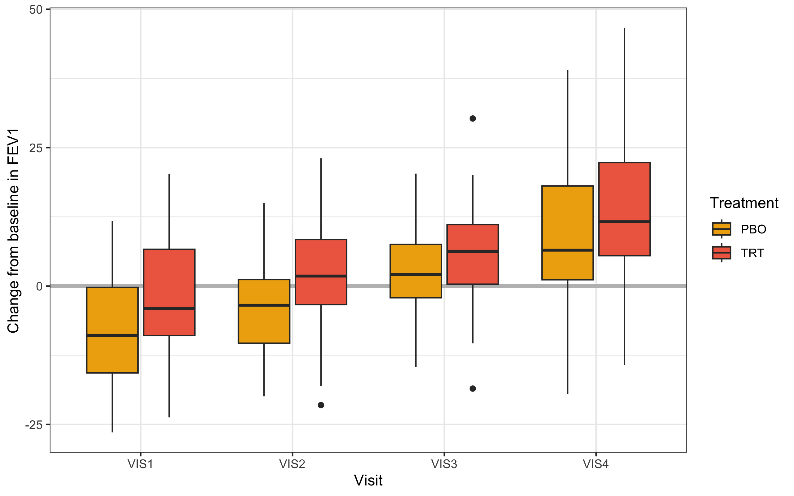

# About {.unnumbered}

This vignette provides an example comparison of a Bayesian MMRM fit, 
obtained by `brms.mmrm::brm_model()`, and a frequentist MMRM fit, 
obtained by `mmrm::mmrm()`. An overview of parameter estimates and 
differences by type of MMRM is given in the [summary (Tables 4 and 5)](#Summary) 
at the end.

# Prerequisites

This comparison workflow requires the following packages.


``` r
> packages <- c(
+   "dplyr",
+   "tidyr",
+   "ggplot2",
+   "gt",
+   "gtsummary",
+   "purrr",
+   "parallel",
+   "brms.mmrm",
+   "mmrm",
+   "posterior"
+ )
> invisible(lapply(packages, library, character.only = TRUE))
```

We set a seed for the random number generator to ensure statistical reproducibility.


``` r
> set.seed(123L)
```

# Data

## Pre-processing

This analysis exercise uses the `fev_dat` dataset contained in the `mmrm`-package:


``` r
> data(fev_data, package = "mmrm")
```

It is an artificial (simulated) dataset of a clinical trial investigating the 
effect of an active treatment on `FEV1` (forced expired volume in one second),
compared to placebo. `FEV1` is a measure of how quickly the lungs can be 
emptied and low levels may indicate chronic obstructive pulmonary disease 
(COPD). 

The dataset is a `tibble` with 800 rows and the following notable variables:

* `USUBJID` (subject ID)
* `AVISIT` (visit number, factor)
* `VISITN` (visit number, numeric)
* `ARMCD` (treatment, `TRT` or `PBO`)
* `RACE` (3-category race)
* `SEX` (female or male)
* `FEV1_BL` (FEV1 at baseline, %)
* `FEV1` (FEV1 at study visits)
* `WEIGHT` (weighting variable)

The primary endpoint for the analysis is change from baseline in `FEV1`, which we derive below and denote `FEV1_CHG`.


``` r
> fev_data <- fev_data |>
+   mutate("FEV1_CHG" = FEV1 - FEV1_BL)
```

The rest of the pre-processing steps create factors for the study arm and visit and apply the usual checking and standardization steps of `brms.mmrm::brm_data()`.


``` r
> fev_data <- brm_data(
+   data = fev_data,
+   outcome = "FEV1_CHG",
+   group = "ARMCD",
+   time = "AVISIT",
+   patient = "USUBJID",
+   baseline = "FEV1_BL",
+   reference_group = "PBO",
+   covariates = c("RACE", "SEX")
+ ) |>
+   brm_data_chronologize(order = "VISITN")
```

The following table shows the first rows of the dataset.


``` r
> head(fev_data) |>
+   gt() |>
+   tab_caption(caption = md("Table 1. First rows of the pre-processed `fev_dat` dataset."))
```

<!--html_preserve--><div id="osncjrvket" style="padding-left:0px;padding-right:0px;padding-top:10px;padding-bottom:10px;overflow-x:auto;overflow-y:auto;width:auto;height:auto;">
<style>#osncjrvket table {
  font-family: system-ui, 'Segoe UI', Roboto, Helvetica, Arial, sans-serif, 'Apple Color Emoji', 'Segoe UI Emoji', 'Segoe UI Symbol', 'Noto Color Emoji';
  -webkit-font-smoothing: antialiased;
  -moz-osx-font-smoothing: grayscale;
}

#osncjrvket thead, #osncjrvket tbody, #osncjrvket tfoot, #osncjrvket tr, #osncjrvket td, #osncjrvket th {
  border-style: none;
}

#osncjrvket p {
  margin: 0;
  padding: 0;
}

#osncjrvket .gt_table {
  display: table;
  border-collapse: collapse;
  line-height: normal;
  margin-left: auto;
  margin-right: auto;
  color: #333333;
  font-size: 16px;
  font-weight: normal;
  font-style: normal;
  background-color: #FFFFFF;
  width: auto;
  border-top-style: solid;
  border-top-width: 2px;
  border-top-color: #A8A8A8;
  border-right-style: none;
  border-right-width: 2px;
  border-right-color: #D3D3D3;
  border-bottom-style: solid;
  border-bottom-width: 2px;
  border-bottom-color: #A8A8A8;
  border-left-style: none;
  border-left-width: 2px;
  border-left-color: #D3D3D3;
}

#osncjrvket .gt_caption {
  padding-top: 4px;
  padding-bottom: 4px;
}

#osncjrvket .gt_title {
  color: #333333;
  font-size: 125%;
  font-weight: initial;
  padding-top: 4px;
  padding-bottom: 4px;
  padding-left: 5px;
  padding-right: 5px;
  border-bottom-color: #FFFFFF;
  border-bottom-width: 0;
}

#osncjrvket .gt_subtitle {
  color: #333333;
  font-size: 85%;
  font-weight: initial;
  padding-top: 3px;
  padding-bottom: 5px;
  padding-left: 5px;
  padding-right: 5px;
  border-top-color: #FFFFFF;
  border-top-width: 0;
}

#osncjrvket .gt_heading {
  background-color: #FFFFFF;
  text-align: center;
  border-bottom-color: #FFFFFF;
  border-left-style: none;
  border-left-width: 1px;
  border-left-color: #D3D3D3;
  border-right-style: none;
  border-right-width: 1px;
  border-right-color: #D3D3D3;
}

#osncjrvket .gt_bottom_border {
  border-bottom-style: solid;
  border-bottom-width: 2px;
  border-bottom-color: #D3D3D3;
}

#osncjrvket .gt_col_headings {
  border-top-style: solid;
  border-top-width: 2px;
  border-top-color: #D3D3D3;
  border-bottom-style: solid;
  border-bottom-width: 2px;
  border-bottom-color: #D3D3D3;
  border-left-style: none;
  border-left-width: 1px;
  border-left-color: #D3D3D3;
  border-right-style: none;
  border-right-width: 1px;
  border-right-color: #D3D3D3;
}

#osncjrvket .gt_col_heading {
  color: #333333;
  background-color: #FFFFFF;
  font-size: 100%;
  font-weight: normal;
  text-transform: inherit;
  border-left-style: none;
  border-left-width: 1px;
  border-left-color: #D3D3D3;
  border-right-style: none;
  border-right-width: 1px;
  border-right-color: #D3D3D3;
  vertical-align: bottom;
  padding-top: 5px;
  padding-bottom: 6px;
  padding-left: 5px;
  padding-right: 5px;
  overflow-x: hidden;
}

#osncjrvket .gt_column_spanner_outer {
  color: #333333;
  background-color: #FFFFFF;
  font-size: 100%;
  font-weight: normal;
  text-transform: inherit;
  padding-top: 0;
  padding-bottom: 0;
  padding-left: 4px;
  padding-right: 4px;
}

#osncjrvket .gt_column_spanner_outer:first-child {
  padding-left: 0;
}

#osncjrvket .gt_column_spanner_outer:last-child {
  padding-right: 0;
}

#osncjrvket .gt_column_spanner {
  border-bottom-style: solid;
  border-bottom-width: 2px;
  border-bottom-color: #D3D3D3;
  vertical-align: bottom;
  padding-top: 5px;
  padding-bottom: 5px;
  overflow-x: hidden;
  display: inline-block;
  width: 100%;
}

#osncjrvket .gt_spanner_row {
  border-bottom-style: hidden;
}

#osncjrvket .gt_group_heading {
  padding-top: 8px;
  padding-bottom: 8px;
  padding-left: 5px;
  padding-right: 5px;
  color: #333333;
  background-color: #FFFFFF;
  font-size: 100%;
  font-weight: initial;
  text-transform: inherit;
  border-top-style: solid;
  border-top-width: 2px;
  border-top-color: #D3D3D3;
  border-bottom-style: solid;
  border-bottom-width: 2px;
  border-bottom-color: #D3D3D3;
  border-left-style: none;
  border-left-width: 1px;
  border-left-color: #D3D3D3;
  border-right-style: none;
  border-right-width: 1px;
  border-right-color: #D3D3D3;
  vertical-align: middle;
  text-align: left;
}

#osncjrvket .gt_empty_group_heading {
  padding: 0.5px;
  color: #333333;
  background-color: #FFFFFF;
  font-size: 100%;
  font-weight: initial;
  border-top-style: solid;
  border-top-width: 2px;
  border-top-color: #D3D3D3;
  border-bottom-style: solid;
  border-bottom-width: 2px;
  border-bottom-color: #D3D3D3;
  vertical-align: middle;
}

#osncjrvket .gt_from_md > :first-child {
  margin-top: 0;
}

#osncjrvket .gt_from_md > :last-child {
  margin-bottom: 0;
}

#osncjrvket .gt_row {
  padding-top: 8px;
  padding-bottom: 8px;
  padding-left: 5px;
  padding-right: 5px;
  margin: 10px;
  border-top-style: solid;
  border-top-width: 1px;
  border-top-color: #D3D3D3;
  border-left-style: none;
  border-left-width: 1px;
  border-left-color: #D3D3D3;
  border-right-style: none;
  border-right-width: 1px;
  border-right-color: #D3D3D3;
  vertical-align: middle;
  overflow-x: hidden;
}

#osncjrvket .gt_stub {
  color: #333333;
  background-color: #FFFFFF;
  font-size: 100%;
  font-weight: initial;
  text-transform: inherit;
  border-right-style: solid;
  border-right-width: 2px;
  border-right-color: #D3D3D3;
  padding-left: 5px;
  padding-right: 5px;
}

#osncjrvket .gt_stub_row_group {
  color: #333333;
  background-color: #FFFFFF;
  font-size: 100%;
  font-weight: initial;
  text-transform: inherit;
  border-right-style: solid;
  border-right-width: 2px;
  border-right-color: #D3D3D3;
  padding-left: 5px;
  padding-right: 5px;
  vertical-align: top;
}

#osncjrvket .gt_row_group_first td {
  border-top-width: 2px;
}

#osncjrvket .gt_row_group_first th {
  border-top-width: 2px;
}

#osncjrvket .gt_summary_row {
  color: #333333;
  background-color: #FFFFFF;
  text-transform: inherit;
  padding-top: 8px;
  padding-bottom: 8px;
  padding-left: 5px;
  padding-right: 5px;
}

#osncjrvket .gt_first_summary_row {
  border-top-style: solid;
  border-top-color: #D3D3D3;
}

#osncjrvket .gt_first_summary_row.thick {
  border-top-width: 2px;
}

#osncjrvket .gt_last_summary_row {
  padding-top: 8px;
  padding-bottom: 8px;
  padding-left: 5px;
  padding-right: 5px;
  border-bottom-style: solid;
  border-bottom-width: 2px;
  border-bottom-color: #D3D3D3;
}

#osncjrvket .gt_grand_summary_row {
  color: #333333;
  background-color: #FFFFFF;
  text-transform: inherit;
  padding-top: 8px;
  padding-bottom: 8px;
  padding-left: 5px;
  padding-right: 5px;
}

#osncjrvket .gt_first_grand_summary_row {
  padding-top: 8px;
  padding-bottom: 8px;
  padding-left: 5px;
  padding-right: 5px;
  border-top-style: double;
  border-top-width: 6px;
  border-top-color: #D3D3D3;
}

#osncjrvket .gt_last_grand_summary_row_top {
  padding-top: 8px;
  padding-bottom: 8px;
  padding-left: 5px;
  padding-right: 5px;
  border-bottom-style: double;
  border-bottom-width: 6px;
  border-bottom-color: #D3D3D3;
}

#osncjrvket .gt_striped {
  background-color: rgba(128, 128, 128, 0.05);
}

#osncjrvket .gt_table_body {
  border-top-style: solid;
  border-top-width: 2px;
  border-top-color: #D3D3D3;
  border-bottom-style: solid;
  border-bottom-width: 2px;
  border-bottom-color: #D3D3D3;
}

#osncjrvket .gt_footnotes {
  color: #333333;
  background-color: #FFFFFF;
  border-bottom-style: none;
  border-bottom-width: 2px;
  border-bottom-color: #D3D3D3;
  border-left-style: none;
  border-left-width: 2px;
  border-left-color: #D3D3D3;
  border-right-style: none;
  border-right-width: 2px;
  border-right-color: #D3D3D3;
}

#osncjrvket .gt_footnote {
  margin: 0px;
  font-size: 90%;
  padding-top: 4px;
  padding-bottom: 4px;
  padding-left: 5px;
  padding-right: 5px;
}

#osncjrvket .gt_sourcenotes {
  color: #333333;
  background-color: #FFFFFF;
  border-bottom-style: none;
  border-bottom-width: 2px;
  border-bottom-color: #D3D3D3;
  border-left-style: none;
  border-left-width: 2px;
  border-left-color: #D3D3D3;
  border-right-style: none;
  border-right-width: 2px;
  border-right-color: #D3D3D3;
}

#osncjrvket .gt_sourcenote {
  font-size: 90%;
  padding-top: 4px;
  padding-bottom: 4px;
  padding-left: 5px;
  padding-right: 5px;
}

#osncjrvket .gt_left {
  text-align: left;
}

#osncjrvket .gt_center {
  text-align: center;
}

#osncjrvket .gt_right {
  text-align: right;
  font-variant-numeric: tabular-nums;
}

#osncjrvket .gt_font_normal {
  font-weight: normal;
}

#osncjrvket .gt_font_bold {
  font-weight: bold;
}

#osncjrvket .gt_font_italic {
  font-style: italic;
}

#osncjrvket .gt_super {
  font-size: 65%;
}

#osncjrvket .gt_footnote_marks {
  font-size: 75%;
  vertical-align: 0.4em;
  position: initial;
}

#osncjrvket .gt_asterisk {
  font-size: 100%;
  vertical-align: 0;
}

#osncjrvket .gt_indent_1 {
  text-indent: 5px;
}

#osncjrvket .gt_indent_2 {
  text-indent: 10px;
}

#osncjrvket .gt_indent_3 {
  text-indent: 15px;
}

#osncjrvket .gt_indent_4 {
  text-indent: 20px;
}

#osncjrvket .gt_indent_5 {
  text-indent: 25px;
}

#osncjrvket .katex-display {
  display: inline-flex !important;
  margin-bottom: 0.75em !important;
}

#osncjrvket div.Reactable > div.rt-table > div.rt-thead > div.rt-tr.rt-tr-group-header > div.rt-th-group:after {
  height: 0px !important;
}
</style>
<table class="gt_table" data-quarto-disable-processing="false" data-quarto-bootstrap="false">
  <!--/html_preserve--><caption class='gt_caption'><span class='gt_from_md'>Table 1. First rows of the pre-processed <code>fev_dat</code> dataset.</span></caption><!--html_preserve-->
  <thead>
    <tr class="gt_col_headings">
      <th class="gt_col_heading gt_columns_bottom_border gt_center" rowspan="1" colspan="1" scope="col" id="USUBJID">USUBJID</th>
      <th class="gt_col_heading gt_columns_bottom_border gt_center" rowspan="1" colspan="1" scope="col" id="AVISIT">AVISIT</th>
      <th class="gt_col_heading gt_columns_bottom_border gt_center" rowspan="1" colspan="1" scope="col" id="ARMCD">ARMCD</th>
      <th class="gt_col_heading gt_columns_bottom_border gt_center" rowspan="1" colspan="1" scope="col" id="RACE">RACE</th>
      <th class="gt_col_heading gt_columns_bottom_border gt_center" rowspan="1" colspan="1" scope="col" id="SEX">SEX</th>
      <th class="gt_col_heading gt_columns_bottom_border gt_right" rowspan="1" colspan="1" scope="col" id="FEV1_BL">FEV1_BL</th>
      <th class="gt_col_heading gt_columns_bottom_border gt_right" rowspan="1" colspan="1" scope="col" id="FEV1">FEV1</th>
      <th class="gt_col_heading gt_columns_bottom_border gt_right" rowspan="1" colspan="1" scope="col" id="WEIGHT">WEIGHT</th>
      <th class="gt_col_heading gt_columns_bottom_border gt_right" rowspan="1" colspan="1" scope="col" id="VISITN">VISITN</th>
      <th class="gt_col_heading gt_columns_bottom_border gt_right" rowspan="1" colspan="1" scope="col" id="VISITN2">VISITN2</th>
      <th class="gt_col_heading gt_columns_bottom_border gt_right" rowspan="1" colspan="1" scope="col" id="FEV1_CHG">FEV1_CHG</th>
    </tr>
  </thead>
  <tbody class="gt_table_body">
    <tr><td headers="USUBJID" class="gt_row gt_center">PT2</td>
<td headers="AVISIT" class="gt_row gt_center">VIS1</td>
<td headers="ARMCD" class="gt_row gt_center">PBO</td>
<td headers="RACE" class="gt_row gt_center">Asian</td>
<td headers="SEX" class="gt_row gt_center">Male</td>
<td headers="FEV1_BL" class="gt_row gt_right">45.02477</td>
<td headers="FEV1" class="gt_row gt_right">NA</td>
<td headers="WEIGHT" class="gt_row gt_right">0.4651848</td>
<td headers="VISITN" class="gt_row gt_right">1</td>
<td headers="VISITN2" class="gt_row gt_right">0.3295078</td>
<td headers="FEV1_CHG" class="gt_row gt_right">NA</td></tr>
    <tr><td headers="USUBJID" class="gt_row gt_center">PT2</td>
<td headers="AVISIT" class="gt_row gt_center">VIS2</td>
<td headers="ARMCD" class="gt_row gt_center">PBO</td>
<td headers="RACE" class="gt_row gt_center">Asian</td>
<td headers="SEX" class="gt_row gt_center">Male</td>
<td headers="FEV1_BL" class="gt_row gt_right">45.02477</td>
<td headers="FEV1" class="gt_row gt_right">31.45522</td>
<td headers="WEIGHT" class="gt_row gt_right">0.2330974</td>
<td headers="VISITN" class="gt_row gt_right">2</td>
<td headers="VISITN2" class="gt_row gt_right">-0.8204684</td>
<td headers="FEV1_CHG" class="gt_row gt_right">-13.569552</td></tr>
    <tr><td headers="USUBJID" class="gt_row gt_center">PT2</td>
<td headers="AVISIT" class="gt_row gt_center">VIS3</td>
<td headers="ARMCD" class="gt_row gt_center">PBO</td>
<td headers="RACE" class="gt_row gt_center">Asian</td>
<td headers="SEX" class="gt_row gt_center">Male</td>
<td headers="FEV1_BL" class="gt_row gt_right">45.02477</td>
<td headers="FEV1" class="gt_row gt_right">36.87889</td>
<td headers="WEIGHT" class="gt_row gt_right">0.3600763</td>
<td headers="VISITN" class="gt_row gt_right">3</td>
<td headers="VISITN2" class="gt_row gt_right">0.4874291</td>
<td headers="FEV1_CHG" class="gt_row gt_right">-8.145878</td></tr>
    <tr><td headers="USUBJID" class="gt_row gt_center">PT2</td>
<td headers="AVISIT" class="gt_row gt_center">VIS4</td>
<td headers="ARMCD" class="gt_row gt_center">PBO</td>
<td headers="RACE" class="gt_row gt_center">Asian</td>
<td headers="SEX" class="gt_row gt_center">Male</td>
<td headers="FEV1_BL" class="gt_row gt_right">45.02477</td>
<td headers="FEV1" class="gt_row gt_right">48.80809</td>
<td headers="WEIGHT" class="gt_row gt_right">0.5073795</td>
<td headers="VISITN" class="gt_row gt_right">4</td>
<td headers="VISITN2" class="gt_row gt_right">0.7383247</td>
<td headers="FEV1_CHG" class="gt_row gt_right">3.783324</td></tr>
    <tr><td headers="USUBJID" class="gt_row gt_center">PT3</td>
<td headers="AVISIT" class="gt_row gt_center">VIS1</td>
<td headers="ARMCD" class="gt_row gt_center">PBO</td>
<td headers="RACE" class="gt_row gt_center">Black or African American</td>
<td headers="SEX" class="gt_row gt_center">Female</td>
<td headers="FEV1_BL" class="gt_row gt_right">43.50070</td>
<td headers="FEV1" class="gt_row gt_right">NA</td>
<td headers="WEIGHT" class="gt_row gt_right">0.6821642</td>
<td headers="VISITN" class="gt_row gt_right">1</td>
<td headers="VISITN2" class="gt_row gt_right">0.5757814</td>
<td headers="FEV1_CHG" class="gt_row gt_right">NA</td></tr>
    <tr><td headers="USUBJID" class="gt_row gt_center">PT3</td>
<td headers="AVISIT" class="gt_row gt_center">VIS2</td>
<td headers="ARMCD" class="gt_row gt_center">PBO</td>
<td headers="RACE" class="gt_row gt_center">Black or African American</td>
<td headers="SEX" class="gt_row gt_center">Female</td>
<td headers="FEV1_BL" class="gt_row gt_right">43.50070</td>
<td headers="FEV1" class="gt_row gt_right">35.98699</td>
<td headers="WEIGHT" class="gt_row gt_right">0.8917896</td>
<td headers="VISITN" class="gt_row gt_right">2</td>
<td headers="VISITN2" class="gt_row gt_right">-0.3053884</td>
<td headers="FEV1_CHG" class="gt_row gt_right">-7.513705</td></tr>
  </tbody>
  
</table>
</div><!--/html_preserve-->

## Descriptive statistics

Table of baseline characteristics:


```{.r .fold-hide}
> fev_data |>
+   select(ARMCD, USUBJID, SEX, RACE, FEV1_BL) |>
+   distinct() |>
+   select(-USUBJID) |>
+   tbl_summary(
+     by = c(ARMCD),
+     statistic = list(
+       all_continuous() ~ "{mean} ({sd})",
+       all_categorical() ~ "{n} / {N} ({p}%)"
+     )
+   ) |>
+   modify_caption("Table 2. Baseline characteristics.")
```

<!--html_preserve--><div id="chzgjisdnq" style="padding-left:0px;padding-right:0px;padding-top:10px;padding-bottom:10px;overflow-x:auto;overflow-y:auto;width:auto;height:auto;">
<style>#chzgjisdnq table {
  font-family: system-ui, 'Segoe UI', Roboto, Helvetica, Arial, sans-serif, 'Apple Color Emoji', 'Segoe UI Emoji', 'Segoe UI Symbol', 'Noto Color Emoji';
  -webkit-font-smoothing: antialiased;
  -moz-osx-font-smoothing: grayscale;
}

#chzgjisdnq thead, #chzgjisdnq tbody, #chzgjisdnq tfoot, #chzgjisdnq tr, #chzgjisdnq td, #chzgjisdnq th {
  border-style: none;
}

#chzgjisdnq p {
  margin: 0;
  padding: 0;
}

#chzgjisdnq .gt_table {
  display: table;
  border-collapse: collapse;
  line-height: normal;
  margin-left: auto;
  margin-right: auto;
  color: #333333;
  font-size: 16px;
  font-weight: normal;
  font-style: normal;
  background-color: #FFFFFF;
  width: auto;
  border-top-style: solid;
  border-top-width: 2px;
  border-top-color: #A8A8A8;
  border-right-style: none;
  border-right-width: 2px;
  border-right-color: #D3D3D3;
  border-bottom-style: solid;
  border-bottom-width: 2px;
  border-bottom-color: #A8A8A8;
  border-left-style: none;
  border-left-width: 2px;
  border-left-color: #D3D3D3;
}

#chzgjisdnq .gt_caption {
  padding-top: 4px;
  padding-bottom: 4px;
}

#chzgjisdnq .gt_title {
  color: #333333;
  font-size: 125%;
  font-weight: initial;
  padding-top: 4px;
  padding-bottom: 4px;
  padding-left: 5px;
  padding-right: 5px;
  border-bottom-color: #FFFFFF;
  border-bottom-width: 0;
}

#chzgjisdnq .gt_subtitle {
  color: #333333;
  font-size: 85%;
  font-weight: initial;
  padding-top: 3px;
  padding-bottom: 5px;
  padding-left: 5px;
  padding-right: 5px;
  border-top-color: #FFFFFF;
  border-top-width: 0;
}

#chzgjisdnq .gt_heading {
  background-color: #FFFFFF;
  text-align: center;
  border-bottom-color: #FFFFFF;
  border-left-style: none;
  border-left-width: 1px;
  border-left-color: #D3D3D3;
  border-right-style: none;
  border-right-width: 1px;
  border-right-color: #D3D3D3;
}

#chzgjisdnq .gt_bottom_border {
  border-bottom-style: solid;
  border-bottom-width: 2px;
  border-bottom-color: #D3D3D3;
}

#chzgjisdnq .gt_col_headings {
  border-top-style: solid;
  border-top-width: 2px;
  border-top-color: #D3D3D3;
  border-bottom-style: solid;
  border-bottom-width: 2px;
  border-bottom-color: #D3D3D3;
  border-left-style: none;
  border-left-width: 1px;
  border-left-color: #D3D3D3;
  border-right-style: none;
  border-right-width: 1px;
  border-right-color: #D3D3D3;
}

#chzgjisdnq .gt_col_heading {
  color: #333333;
  background-color: #FFFFFF;
  font-size: 100%;
  font-weight: normal;
  text-transform: inherit;
  border-left-style: none;
  border-left-width: 1px;
  border-left-color: #D3D3D3;
  border-right-style: none;
  border-right-width: 1px;
  border-right-color: #D3D3D3;
  vertical-align: bottom;
  padding-top: 5px;
  padding-bottom: 6px;
  padding-left: 5px;
  padding-right: 5px;
  overflow-x: hidden;
}

#chzgjisdnq .gt_column_spanner_outer {
  color: #333333;
  background-color: #FFFFFF;
  font-size: 100%;
  font-weight: normal;
  text-transform: inherit;
  padding-top: 0;
  padding-bottom: 0;
  padding-left: 4px;
  padding-right: 4px;
}

#chzgjisdnq .gt_column_spanner_outer:first-child {
  padding-left: 0;
}

#chzgjisdnq .gt_column_spanner_outer:last-child {
  padding-right: 0;
}

#chzgjisdnq .gt_column_spanner {
  border-bottom-style: solid;
  border-bottom-width: 2px;
  border-bottom-color: #D3D3D3;
  vertical-align: bottom;
  padding-top: 5px;
  padding-bottom: 5px;
  overflow-x: hidden;
  display: inline-block;
  width: 100%;
}

#chzgjisdnq .gt_spanner_row {
  border-bottom-style: hidden;
}

#chzgjisdnq .gt_group_heading {
  padding-top: 8px;
  padding-bottom: 8px;
  padding-left: 5px;
  padding-right: 5px;
  color: #333333;
  background-color: #FFFFFF;
  font-size: 100%;
  font-weight: initial;
  text-transform: inherit;
  border-top-style: solid;
  border-top-width: 2px;
  border-top-color: #D3D3D3;
  border-bottom-style: solid;
  border-bottom-width: 2px;
  border-bottom-color: #D3D3D3;
  border-left-style: none;
  border-left-width: 1px;
  border-left-color: #D3D3D3;
  border-right-style: none;
  border-right-width: 1px;
  border-right-color: #D3D3D3;
  vertical-align: middle;
  text-align: left;
}

#chzgjisdnq .gt_empty_group_heading {
  padding: 0.5px;
  color: #333333;
  background-color: #FFFFFF;
  font-size: 100%;
  font-weight: initial;
  border-top-style: solid;
  border-top-width: 2px;
  border-top-color: #D3D3D3;
  border-bottom-style: solid;
  border-bottom-width: 2px;
  border-bottom-color: #D3D3D3;
  vertical-align: middle;
}

#chzgjisdnq .gt_from_md > :first-child {
  margin-top: 0;
}

#chzgjisdnq .gt_from_md > :last-child {
  margin-bottom: 0;
}

#chzgjisdnq .gt_row {
  padding-top: 8px;
  padding-bottom: 8px;
  padding-left: 5px;
  padding-right: 5px;
  margin: 10px;
  border-top-style: solid;
  border-top-width: 1px;
  border-top-color: #D3D3D3;
  border-left-style: none;
  border-left-width: 1px;
  border-left-color: #D3D3D3;
  border-right-style: none;
  border-right-width: 1px;
  border-right-color: #D3D3D3;
  vertical-align: middle;
  overflow-x: hidden;
}

#chzgjisdnq .gt_stub {
  color: #333333;
  background-color: #FFFFFF;
  font-size: 100%;
  font-weight: initial;
  text-transform: inherit;
  border-right-style: solid;
  border-right-width: 2px;
  border-right-color: #D3D3D3;
  padding-left: 5px;
  padding-right: 5px;
}

#chzgjisdnq .gt_stub_row_group {
  color: #333333;
  background-color: #FFFFFF;
  font-size: 100%;
  font-weight: initial;
  text-transform: inherit;
  border-right-style: solid;
  border-right-width: 2px;
  border-right-color: #D3D3D3;
  padding-left: 5px;
  padding-right: 5px;
  vertical-align: top;
}

#chzgjisdnq .gt_row_group_first td {
  border-top-width: 2px;
}

#chzgjisdnq .gt_row_group_first th {
  border-top-width: 2px;
}

#chzgjisdnq .gt_summary_row {
  color: #333333;
  background-color: #FFFFFF;
  text-transform: inherit;
  padding-top: 8px;
  padding-bottom: 8px;
  padding-left: 5px;
  padding-right: 5px;
}

#chzgjisdnq .gt_first_summary_row {
  border-top-style: solid;
  border-top-color: #D3D3D3;
}

#chzgjisdnq .gt_first_summary_row.thick {
  border-top-width: 2px;
}

#chzgjisdnq .gt_last_summary_row {
  padding-top: 8px;
  padding-bottom: 8px;
  padding-left: 5px;
  padding-right: 5px;
  border-bottom-style: solid;
  border-bottom-width: 2px;
  border-bottom-color: #D3D3D3;
}

#chzgjisdnq .gt_grand_summary_row {
  color: #333333;
  background-color: #FFFFFF;
  text-transform: inherit;
  padding-top: 8px;
  padding-bottom: 8px;
  padding-left: 5px;
  padding-right: 5px;
}

#chzgjisdnq .gt_first_grand_summary_row {
  padding-top: 8px;
  padding-bottom: 8px;
  padding-left: 5px;
  padding-right: 5px;
  border-top-style: double;
  border-top-width: 6px;
  border-top-color: #D3D3D3;
}

#chzgjisdnq .gt_last_grand_summary_row_top {
  padding-top: 8px;
  padding-bottom: 8px;
  padding-left: 5px;
  padding-right: 5px;
  border-bottom-style: double;
  border-bottom-width: 6px;
  border-bottom-color: #D3D3D3;
}

#chzgjisdnq .gt_striped {
  background-color: rgba(128, 128, 128, 0.05);
}

#chzgjisdnq .gt_table_body {
  border-top-style: solid;
  border-top-width: 2px;
  border-top-color: #D3D3D3;
  border-bottom-style: solid;
  border-bottom-width: 2px;
  border-bottom-color: #D3D3D3;
}

#chzgjisdnq .gt_footnotes {
  color: #333333;
  background-color: #FFFFFF;
  border-bottom-style: none;
  border-bottom-width: 2px;
  border-bottom-color: #D3D3D3;
  border-left-style: none;
  border-left-width: 2px;
  border-left-color: #D3D3D3;
  border-right-style: none;
  border-right-width: 2px;
  border-right-color: #D3D3D3;
}

#chzgjisdnq .gt_footnote {
  margin: 0px;
  font-size: 90%;
  padding-top: 4px;
  padding-bottom: 4px;
  padding-left: 5px;
  padding-right: 5px;
}

#chzgjisdnq .gt_sourcenotes {
  color: #333333;
  background-color: #FFFFFF;
  border-bottom-style: none;
  border-bottom-width: 2px;
  border-bottom-color: #D3D3D3;
  border-left-style: none;
  border-left-width: 2px;
  border-left-color: #D3D3D3;
  border-right-style: none;
  border-right-width: 2px;
  border-right-color: #D3D3D3;
}

#chzgjisdnq .gt_sourcenote {
  font-size: 90%;
  padding-top: 4px;
  padding-bottom: 4px;
  padding-left: 5px;
  padding-right: 5px;
}

#chzgjisdnq .gt_left {
  text-align: left;
}

#chzgjisdnq .gt_center {
  text-align: center;
}

#chzgjisdnq .gt_right {
  text-align: right;
  font-variant-numeric: tabular-nums;
}

#chzgjisdnq .gt_font_normal {
  font-weight: normal;
}

#chzgjisdnq .gt_font_bold {
  font-weight: bold;
}

#chzgjisdnq .gt_font_italic {
  font-style: italic;
}

#chzgjisdnq .gt_super {
  font-size: 65%;
}

#chzgjisdnq .gt_footnote_marks {
  font-size: 75%;
  vertical-align: 0.4em;
  position: initial;
}

#chzgjisdnq .gt_asterisk {
  font-size: 100%;
  vertical-align: 0;
}

#chzgjisdnq .gt_indent_1 {
  text-indent: 5px;
}

#chzgjisdnq .gt_indent_2 {
  text-indent: 10px;
}

#chzgjisdnq .gt_indent_3 {
  text-indent: 15px;
}

#chzgjisdnq .gt_indent_4 {
  text-indent: 20px;
}

#chzgjisdnq .gt_indent_5 {
  text-indent: 25px;
}

#chzgjisdnq .katex-display {
  display: inline-flex !important;
  margin-bottom: 0.75em !important;
}

#chzgjisdnq div.Reactable > div.rt-table > div.rt-thead > div.rt-tr.rt-tr-group-header > div.rt-th-group:after {
  height: 0px !important;
}
</style>
<table class="gt_table" data-quarto-disable-processing="false" data-quarto-bootstrap="false">
  <!--/html_preserve--><caption class='gt_caption'><span class='gt_from_md'>Table 2. Baseline characteristics.</span></caption><!--html_preserve-->
  <thead>
    <tr class="gt_col_headings">
      <th class="gt_col_heading gt_columns_bottom_border gt_left" rowspan="1" colspan="1" scope="col" id="label"><span class='gt_from_md'><strong>Characteristic</strong></span></th>
      <th class="gt_col_heading gt_columns_bottom_border gt_center" rowspan="1" colspan="1" scope="col" id="stat_1"><span class='gt_from_md'><strong>PBO</strong><br />
N = 105</span><span class="gt_footnote_marks" style="white-space:nowrap;font-style:italic;font-weight:normal;line-height:0;"><sup>1</sup></span></th>
      <th class="gt_col_heading gt_columns_bottom_border gt_center" rowspan="1" colspan="1" scope="col" id="stat_2"><span class='gt_from_md'><strong>TRT</strong><br />
N = 95</span><span class="gt_footnote_marks" style="white-space:nowrap;font-style:italic;font-weight:normal;line-height:0;"><sup>1</sup></span></th>
    </tr>
  </thead>
  <tbody class="gt_table_body">
    <tr><td headers="label" class="gt_row gt_left">SEX</td>
<td headers="stat_1" class="gt_row gt_center"><br /></td>
<td headers="stat_2" class="gt_row gt_center"><br /></td></tr>
    <tr><td headers="label" class="gt_row gt_left">    Male</td>
<td headers="stat_1" class="gt_row gt_center">50 / 105 (48%)</td>
<td headers="stat_2" class="gt_row gt_center">44 / 95 (46%)</td></tr>
    <tr><td headers="label" class="gt_row gt_left">    Female</td>
<td headers="stat_1" class="gt_row gt_center">55 / 105 (52%)</td>
<td headers="stat_2" class="gt_row gt_center">51 / 95 (54%)</td></tr>
    <tr><td headers="label" class="gt_row gt_left">RACE</td>
<td headers="stat_1" class="gt_row gt_center"><br /></td>
<td headers="stat_2" class="gt_row gt_center"><br /></td></tr>
    <tr><td headers="label" class="gt_row gt_left">    Asian</td>
<td headers="stat_1" class="gt_row gt_center">38 / 105 (36%)</td>
<td headers="stat_2" class="gt_row gt_center">32 / 95 (34%)</td></tr>
    <tr><td headers="label" class="gt_row gt_left">    Black or African American</td>
<td headers="stat_1" class="gt_row gt_center">46 / 105 (44%)</td>
<td headers="stat_2" class="gt_row gt_center">29 / 95 (31%)</td></tr>
    <tr><td headers="label" class="gt_row gt_left">    White</td>
<td headers="stat_1" class="gt_row gt_center">21 / 105 (20%)</td>
<td headers="stat_2" class="gt_row gt_center">34 / 95 (36%)</td></tr>
    <tr><td headers="label" class="gt_row gt_left">FEV1_BL</td>
<td headers="stat_1" class="gt_row gt_center">40 (9)</td>
<td headers="stat_2" class="gt_row gt_center">40 (9)</td></tr>
  </tbody>
  <tfoot>
    <tr class="gt_footnotes">
      <td class="gt_footnote" colspan="3"><span class="gt_footnote_marks" style="white-space:nowrap;font-style:italic;font-weight:normal;line-height:0;"><sup>1</sup></span> <span class='gt_from_md'>n / N (%); Mean (SD)</span></td>
    </tr>
  </tfoot>
</table>
</div><!--/html_preserve-->

Table of change from baseline in FEV1 over 52 weeks:


```{.r .fold-hide}
> fev_data |>
+   pull(AVISIT) |>
+   unique() |>
+   sort() |>
+   purrr::map(
+     .f = ~ fev_data |>
+       filter(AVISIT %in% .x) |>
+       tbl_summary(
+         by = ARMCD,
+         include = FEV1_CHG,
+         type = FEV1_CHG ~ "continuous2",
+         statistic = FEV1_CHG ~ c(
+           "{mean} ({sd})",
+           "{median} ({p25}, {p75})",
+           "{min}, {max}"
+         ),
+         label = list(FEV1_CHG = paste("Visit ", .x))
+       )
+   ) |>
+   tbl_stack(quiet = TRUE) |>
+   modify_caption("Table 3. Change from baseline.")
```

<!--html_preserve--><div id="cngcwvzoue" style="padding-left:0px;padding-right:0px;padding-top:10px;padding-bottom:10px;overflow-x:auto;overflow-y:auto;width:auto;height:auto;">
<style>#cngcwvzoue table {
  font-family: system-ui, 'Segoe UI', Roboto, Helvetica, Arial, sans-serif, 'Apple Color Emoji', 'Segoe UI Emoji', 'Segoe UI Symbol', 'Noto Color Emoji';
  -webkit-font-smoothing: antialiased;
  -moz-osx-font-smoothing: grayscale;
}

#cngcwvzoue thead, #cngcwvzoue tbody, #cngcwvzoue tfoot, #cngcwvzoue tr, #cngcwvzoue td, #cngcwvzoue th {
  border-style: none;
}

#cngcwvzoue p {
  margin: 0;
  padding: 0;
}

#cngcwvzoue .gt_table {
  display: table;
  border-collapse: collapse;
  line-height: normal;
  margin-left: auto;
  margin-right: auto;
  color: #333333;
  font-size: 16px;
  font-weight: normal;
  font-style: normal;
  background-color: #FFFFFF;
  width: auto;
  border-top-style: solid;
  border-top-width: 2px;
  border-top-color: #A8A8A8;
  border-right-style: none;
  border-right-width: 2px;
  border-right-color: #D3D3D3;
  border-bottom-style: solid;
  border-bottom-width: 2px;
  border-bottom-color: #A8A8A8;
  border-left-style: none;
  border-left-width: 2px;
  border-left-color: #D3D3D3;
}

#cngcwvzoue .gt_caption {
  padding-top: 4px;
  padding-bottom: 4px;
}

#cngcwvzoue .gt_title {
  color: #333333;
  font-size: 125%;
  font-weight: initial;
  padding-top: 4px;
  padding-bottom: 4px;
  padding-left: 5px;
  padding-right: 5px;
  border-bottom-color: #FFFFFF;
  border-bottom-width: 0;
}

#cngcwvzoue .gt_subtitle {
  color: #333333;
  font-size: 85%;
  font-weight: initial;
  padding-top: 3px;
  padding-bottom: 5px;
  padding-left: 5px;
  padding-right: 5px;
  border-top-color: #FFFFFF;
  border-top-width: 0;
}

#cngcwvzoue .gt_heading {
  background-color: #FFFFFF;
  text-align: center;
  border-bottom-color: #FFFFFF;
  border-left-style: none;
  border-left-width: 1px;
  border-left-color: #D3D3D3;
  border-right-style: none;
  border-right-width: 1px;
  border-right-color: #D3D3D3;
}

#cngcwvzoue .gt_bottom_border {
  border-bottom-style: solid;
  border-bottom-width: 2px;
  border-bottom-color: #D3D3D3;
}

#cngcwvzoue .gt_col_headings {
  border-top-style: solid;
  border-top-width: 2px;
  border-top-color: #D3D3D3;
  border-bottom-style: solid;
  border-bottom-width: 2px;
  border-bottom-color: #D3D3D3;
  border-left-style: none;
  border-left-width: 1px;
  border-left-color: #D3D3D3;
  border-right-style: none;
  border-right-width: 1px;
  border-right-color: #D3D3D3;
}

#cngcwvzoue .gt_col_heading {
  color: #333333;
  background-color: #FFFFFF;
  font-size: 100%;
  font-weight: normal;
  text-transform: inherit;
  border-left-style: none;
  border-left-width: 1px;
  border-left-color: #D3D3D3;
  border-right-style: none;
  border-right-width: 1px;
  border-right-color: #D3D3D3;
  vertical-align: bottom;
  padding-top: 5px;
  padding-bottom: 6px;
  padding-left: 5px;
  padding-right: 5px;
  overflow-x: hidden;
}

#cngcwvzoue .gt_column_spanner_outer {
  color: #333333;
  background-color: #FFFFFF;
  font-size: 100%;
  font-weight: normal;
  text-transform: inherit;
  padding-top: 0;
  padding-bottom: 0;
  padding-left: 4px;
  padding-right: 4px;
}

#cngcwvzoue .gt_column_spanner_outer:first-child {
  padding-left: 0;
}

#cngcwvzoue .gt_column_spanner_outer:last-child {
  padding-right: 0;
}

#cngcwvzoue .gt_column_spanner {
  border-bottom-style: solid;
  border-bottom-width: 2px;
  border-bottom-color: #D3D3D3;
  vertical-align: bottom;
  padding-top: 5px;
  padding-bottom: 5px;
  overflow-x: hidden;
  display: inline-block;
  width: 100%;
}

#cngcwvzoue .gt_spanner_row {
  border-bottom-style: hidden;
}

#cngcwvzoue .gt_group_heading {
  padding-top: 8px;
  padding-bottom: 8px;
  padding-left: 5px;
  padding-right: 5px;
  color: #333333;
  background-color: #FFFFFF;
  font-size: 100%;
  font-weight: initial;
  text-transform: inherit;
  border-top-style: solid;
  border-top-width: 2px;
  border-top-color: #D3D3D3;
  border-bottom-style: solid;
  border-bottom-width: 2px;
  border-bottom-color: #D3D3D3;
  border-left-style: none;
  border-left-width: 1px;
  border-left-color: #D3D3D3;
  border-right-style: none;
  border-right-width: 1px;
  border-right-color: #D3D3D3;
  vertical-align: middle;
  text-align: left;
}

#cngcwvzoue .gt_empty_group_heading {
  padding: 0.5px;
  color: #333333;
  background-color: #FFFFFF;
  font-size: 100%;
  font-weight: initial;
  border-top-style: solid;
  border-top-width: 2px;
  border-top-color: #D3D3D3;
  border-bottom-style: solid;
  border-bottom-width: 2px;
  border-bottom-color: #D3D3D3;
  vertical-align: middle;
}

#cngcwvzoue .gt_from_md > :first-child {
  margin-top: 0;
}

#cngcwvzoue .gt_from_md > :last-child {
  margin-bottom: 0;
}

#cngcwvzoue .gt_row {
  padding-top: 8px;
  padding-bottom: 8px;
  padding-left: 5px;
  padding-right: 5px;
  margin: 10px;
  border-top-style: solid;
  border-top-width: 1px;
  border-top-color: #D3D3D3;
  border-left-style: none;
  border-left-width: 1px;
  border-left-color: #D3D3D3;
  border-right-style: none;
  border-right-width: 1px;
  border-right-color: #D3D3D3;
  vertical-align: middle;
  overflow-x: hidden;
}

#cngcwvzoue .gt_stub {
  color: #333333;
  background-color: #FFFFFF;
  font-size: 100%;
  font-weight: initial;
  text-transform: inherit;
  border-right-style: solid;
  border-right-width: 2px;
  border-right-color: #D3D3D3;
  padding-left: 5px;
  padding-right: 5px;
}

#cngcwvzoue .gt_stub_row_group {
  color: #333333;
  background-color: #FFFFFF;
  font-size: 100%;
  font-weight: initial;
  text-transform: inherit;
  border-right-style: solid;
  border-right-width: 2px;
  border-right-color: #D3D3D3;
  padding-left: 5px;
  padding-right: 5px;
  vertical-align: top;
}

#cngcwvzoue .gt_row_group_first td {
  border-top-width: 2px;
}

#cngcwvzoue .gt_row_group_first th {
  border-top-width: 2px;
}

#cngcwvzoue .gt_summary_row {
  color: #333333;
  background-color: #FFFFFF;
  text-transform: inherit;
  padding-top: 8px;
  padding-bottom: 8px;
  padding-left: 5px;
  padding-right: 5px;
}

#cngcwvzoue .gt_first_summary_row {
  border-top-style: solid;
  border-top-color: #D3D3D3;
}

#cngcwvzoue .gt_first_summary_row.thick {
  border-top-width: 2px;
}

#cngcwvzoue .gt_last_summary_row {
  padding-top: 8px;
  padding-bottom: 8px;
  padding-left: 5px;
  padding-right: 5px;
  border-bottom-style: solid;
  border-bottom-width: 2px;
  border-bottom-color: #D3D3D3;
}

#cngcwvzoue .gt_grand_summary_row {
  color: #333333;
  background-color: #FFFFFF;
  text-transform: inherit;
  padding-top: 8px;
  padding-bottom: 8px;
  padding-left: 5px;
  padding-right: 5px;
}

#cngcwvzoue .gt_first_grand_summary_row {
  padding-top: 8px;
  padding-bottom: 8px;
  padding-left: 5px;
  padding-right: 5px;
  border-top-style: double;
  border-top-width: 6px;
  border-top-color: #D3D3D3;
}

#cngcwvzoue .gt_last_grand_summary_row_top {
  padding-top: 8px;
  padding-bottom: 8px;
  padding-left: 5px;
  padding-right: 5px;
  border-bottom-style: double;
  border-bottom-width: 6px;
  border-bottom-color: #D3D3D3;
}

#cngcwvzoue .gt_striped {
  background-color: rgba(128, 128, 128, 0.05);
}

#cngcwvzoue .gt_table_body {
  border-top-style: solid;
  border-top-width: 2px;
  border-top-color: #D3D3D3;
  border-bottom-style: solid;
  border-bottom-width: 2px;
  border-bottom-color: #D3D3D3;
}

#cngcwvzoue .gt_footnotes {
  color: #333333;
  background-color: #FFFFFF;
  border-bottom-style: none;
  border-bottom-width: 2px;
  border-bottom-color: #D3D3D3;
  border-left-style: none;
  border-left-width: 2px;
  border-left-color: #D3D3D3;
  border-right-style: none;
  border-right-width: 2px;
  border-right-color: #D3D3D3;
}

#cngcwvzoue .gt_footnote {
  margin: 0px;
  font-size: 90%;
  padding-top: 4px;
  padding-bottom: 4px;
  padding-left: 5px;
  padding-right: 5px;
}

#cngcwvzoue .gt_sourcenotes {
  color: #333333;
  background-color: #FFFFFF;
  border-bottom-style: none;
  border-bottom-width: 2px;
  border-bottom-color: #D3D3D3;
  border-left-style: none;
  border-left-width: 2px;
  border-left-color: #D3D3D3;
  border-right-style: none;
  border-right-width: 2px;
  border-right-color: #D3D3D3;
}

#cngcwvzoue .gt_sourcenote {
  font-size: 90%;
  padding-top: 4px;
  padding-bottom: 4px;
  padding-left: 5px;
  padding-right: 5px;
}

#cngcwvzoue .gt_left {
  text-align: left;
}

#cngcwvzoue .gt_center {
  text-align: center;
}

#cngcwvzoue .gt_right {
  text-align: right;
  font-variant-numeric: tabular-nums;
}

#cngcwvzoue .gt_font_normal {
  font-weight: normal;
}

#cngcwvzoue .gt_font_bold {
  font-weight: bold;
}

#cngcwvzoue .gt_font_italic {
  font-style: italic;
}

#cngcwvzoue .gt_super {
  font-size: 65%;
}

#cngcwvzoue .gt_footnote_marks {
  font-size: 75%;
  vertical-align: 0.4em;
  position: initial;
}

#cngcwvzoue .gt_asterisk {
  font-size: 100%;
  vertical-align: 0;
}

#cngcwvzoue .gt_indent_1 {
  text-indent: 5px;
}

#cngcwvzoue .gt_indent_2 {
  text-indent: 10px;
}

#cngcwvzoue .gt_indent_3 {
  text-indent: 15px;
}

#cngcwvzoue .gt_indent_4 {
  text-indent: 20px;
}

#cngcwvzoue .gt_indent_5 {
  text-indent: 25px;
}

#cngcwvzoue .katex-display {
  display: inline-flex !important;
  margin-bottom: 0.75em !important;
}

#cngcwvzoue div.Reactable > div.rt-table > div.rt-thead > div.rt-tr.rt-tr-group-header > div.rt-th-group:after {
  height: 0px !important;
}
</style>
<table class="gt_table" data-quarto-disable-processing="false" data-quarto-bootstrap="false">
  <!--/html_preserve--><caption class='gt_caption'><span class='gt_from_md'>Table 3. Change from baseline.</span></caption><!--html_preserve-->
  <thead>
    <tr class="gt_col_headings">
      <th class="gt_col_heading gt_columns_bottom_border gt_left" rowspan="1" colspan="1" scope="col" id="label"><span class='gt_from_md'><strong>Characteristic</strong></span></th>
      <th class="gt_col_heading gt_columns_bottom_border gt_center" rowspan="1" colspan="1" scope="col" id="stat_1"><span class='gt_from_md'><strong>PBO</strong><br />
N = 105</span></th>
      <th class="gt_col_heading gt_columns_bottom_border gt_center" rowspan="1" colspan="1" scope="col" id="stat_2"><span class='gt_from_md'><strong>TRT</strong><br />
N = 95</span></th>
    </tr>
  </thead>
  <tbody class="gt_table_body">
    <tr><td headers="label" class="gt_row gt_left">Visit  VIS1</td>
<td headers="stat_1" class="gt_row gt_center"><br /></td>
<td headers="stat_2" class="gt_row gt_center"><br /></td></tr>
    <tr><td headers="label" class="gt_row gt_left">    Mean (SD)</td>
<td headers="stat_1" class="gt_row gt_center">-8 (9)</td>
<td headers="stat_2" class="gt_row gt_center">-2 (10)</td></tr>
    <tr><td headers="label" class="gt_row gt_left">    Median (Q1, Q3)</td>
<td headers="stat_1" class="gt_row gt_center">-9 (-16, 0)</td>
<td headers="stat_2" class="gt_row gt_center">-4 (-9, 7)</td></tr>
    <tr><td headers="label" class="gt_row gt_left">    Min, Max</td>
<td headers="stat_1" class="gt_row gt_center">-26, 12</td>
<td headers="stat_2" class="gt_row gt_center">-24, 20</td></tr>
    <tr><td headers="label" class="gt_row gt_left">    Unknown</td>
<td headers="stat_1" class="gt_row gt_center">37</td>
<td headers="stat_2" class="gt_row gt_center">29</td></tr>
    <tr><td headers="label" class="gt_row gt_left">Visit  VIS2</td>
<td headers="stat_1" class="gt_row gt_center"><br /></td>
<td headers="stat_2" class="gt_row gt_center"><br /></td></tr>
    <tr><td headers="label" class="gt_row gt_left">    Mean (SD)</td>
<td headers="stat_1" class="gt_row gt_center">-3 (8)</td>
<td headers="stat_2" class="gt_row gt_center">2 (9)</td></tr>
    <tr><td headers="label" class="gt_row gt_left">    Median (Q1, Q3)</td>
<td headers="stat_1" class="gt_row gt_center">-3 (-10, 1)</td>
<td headers="stat_2" class="gt_row gt_center">2 (-4, 8)</td></tr>
    <tr><td headers="label" class="gt_row gt_left">    Min, Max</td>
<td headers="stat_1" class="gt_row gt_center">-20, 15</td>
<td headers="stat_2" class="gt_row gt_center">-22, 23</td></tr>
    <tr><td headers="label" class="gt_row gt_left">    Unknown</td>
<td headers="stat_1" class="gt_row gt_center">36</td>
<td headers="stat_2" class="gt_row gt_center">24</td></tr>
    <tr><td headers="label" class="gt_row gt_left">Visit  VIS3</td>
<td headers="stat_1" class="gt_row gt_center"><br /></td>
<td headers="stat_2" class="gt_row gt_center"><br /></td></tr>
    <tr><td headers="label" class="gt_row gt_left">    Mean (SD)</td>
<td headers="stat_1" class="gt_row gt_center">2 (8)</td>
<td headers="stat_2" class="gt_row gt_center">5 (9)</td></tr>
    <tr><td headers="label" class="gt_row gt_left">    Median (Q1, Q3)</td>
<td headers="stat_1" class="gt_row gt_center">2 (-2, 8)</td>
<td headers="stat_2" class="gt_row gt_center">6 (0, 11)</td></tr>
    <tr><td headers="label" class="gt_row gt_left">    Min, Max</td>
<td headers="stat_1" class="gt_row gt_center">-15, 20</td>
<td headers="stat_2" class="gt_row gt_center">-19, 30</td></tr>
    <tr><td headers="label" class="gt_row gt_left">    Unknown</td>
<td headers="stat_1" class="gt_row gt_center">34</td>
<td headers="stat_2" class="gt_row gt_center">37</td></tr>
    <tr><td headers="label" class="gt_row gt_left">Visit  VIS4</td>
<td headers="stat_1" class="gt_row gt_center"><br /></td>
<td headers="stat_2" class="gt_row gt_center"><br /></td></tr>
    <tr><td headers="label" class="gt_row gt_left">    Mean (SD)</td>
<td headers="stat_1" class="gt_row gt_center">8 (12)</td>
<td headers="stat_2" class="gt_row gt_center">13 (13)</td></tr>
    <tr><td headers="label" class="gt_row gt_left">    Median (Q1, Q3)</td>
<td headers="stat_1" class="gt_row gt_center">6 (1, 20)</td>
<td headers="stat_2" class="gt_row gt_center">12 (5, 23)</td></tr>
    <tr><td headers="label" class="gt_row gt_left">    Min, Max</td>
<td headers="stat_1" class="gt_row gt_center">-20, 39</td>
<td headers="stat_2" class="gt_row gt_center">-14, 47</td></tr>
    <tr><td headers="label" class="gt_row gt_left">    Unknown</td>
<td headers="stat_1" class="gt_row gt_center">38</td>
<td headers="stat_2" class="gt_row gt_center">28</td></tr>
  </tbody>
  
</table>
</div><!--/html_preserve-->

The following figure shows the primary endpoint over the four study visits in the data.


``` r
> fev_data |>
+   group_by(ARMCD) |>
+   ggplot(aes(x = AVISIT, y = FEV1_CHG, fill = factor(ARMCD))) +
+   geom_hline(yintercept = 0, col = "grey", linewidth = 1.2) +
+   geom_boxplot(na.rm = TRUE) +
+   labs(
+     x = "Visit",
+     y = "Change from baseline in FEV1",
+     fill = "Treatment"
+   ) +
+   scale_fill_manual(values = c("darkgoldenrod2", "coral2")) +
+   theme_bw()
```

<div class="figure" style="text-align: center">

<p class="caption">Figure 1. Change from baseline in FEV1 over 4 visit time points.</p>
</div>

# Fitting MMRMs

## Bayesian model

The formula for the Bayesian model includes additive effects for baseline, study visit, race, sex, and study-arm-by-visit interaction.


```{.r .fold-hide}
> b_mmrm_formula <- brm_formula(
+   data = fev_data,
+   intercept = TRUE,
+   baseline = TRUE,
+   group = FALSE,
+   time = TRUE,
+   baseline_time = FALSE,
+   group_time = TRUE,
+   correlation = "unstructured"
+ )
> print(b_mmrm_formula)
#> FEV1_CHG ~ FEV1_BL + ARMCD:AVISIT + AVISIT + RACE + SEX + unstr(time = AVISIT, gr = USUBJID) 
#> sigma ~ 0 + AVISIT
```

We fit the model using `brms.mmrm::brm_model()`. To ensure a good basis of comparison with the frequentist model, we put an extremely diffuse prior on the intercept. The parameters already have diffuse flexible priors by default.


```{.r .fold-hide}
> b_mmrm_fit <- brm_model(
+   data = filter(fev_data, !is.na(FEV1_CHG)),
+   formula = b_mmrm_formula,
+   prior = brms::prior(class = "Intercept", prior = "student_t(3, 0, 1000)"),
+   iter = 10000,
+   warmup = 2000,
+   chains = 4,
+   cores = 4,
+   seed = 1,
+   refresh = 0
+ )
#> Running MCMC with 4 parallel chains...
#> 
#> Chain 2 finished in 22.6 seconds.
#> Chain 4 finished in 23.0 seconds.
#> Chain 1 finished in 23.4 seconds.
#> Chain 3 finished in 23.3 seconds.
#> 
#> All 4 chains finished successfully.
#> Mean chain execution time: 23.1 seconds.
#> Total execution time: 23.5 seconds.
```

Here is a posterior summary of model parameters, including fixed effects and pairwise correlation among visits within patients.


```{.r .fold-hide}
> summary(b_mmrm_fit)
#>  Family: gaussian 
#>   Links: mu = identity; sigma = log 
#> Formula: FEV1_CHG ~ FEV1_BL + ARMCD:AVISIT + AVISIT + RACE + SEX + unstr(time = AVISIT, gr = USUBJID) 
#>          sigma ~ 0 + AVISIT
#>    Data: modeled_data (Number of observations: 537) 
#>   Draws: 4 chains, each with iter = 10000; warmup = 2000; thin = 1;
#>          total post-warmup draws = 32000
#> 
#> Correlation Structures:
#>                    Estimate Est.Error l-95% CI u-95% CI Rhat Bulk_ESS Tail_ESS
#> cortime(VIS1,VIS2)     0.36      0.08     0.19     0.52 1.00    55170    25674
#> cortime(VIS1,VIS3)     0.14      0.10    -0.06     0.33 1.00    57265    24050
#> cortime(VIS2,VIS3)     0.04      0.10    -0.15     0.23 1.00    50963    24352
#> cortime(VIS1,VIS4)     0.17      0.11    -0.06     0.38 1.00    57250    24491
#> cortime(VIS2,VIS4)     0.11      0.09    -0.06     0.28 1.00    57480    25753
#> cortime(VIS3,VIS4)     0.01      0.10    -0.18     0.21 1.00    49870    24634
#> 
#> Regression Coefficients:
#>                            Estimate Est.Error l-95% CI u-95% CI Rhat Bulk_ESS Tail_ESS
#> Intercept                     24.36      1.41    21.57    27.12 1.00    48546    25877
#> FEV1_BL                       -0.84      0.03    -0.90    -0.79 1.00    64473    23059
#> AVISIT2                        4.79      0.81     3.22     6.38 1.00    37872    26950
#> AVISIT3                       10.37      0.82     8.77    12.00 1.00    34320    25281
#> AVISIT4                       15.19      1.32    12.59    17.76 1.00    37729    25306
#> RACEBlackorAfricanAmerican     1.41      0.59     0.25     2.57 1.00    52830    25732
#> RACEWhite                      5.45      0.62     4.24     6.65 1.00    51233    25125
#> SEXFemale                      0.34      0.51    -0.65     1.33 1.00    57472    26156
#> AVISITVIS1:ARMCDTRT            3.98      1.07     1.87     6.09 1.00    35035    26023
#> AVISITVIS2:ARMCDTRT            3.94      0.82     2.32     5.53 1.00    53609    23736
#> AVISITVIS3:ARMCDTRT            2.98      0.68     1.65     4.31 1.00    55724    24704
#> AVISITVIS4:ARMCDTRT            4.41      1.70     1.11     7.73 1.00    45487    25110
#> sigma_AVISITVIS1               1.83      0.06     1.71     1.95 1.00    57928    25818
#> sigma_AVISITVIS2               1.59      0.06     1.47     1.71 1.00    53397    23759
#> sigma_AVISITVIS3               1.33      0.06     1.20     1.46 1.00    55513    23227
#> sigma_AVISITVIS4               2.28      0.06     2.16     2.41 1.00    61076    23707
#> 
#> Draws were sampled using sample(hmc). For each parameter, Bulk_ESS
#> and Tail_ESS are effective sample size measures, and Rhat is the potential
#> scale reduction factor on split chains (at convergence, Rhat = 1).
```

## Frequentist model

The formula for the frequentist model is the same, except for the different syntax for specifying the covariance structure of the MMRM. We fit the model below.


```{.r .fold-hide}
> f_mmrm_fit <- mmrm::mmrm(
+   formula = FEV1_CHG ~ FEV1_BL + ARMCD:AVISIT + AVISIT + RACE + SEX +
+     us(AVISIT | USUBJID),
+   data = mutate(
+     fev_data,
+     AVISIT = factor(as.character(AVISIT), ordered = FALSE)
+   )
+ )
```

The parameter summaries of the frequentist model are below.


```{.r .fold-hide}
> summary(f_mmrm_fit)
#> mmrm fit
#> 
#> Formula:     FEV1_CHG ~ FEV1_BL + ARMCD:AVISIT + AVISIT + RACE + SEX + us(AVISIT |      USUBJID)
#> Data:        mutate(fev_data, AVISIT = factor(as.character(AVISIT), ordered = FALSE)) (used 537 
#> observations from 197 subjects with maximum 4 timepoints)
#> Covariance:  unstructured (10 variance parameters)
#> Method:      Satterthwaite
#> Vcov Method: Asymptotic
#> Inference:   REML
#> 
#> Model selection criteria:
#>      AIC      BIC   logLik deviance 
#>   3381.4   3414.2  -1680.7   3361.4 
#> 
#> Coefficients: 
#>                                Estimate Std. Error        df t value Pr(>|t|)    
#> (Intercept)                    24.35372    1.40754 257.97000  17.302  < 2e-16 ***
#> FEV1_BL                        -0.84022    0.02777 190.27000 -30.251  < 2e-16 ***
#> AVISITVIS2                      4.79036    0.79848 144.82000   5.999 1.51e-08 ***
#> AVISITVIS3                     10.36601    0.81318 157.08000  12.748  < 2e-16 ***
#> AVISITVIS4                     15.19231    1.30857 139.25000  11.610  < 2e-16 ***
#> RACEBlack or African American   1.41921    0.57874 169.56000   2.452 0.015211 *  
#> RACEWhite                       5.45679    0.61626 157.54000   8.855 1.65e-15 ***
#> SEXFemale                       0.33812    0.49273 166.43000   0.686 0.493529    
#> AVISITVIS1:ARMCDTRT             3.98329    1.04540 142.32000   3.810 0.000206 ***
#> AVISITVIS2:ARMCDTRT             3.93076    0.81351 142.26000   4.832 3.46e-06 ***
#> AVISITVIS3:ARMCDTRT             2.98372    0.66567 129.61000   4.482 1.61e-05 ***
#> AVISITVIS4:ARMCDTRT             4.40400    1.66049 132.88000   2.652 0.008970 ** 
#> ---
#> Signif. codes:  0 '***' 0.001 '**' 0.01 '*' 0.05 '.' 0.1 ' ' 1
#> 
#> Covariance estimate:
#>         VIS1    VIS2    VIS3    VIS4
#> VIS1 37.8301 11.3255  3.4796 10.6844
#> VIS2 11.3255 23.5476  0.7760  5.5103
#> VIS3  3.4796  0.7760 13.8037  0.5683
#> VIS4 10.6844  5.5103  0.5683 92.9625
```

# Comparison 

This section compares the Bayesian posterior parameter estimates from `brms.mmrm` to the frequentist parameter estimates of the `mmrm` package.

## Extract estimates from Bayesian model

We extract and standardize the Bayesian estimates.


```{.r .fold-hide}
> b_mmrm_draws <- b_mmrm_fit |>
+   as_draws_df()
> visit_levels <- sort(unique(as.character(fev_data$AVISIT)))
> for (level in visit_levels) {
+   name <- paste0("b_sigma_AVISIT", level)
+   b_mmrm_draws[[name]] <- exp(b_mmrm_draws[[name]])
+ }
> b_mmrm_summary <- b_mmrm_draws |>
+   summarize_draws() |>
+   select(variable, mean, sd) |>
+   filter(!(variable %in% c("Intercept", "lprior", "lp__"))) |>
+   rename(bayes_estimate = mean, bayes_se = sd) |>
+   mutate(
+     variable = variable |>
+       tolower() |>
+       gsub(pattern = "b_", replacement = "") |>
+       gsub(pattern = "b_sigma_AVISIT", replacement = "sigma_") |>
+       gsub(pattern = "cortime", replacement = "correlation") |>
+       gsub(pattern = "__", replacement = "_") |>
+       gsub(pattern = "avisitvis", replacement = "avisit")
+   )
```

## Extract estimates from frequentist model

We extract and standardize the frequentist estimates.


```{.r .fold-hide}
> f_mmrm_fixed <- summary(f_mmrm_fit)$coefficients |>
+   as_tibble(rownames = "variable") |>
+   mutate(variable = tolower(variable)) |>
+   mutate(variable = gsub("(", "", variable, fixed = TRUE)) |>
+   mutate(variable = gsub(")", "", variable, fixed = TRUE)) |>
+   mutate(variable = gsub("avisitvis", "avisit", variable)) |>
+   rename(freq_estimate = Estimate, freq_se = `Std. Error`) |>
+   select(variable, freq_estimate, freq_se)
```


```{.r .fold-hide}
> f_mmrm_variance <- tibble(
+   variable = paste0("sigma_AVISIT", visit_levels) |>
+     tolower() |>
+     gsub(pattern = "avisitvis", replacement = "avisit"),
+   freq_estimate = sqrt(diag(f_mmrm_fit$cov))
+ )
```


```{.r .fold-hide}
> f_diagonal_factor <- diag(1 / sqrt(diag(f_mmrm_fit$cov)))
> f_corr_matrix <- f_diagonal_factor %*% f_mmrm_fit$cov %*% f_diagonal_factor
> colnames(f_corr_matrix) <- visit_levels
```


```{.r .fold-hide}
> f_mmrm_correlation <- f_corr_matrix |>
+   as.data.frame() |>
+   as_tibble() |>
+   mutate(x1 = visit_levels) |>
+   pivot_longer(
+     cols = -any_of("x1"),
+     names_to = "x2",
+     values_to = "freq_estimate"
+   ) |>
+   filter(
+     as.numeric(gsub("[^0-9]", "", x1)) < as.numeric(gsub("[^0-9]", "", x2))
+   ) |>
+   mutate(variable = sprintf("correlation_%s_%s", x1, x2)) |>
+   select(variable, freq_estimate)
```


```{.r .fold-hide}
> f_mmrm_summary <- bind_rows(
+   f_mmrm_fixed,
+   f_mmrm_variance,
+   f_mmrm_correlation
+ ) |>
+   mutate(variable = gsub("\\s+", "", variable) |> tolower())
```

## Summary {#Summary}

The first table below summarizes the parameter estimates from each model and the differences between estimates (Bayesian minus frequentist). The second table shows the standard errors of these estimates and differences between standard errors. In each table, the "Relative" column shows the relative difference (the difference divided by the frequentist quantity).

Because of the different statistical paradigms and estimation procedures, especially regarding the covariance parameters, it would not be realistic to expect the Bayesian and frequentist approaches to yield virtually identical results. Nevertheless, the absolute and relative differences in the table below show strong agreement between `brms.mmrm` and `mmrm`.


```{.r .fold-hide}
> b_f_comparison <- full_join(
+   x = b_mmrm_summary,
+   y = f_mmrm_summary,
+   by = "variable"
+ ) |>
+   mutate(
+     diff_estimate = bayes_estimate - freq_estimate,
+     diff_relative_estimate = diff_estimate / freq_estimate,
+     diff_se = bayes_se - freq_se,
+     diff_relative_se = diff_se / freq_se
+   ) |>
+   select(variable, ends_with("estimate"), ends_with("se"))
```


```{.r .fold-hide}
> table_estimates <- b_f_comparison |>
+   select(variable, ends_with("estimate"))
> gt(table_estimates) |>
+   fmt_number(decimals = 4) |>
+   tab_caption(
+     caption = md(
+       paste(
+         "Table 4. Comparison of parameter estimates between",
+         "Bayesian and frequentist MMRMs."
+       )
+     )
+   ) |>
+   cols_label(
+     variable = "Variable",
+     bayes_estimate = "Bayesian",
+     freq_estimate = "Frequentist",
+     diff_estimate = "Difference",
+     diff_relative_estimate = "Relative"
+   )
```

<!--html_preserve--><div id="anzvdiqozb" style="padding-left:0px;padding-right:0px;padding-top:10px;padding-bottom:10px;overflow-x:auto;overflow-y:auto;width:auto;height:auto;">
<style>#anzvdiqozb table {
  font-family: system-ui, 'Segoe UI', Roboto, Helvetica, Arial, sans-serif, 'Apple Color Emoji', 'Segoe UI Emoji', 'Segoe UI Symbol', 'Noto Color Emoji';
  -webkit-font-smoothing: antialiased;
  -moz-osx-font-smoothing: grayscale;
}

#anzvdiqozb thead, #anzvdiqozb tbody, #anzvdiqozb tfoot, #anzvdiqozb tr, #anzvdiqozb td, #anzvdiqozb th {
  border-style: none;
}

#anzvdiqozb p {
  margin: 0;
  padding: 0;
}

#anzvdiqozb .gt_table {
  display: table;
  border-collapse: collapse;
  line-height: normal;
  margin-left: auto;
  margin-right: auto;
  color: #333333;
  font-size: 16px;
  font-weight: normal;
  font-style: normal;
  background-color: #FFFFFF;
  width: auto;
  border-top-style: solid;
  border-top-width: 2px;
  border-top-color: #A8A8A8;
  border-right-style: none;
  border-right-width: 2px;
  border-right-color: #D3D3D3;
  border-bottom-style: solid;
  border-bottom-width: 2px;
  border-bottom-color: #A8A8A8;
  border-left-style: none;
  border-left-width: 2px;
  border-left-color: #D3D3D3;
}

#anzvdiqozb .gt_caption {
  padding-top: 4px;
  padding-bottom: 4px;
}

#anzvdiqozb .gt_title {
  color: #333333;
  font-size: 125%;
  font-weight: initial;
  padding-top: 4px;
  padding-bottom: 4px;
  padding-left: 5px;
  padding-right: 5px;
  border-bottom-color: #FFFFFF;
  border-bottom-width: 0;
}

#anzvdiqozb .gt_subtitle {
  color: #333333;
  font-size: 85%;
  font-weight: initial;
  padding-top: 3px;
  padding-bottom: 5px;
  padding-left: 5px;
  padding-right: 5px;
  border-top-color: #FFFFFF;
  border-top-width: 0;
}

#anzvdiqozb .gt_heading {
  background-color: #FFFFFF;
  text-align: center;
  border-bottom-color: #FFFFFF;
  border-left-style: none;
  border-left-width: 1px;
  border-left-color: #D3D3D3;
  border-right-style: none;
  border-right-width: 1px;
  border-right-color: #D3D3D3;
}

#anzvdiqozb .gt_bottom_border {
  border-bottom-style: solid;
  border-bottom-width: 2px;
  border-bottom-color: #D3D3D3;
}

#anzvdiqozb .gt_col_headings {
  border-top-style: solid;
  border-top-width: 2px;
  border-top-color: #D3D3D3;
  border-bottom-style: solid;
  border-bottom-width: 2px;
  border-bottom-color: #D3D3D3;
  border-left-style: none;
  border-left-width: 1px;
  border-left-color: #D3D3D3;
  border-right-style: none;
  border-right-width: 1px;
  border-right-color: #D3D3D3;
}

#anzvdiqozb .gt_col_heading {
  color: #333333;
  background-color: #FFFFFF;
  font-size: 100%;
  font-weight: normal;
  text-transform: inherit;
  border-left-style: none;
  border-left-width: 1px;
  border-left-color: #D3D3D3;
  border-right-style: none;
  border-right-width: 1px;
  border-right-color: #D3D3D3;
  vertical-align: bottom;
  padding-top: 5px;
  padding-bottom: 6px;
  padding-left: 5px;
  padding-right: 5px;
  overflow-x: hidden;
}

#anzvdiqozb .gt_column_spanner_outer {
  color: #333333;
  background-color: #FFFFFF;
  font-size: 100%;
  font-weight: normal;
  text-transform: inherit;
  padding-top: 0;
  padding-bottom: 0;
  padding-left: 4px;
  padding-right: 4px;
}

#anzvdiqozb .gt_column_spanner_outer:first-child {
  padding-left: 0;
}

#anzvdiqozb .gt_column_spanner_outer:last-child {
  padding-right: 0;
}

#anzvdiqozb .gt_column_spanner {
  border-bottom-style: solid;
  border-bottom-width: 2px;
  border-bottom-color: #D3D3D3;
  vertical-align: bottom;
  padding-top: 5px;
  padding-bottom: 5px;
  overflow-x: hidden;
  display: inline-block;
  width: 100%;
}

#anzvdiqozb .gt_spanner_row {
  border-bottom-style: hidden;
}

#anzvdiqozb .gt_group_heading {
  padding-top: 8px;
  padding-bottom: 8px;
  padding-left: 5px;
  padding-right: 5px;
  color: #333333;
  background-color: #FFFFFF;
  font-size: 100%;
  font-weight: initial;
  text-transform: inherit;
  border-top-style: solid;
  border-top-width: 2px;
  border-top-color: #D3D3D3;
  border-bottom-style: solid;
  border-bottom-width: 2px;
  border-bottom-color: #D3D3D3;
  border-left-style: none;
  border-left-width: 1px;
  border-left-color: #D3D3D3;
  border-right-style: none;
  border-right-width: 1px;
  border-right-color: #D3D3D3;
  vertical-align: middle;
  text-align: left;
}

#anzvdiqozb .gt_empty_group_heading {
  padding: 0.5px;
  color: #333333;
  background-color: #FFFFFF;
  font-size: 100%;
  font-weight: initial;
  border-top-style: solid;
  border-top-width: 2px;
  border-top-color: #D3D3D3;
  border-bottom-style: solid;
  border-bottom-width: 2px;
  border-bottom-color: #D3D3D3;
  vertical-align: middle;
}

#anzvdiqozb .gt_from_md > :first-child {
  margin-top: 0;
}

#anzvdiqozb .gt_from_md > :last-child {
  margin-bottom: 0;
}

#anzvdiqozb .gt_row {
  padding-top: 8px;
  padding-bottom: 8px;
  padding-left: 5px;
  padding-right: 5px;
  margin: 10px;
  border-top-style: solid;
  border-top-width: 1px;
  border-top-color: #D3D3D3;
  border-left-style: none;
  border-left-width: 1px;
  border-left-color: #D3D3D3;
  border-right-style: none;
  border-right-width: 1px;
  border-right-color: #D3D3D3;
  vertical-align: middle;
  overflow-x: hidden;
}

#anzvdiqozb .gt_stub {
  color: #333333;
  background-color: #FFFFFF;
  font-size: 100%;
  font-weight: initial;
  text-transform: inherit;
  border-right-style: solid;
  border-right-width: 2px;
  border-right-color: #D3D3D3;
  padding-left: 5px;
  padding-right: 5px;
}

#anzvdiqozb .gt_stub_row_group {
  color: #333333;
  background-color: #FFFFFF;
  font-size: 100%;
  font-weight: initial;
  text-transform: inherit;
  border-right-style: solid;
  border-right-width: 2px;
  border-right-color: #D3D3D3;
  padding-left: 5px;
  padding-right: 5px;
  vertical-align: top;
}

#anzvdiqozb .gt_row_group_first td {
  border-top-width: 2px;
}

#anzvdiqozb .gt_row_group_first th {
  border-top-width: 2px;
}

#anzvdiqozb .gt_summary_row {
  color: #333333;
  background-color: #FFFFFF;
  text-transform: inherit;
  padding-top: 8px;
  padding-bottom: 8px;
  padding-left: 5px;
  padding-right: 5px;
}

#anzvdiqozb .gt_first_summary_row {
  border-top-style: solid;
  border-top-color: #D3D3D3;
}

#anzvdiqozb .gt_first_summary_row.thick {
  border-top-width: 2px;
}

#anzvdiqozb .gt_last_summary_row {
  padding-top: 8px;
  padding-bottom: 8px;
  padding-left: 5px;
  padding-right: 5px;
  border-bottom-style: solid;
  border-bottom-width: 2px;
  border-bottom-color: #D3D3D3;
}

#anzvdiqozb .gt_grand_summary_row {
  color: #333333;
  background-color: #FFFFFF;
  text-transform: inherit;
  padding-top: 8px;
  padding-bottom: 8px;
  padding-left: 5px;
  padding-right: 5px;
}

#anzvdiqozb .gt_first_grand_summary_row {
  padding-top: 8px;
  padding-bottom: 8px;
  padding-left: 5px;
  padding-right: 5px;
  border-top-style: double;
  border-top-width: 6px;
  border-top-color: #D3D3D3;
}

#anzvdiqozb .gt_last_grand_summary_row_top {
  padding-top: 8px;
  padding-bottom: 8px;
  padding-left: 5px;
  padding-right: 5px;
  border-bottom-style: double;
  border-bottom-width: 6px;
  border-bottom-color: #D3D3D3;
}

#anzvdiqozb .gt_striped {
  background-color: rgba(128, 128, 128, 0.05);
}

#anzvdiqozb .gt_table_body {
  border-top-style: solid;
  border-top-width: 2px;
  border-top-color: #D3D3D3;
  border-bottom-style: solid;
  border-bottom-width: 2px;
  border-bottom-color: #D3D3D3;
}

#anzvdiqozb .gt_footnotes {
  color: #333333;
  background-color: #FFFFFF;
  border-bottom-style: none;
  border-bottom-width: 2px;
  border-bottom-color: #D3D3D3;
  border-left-style: none;
  border-left-width: 2px;
  border-left-color: #D3D3D3;
  border-right-style: none;
  border-right-width: 2px;
  border-right-color: #D3D3D3;
}

#anzvdiqozb .gt_footnote {
  margin: 0px;
  font-size: 90%;
  padding-top: 4px;
  padding-bottom: 4px;
  padding-left: 5px;
  padding-right: 5px;
}

#anzvdiqozb .gt_sourcenotes {
  color: #333333;
  background-color: #FFFFFF;
  border-bottom-style: none;
  border-bottom-width: 2px;
  border-bottom-color: #D3D3D3;
  border-left-style: none;
  border-left-width: 2px;
  border-left-color: #D3D3D3;
  border-right-style: none;
  border-right-width: 2px;
  border-right-color: #D3D3D3;
}

#anzvdiqozb .gt_sourcenote {
  font-size: 90%;
  padding-top: 4px;
  padding-bottom: 4px;
  padding-left: 5px;
  padding-right: 5px;
}

#anzvdiqozb .gt_left {
  text-align: left;
}

#anzvdiqozb .gt_center {
  text-align: center;
}

#anzvdiqozb .gt_right {
  text-align: right;
  font-variant-numeric: tabular-nums;
}

#anzvdiqozb .gt_font_normal {
  font-weight: normal;
}

#anzvdiqozb .gt_font_bold {
  font-weight: bold;
}

#anzvdiqozb .gt_font_italic {
  font-style: italic;
}

#anzvdiqozb .gt_super {
  font-size: 65%;
}

#anzvdiqozb .gt_footnote_marks {
  font-size: 75%;
  vertical-align: 0.4em;
  position: initial;
}

#anzvdiqozb .gt_asterisk {
  font-size: 100%;
  vertical-align: 0;
}

#anzvdiqozb .gt_indent_1 {
  text-indent: 5px;
}

#anzvdiqozb .gt_indent_2 {
  text-indent: 10px;
}

#anzvdiqozb .gt_indent_3 {
  text-indent: 15px;
}

#anzvdiqozb .gt_indent_4 {
  text-indent: 20px;
}

#anzvdiqozb .gt_indent_5 {
  text-indent: 25px;
}

#anzvdiqozb .katex-display {
  display: inline-flex !important;
  margin-bottom: 0.75em !important;
}

#anzvdiqozb div.Reactable > div.rt-table > div.rt-thead > div.rt-tr.rt-tr-group-header > div.rt-th-group:after {
  height: 0px !important;
}
</style>
<table class="gt_table" data-quarto-disable-processing="false" data-quarto-bootstrap="false">
  <!--/html_preserve--><caption class='gt_caption'><span class='gt_from_md'>Table 4. Comparison of parameter estimates between Bayesian and frequentist MMRMs.</span></caption><!--html_preserve-->
  <thead>
    <tr class="gt_col_headings">
      <th class="gt_col_heading gt_columns_bottom_border gt_left" rowspan="1" colspan="1" scope="col" id="variable">Variable</th>
      <th class="gt_col_heading gt_columns_bottom_border gt_right" rowspan="1" colspan="1" scope="col" id="bayes_estimate">Bayesian</th>
      <th class="gt_col_heading gt_columns_bottom_border gt_right" rowspan="1" colspan="1" scope="col" id="freq_estimate">Frequentist</th>
      <th class="gt_col_heading gt_columns_bottom_border gt_right" rowspan="1" colspan="1" scope="col" id="diff_estimate">Difference</th>
      <th class="gt_col_heading gt_columns_bottom_border gt_right" rowspan="1" colspan="1" scope="col" id="diff_relative_estimate">Relative</th>
    </tr>
  </thead>
  <tbody class="gt_table_body">
    <tr><td headers="variable" class="gt_row gt_left">intercept</td>
<td headers="bayes_estimate" class="gt_row gt_right">24.3554</td>
<td headers="freq_estimate" class="gt_row gt_right">24.3537</td>
<td headers="diff_estimate" class="gt_row gt_right">0.0017</td>
<td headers="diff_relative_estimate" class="gt_row gt_right">0.0001</td></tr>
    <tr><td headers="variable" class="gt_row gt_left">fev1_bl</td>
<td headers="bayes_estimate" class="gt_row gt_right">−0.8402</td>
<td headers="freq_estimate" class="gt_row gt_right">−0.8402</td>
<td headers="diff_estimate" class="gt_row gt_right">0.0000</td>
<td headers="diff_relative_estimate" class="gt_row gt_right">−0.0001</td></tr>
    <tr><td headers="variable" class="gt_row gt_left">avisit2</td>
<td headers="bayes_estimate" class="gt_row gt_right">4.7922</td>
<td headers="freq_estimate" class="gt_row gt_right">4.7904</td>
<td headers="diff_estimate" class="gt_row gt_right">0.0018</td>
<td headers="diff_relative_estimate" class="gt_row gt_right">0.0004</td></tr>
    <tr><td headers="variable" class="gt_row gt_left">avisit3</td>
<td headers="bayes_estimate" class="gt_row gt_right">10.3706</td>
<td headers="freq_estimate" class="gt_row gt_right">10.3660</td>
<td headers="diff_estimate" class="gt_row gt_right">0.0046</td>
<td headers="diff_relative_estimate" class="gt_row gt_right">0.0004</td></tr>
    <tr><td headers="variable" class="gt_row gt_left">avisit4</td>
<td headers="bayes_estimate" class="gt_row gt_right">15.1916</td>
<td headers="freq_estimate" class="gt_row gt_right">15.1923</td>
<td headers="diff_estimate" class="gt_row gt_right">−0.0007</td>
<td headers="diff_relative_estimate" class="gt_row gt_right">0.0000</td></tr>
    <tr><td headers="variable" class="gt_row gt_left">raceblackorafricanamerican</td>
<td headers="bayes_estimate" class="gt_row gt_right">1.4121</td>
<td headers="freq_estimate" class="gt_row gt_right">1.4192</td>
<td headers="diff_estimate" class="gt_row gt_right">−0.0071</td>
<td headers="diff_relative_estimate" class="gt_row gt_right">−0.0050</td></tr>
    <tr><td headers="variable" class="gt_row gt_left">racewhite</td>
<td headers="bayes_estimate" class="gt_row gt_right">5.4472</td>
<td headers="freq_estimate" class="gt_row gt_right">5.4568</td>
<td headers="diff_estimate" class="gt_row gt_right">−0.0096</td>
<td headers="diff_relative_estimate" class="gt_row gt_right">−0.0018</td></tr>
    <tr><td headers="variable" class="gt_row gt_left">sexfemale</td>
<td headers="bayes_estimate" class="gt_row gt_right">0.3426</td>
<td headers="freq_estimate" class="gt_row gt_right">0.3381</td>
<td headers="diff_estimate" class="gt_row gt_right">0.0045</td>
<td headers="diff_relative_estimate" class="gt_row gt_right">0.0132</td></tr>
    <tr><td headers="variable" class="gt_row gt_left">avisit1:armcdtrt</td>
<td headers="bayes_estimate" class="gt_row gt_right">3.9763</td>
<td headers="freq_estimate" class="gt_row gt_right">3.9833</td>
<td headers="diff_estimate" class="gt_row gt_right">−0.0069</td>
<td headers="diff_relative_estimate" class="gt_row gt_right">−0.0017</td></tr>
    <tr><td headers="variable" class="gt_row gt_left">avisit2:armcdtrt</td>
<td headers="bayes_estimate" class="gt_row gt_right">3.9363</td>
<td headers="freq_estimate" class="gt_row gt_right">3.9308</td>
<td headers="diff_estimate" class="gt_row gt_right">0.0055</td>
<td headers="diff_relative_estimate" class="gt_row gt_right">0.0014</td></tr>
    <tr><td headers="variable" class="gt_row gt_left">avisit3:armcdtrt</td>
<td headers="bayes_estimate" class="gt_row gt_right">2.9781</td>
<td headers="freq_estimate" class="gt_row gt_right">2.9837</td>
<td headers="diff_estimate" class="gt_row gt_right">−0.0056</td>
<td headers="diff_relative_estimate" class="gt_row gt_right">−0.0019</td></tr>
    <tr><td headers="variable" class="gt_row gt_left">avisit4:armcdtrt</td>
<td headers="bayes_estimate" class="gt_row gt_right">4.4076</td>
<td headers="freq_estimate" class="gt_row gt_right">4.4040</td>
<td headers="diff_estimate" class="gt_row gt_right">0.0036</td>
<td headers="diff_relative_estimate" class="gt_row gt_right">0.0008</td></tr>
    <tr><td headers="variable" class="gt_row gt_left">sigma_avisit1</td>
<td headers="bayes_estimate" class="gt_row gt_right">6.2339</td>
<td headers="freq_estimate" class="gt_row gt_right">6.1506</td>
<td headers="diff_estimate" class="gt_row gt_right">0.0833</td>
<td headers="diff_relative_estimate" class="gt_row gt_right">0.0135</td></tr>
    <tr><td headers="variable" class="gt_row gt_left">sigma_avisit2</td>
<td headers="bayes_estimate" class="gt_row gt_right">4.9149</td>
<td headers="freq_estimate" class="gt_row gt_right">4.8526</td>
<td headers="diff_estimate" class="gt_row gt_right">0.0623</td>
<td headers="diff_relative_estimate" class="gt_row gt_right">0.0128</td></tr>
    <tr><td headers="variable" class="gt_row gt_left">sigma_avisit3</td>
<td headers="bayes_estimate" class="gt_row gt_right">3.7760</td>
<td headers="freq_estimate" class="gt_row gt_right">3.7153</td>
<td headers="diff_estimate" class="gt_row gt_right">0.0606</td>
<td headers="diff_relative_estimate" class="gt_row gt_right">0.0163</td></tr>
    <tr><td headers="variable" class="gt_row gt_left">sigma_avisit4</td>
<td headers="bayes_estimate" class="gt_row gt_right">9.8025</td>
<td headers="freq_estimate" class="gt_row gt_right">9.6417</td>
<td headers="diff_estimate" class="gt_row gt_right">0.1608</td>
<td headers="diff_relative_estimate" class="gt_row gt_right">0.0167</td></tr>
    <tr><td headers="variable" class="gt_row gt_left">correlation_vis1_vis2</td>
<td headers="bayes_estimate" class="gt_row gt_right">0.3605</td>
<td headers="freq_estimate" class="gt_row gt_right">0.3795</td>
<td headers="diff_estimate" class="gt_row gt_right">−0.0189</td>
<td headers="diff_relative_estimate" class="gt_row gt_right">−0.0499</td></tr>
    <tr><td headers="variable" class="gt_row gt_left">correlation_vis1_vis3</td>
<td headers="bayes_estimate" class="gt_row gt_right">0.1415</td>
<td headers="freq_estimate" class="gt_row gt_right">0.1523</td>
<td headers="diff_estimate" class="gt_row gt_right">−0.0108</td>
<td headers="diff_relative_estimate" class="gt_row gt_right">−0.0709</td></tr>
    <tr><td headers="variable" class="gt_row gt_left">correlation_vis2_vis3</td>
<td headers="bayes_estimate" class="gt_row gt_right">0.0388</td>
<td headers="freq_estimate" class="gt_row gt_right">0.0430</td>
<td headers="diff_estimate" class="gt_row gt_right">−0.0042</td>
<td headers="diff_relative_estimate" class="gt_row gt_right">−0.0975</td></tr>
    <tr><td headers="variable" class="gt_row gt_left">correlation_vis1_vis4</td>
<td headers="bayes_estimate" class="gt_row gt_right">0.1679</td>
<td headers="freq_estimate" class="gt_row gt_right">0.1802</td>
<td headers="diff_estimate" class="gt_row gt_right">−0.0123</td>
<td headers="diff_relative_estimate" class="gt_row gt_right">−0.0683</td></tr>
    <tr><td headers="variable" class="gt_row gt_left">correlation_vis2_vis4</td>
<td headers="bayes_estimate" class="gt_row gt_right">0.1110</td>
<td headers="freq_estimate" class="gt_row gt_right">0.1178</td>
<td headers="diff_estimate" class="gt_row gt_right">−0.0068</td>
<td headers="diff_relative_estimate" class="gt_row gt_right">−0.0576</td></tr>
    <tr><td headers="variable" class="gt_row gt_left">correlation_vis3_vis4</td>
<td headers="bayes_estimate" class="gt_row gt_right">0.0135</td>
<td headers="freq_estimate" class="gt_row gt_right">0.0159</td>
<td headers="diff_estimate" class="gt_row gt_right">−0.0023</td>
<td headers="diff_relative_estimate" class="gt_row gt_right">−0.1472</td></tr>
  </tbody>
  
</table>
</div><!--/html_preserve-->


```{.r .fold-hide}
> table_se <- b_f_comparison |>
+   select(variable, ends_with("se")) |>
+   filter(!is.na(freq_se))
> gt(table_se) |>
+   fmt_number(decimals = 4) |>
+   tab_caption(
+     caption = md(
+       paste(
+         "Table 5. Comparison of parameter standard errors between",
+         "Bayesian and frequentist MMRMs."
+       )
+     )
+   ) |>
+   cols_label(
+     variable = "Variable",
+     bayes_se = "Bayesian",
+     freq_se = "Frequentist",
+     diff_se = "Difference",
+     diff_relative_se = "Relative"
+   )
```

<!--html_preserve--><div id="hbzjyswdaj" style="padding-left:0px;padding-right:0px;padding-top:10px;padding-bottom:10px;overflow-x:auto;overflow-y:auto;width:auto;height:auto;">
<style>#hbzjyswdaj table {
  font-family: system-ui, 'Segoe UI', Roboto, Helvetica, Arial, sans-serif, 'Apple Color Emoji', 'Segoe UI Emoji', 'Segoe UI Symbol', 'Noto Color Emoji';
  -webkit-font-smoothing: antialiased;
  -moz-osx-font-smoothing: grayscale;
}

#hbzjyswdaj thead, #hbzjyswdaj tbody, #hbzjyswdaj tfoot, #hbzjyswdaj tr, #hbzjyswdaj td, #hbzjyswdaj th {
  border-style: none;
}

#hbzjyswdaj p {
  margin: 0;
  padding: 0;
}

#hbzjyswdaj .gt_table {
  display: table;
  border-collapse: collapse;
  line-height: normal;
  margin-left: auto;
  margin-right: auto;
  color: #333333;
  font-size: 16px;
  font-weight: normal;
  font-style: normal;
  background-color: #FFFFFF;
  width: auto;
  border-top-style: solid;
  border-top-width: 2px;
  border-top-color: #A8A8A8;
  border-right-style: none;
  border-right-width: 2px;
  border-right-color: #D3D3D3;
  border-bottom-style: solid;
  border-bottom-width: 2px;
  border-bottom-color: #A8A8A8;
  border-left-style: none;
  border-left-width: 2px;
  border-left-color: #D3D3D3;
}

#hbzjyswdaj .gt_caption {
  padding-top: 4px;
  padding-bottom: 4px;
}

#hbzjyswdaj .gt_title {
  color: #333333;
  font-size: 125%;
  font-weight: initial;
  padding-top: 4px;
  padding-bottom: 4px;
  padding-left: 5px;
  padding-right: 5px;
  border-bottom-color: #FFFFFF;
  border-bottom-width: 0;
}

#hbzjyswdaj .gt_subtitle {
  color: #333333;
  font-size: 85%;
  font-weight: initial;
  padding-top: 3px;
  padding-bottom: 5px;
  padding-left: 5px;
  padding-right: 5px;
  border-top-color: #FFFFFF;
  border-top-width: 0;
}

#hbzjyswdaj .gt_heading {
  background-color: #FFFFFF;
  text-align: center;
  border-bottom-color: #FFFFFF;
  border-left-style: none;
  border-left-width: 1px;
  border-left-color: #D3D3D3;
  border-right-style: none;
  border-right-width: 1px;
  border-right-color: #D3D3D3;
}

#hbzjyswdaj .gt_bottom_border {
  border-bottom-style: solid;
  border-bottom-width: 2px;
  border-bottom-color: #D3D3D3;
}

#hbzjyswdaj .gt_col_headings {
  border-top-style: solid;
  border-top-width: 2px;
  border-top-color: #D3D3D3;
  border-bottom-style: solid;
  border-bottom-width: 2px;
  border-bottom-color: #D3D3D3;
  border-left-style: none;
  border-left-width: 1px;
  border-left-color: #D3D3D3;
  border-right-style: none;
  border-right-width: 1px;
  border-right-color: #D3D3D3;
}

#hbzjyswdaj .gt_col_heading {
  color: #333333;
  background-color: #FFFFFF;
  font-size: 100%;
  font-weight: normal;
  text-transform: inherit;
  border-left-style: none;
  border-left-width: 1px;
  border-left-color: #D3D3D3;
  border-right-style: none;
  border-right-width: 1px;
  border-right-color: #D3D3D3;
  vertical-align: bottom;
  padding-top: 5px;
  padding-bottom: 6px;
  padding-left: 5px;
  padding-right: 5px;
  overflow-x: hidden;
}

#hbzjyswdaj .gt_column_spanner_outer {
  color: #333333;
  background-color: #FFFFFF;
  font-size: 100%;
  font-weight: normal;
  text-transform: inherit;
  padding-top: 0;
  padding-bottom: 0;
  padding-left: 4px;
  padding-right: 4px;
}

#hbzjyswdaj .gt_column_spanner_outer:first-child {
  padding-left: 0;
}

#hbzjyswdaj .gt_column_spanner_outer:last-child {
  padding-right: 0;
}

#hbzjyswdaj .gt_column_spanner {
  border-bottom-style: solid;
  border-bottom-width: 2px;
  border-bottom-color: #D3D3D3;
  vertical-align: bottom;
  padding-top: 5px;
  padding-bottom: 5px;
  overflow-x: hidden;
  display: inline-block;
  width: 100%;
}

#hbzjyswdaj .gt_spanner_row {
  border-bottom-style: hidden;
}

#hbzjyswdaj .gt_group_heading {
  padding-top: 8px;
  padding-bottom: 8px;
  padding-left: 5px;
  padding-right: 5px;
  color: #333333;
  background-color: #FFFFFF;
  font-size: 100%;
  font-weight: initial;
  text-transform: inherit;
  border-top-style: solid;
  border-top-width: 2px;
  border-top-color: #D3D3D3;
  border-bottom-style: solid;
  border-bottom-width: 2px;
  border-bottom-color: #D3D3D3;
  border-left-style: none;
  border-left-width: 1px;
  border-left-color: #D3D3D3;
  border-right-style: none;
  border-right-width: 1px;
  border-right-color: #D3D3D3;
  vertical-align: middle;
  text-align: left;
}

#hbzjyswdaj .gt_empty_group_heading {
  padding: 0.5px;
  color: #333333;
  background-color: #FFFFFF;
  font-size: 100%;
  font-weight: initial;
  border-top-style: solid;
  border-top-width: 2px;
  border-top-color: #D3D3D3;
  border-bottom-style: solid;
  border-bottom-width: 2px;
  border-bottom-color: #D3D3D3;
  vertical-align: middle;
}

#hbzjyswdaj .gt_from_md > :first-child {
  margin-top: 0;
}

#hbzjyswdaj .gt_from_md > :last-child {
  margin-bottom: 0;
}

#hbzjyswdaj .gt_row {
  padding-top: 8px;
  padding-bottom: 8px;
  padding-left: 5px;
  padding-right: 5px;
  margin: 10px;
  border-top-style: solid;
  border-top-width: 1px;
  border-top-color: #D3D3D3;
  border-left-style: none;
  border-left-width: 1px;
  border-left-color: #D3D3D3;
  border-right-style: none;
  border-right-width: 1px;
  border-right-color: #D3D3D3;
  vertical-align: middle;
  overflow-x: hidden;
}

#hbzjyswdaj .gt_stub {
  color: #333333;
  background-color: #FFFFFF;
  font-size: 100%;
  font-weight: initial;
  text-transform: inherit;
  border-right-style: solid;
  border-right-width: 2px;
  border-right-color: #D3D3D3;
  padding-left: 5px;
  padding-right: 5px;
}

#hbzjyswdaj .gt_stub_row_group {
  color: #333333;
  background-color: #FFFFFF;
  font-size: 100%;
  font-weight: initial;
  text-transform: inherit;
  border-right-style: solid;
  border-right-width: 2px;
  border-right-color: #D3D3D3;
  padding-left: 5px;
  padding-right: 5px;
  vertical-align: top;
}

#hbzjyswdaj .gt_row_group_first td {
  border-top-width: 2px;
}

#hbzjyswdaj .gt_row_group_first th {
  border-top-width: 2px;
}

#hbzjyswdaj .gt_summary_row {
  color: #333333;
  background-color: #FFFFFF;
  text-transform: inherit;
  padding-top: 8px;
  padding-bottom: 8px;
  padding-left: 5px;
  padding-right: 5px;
}

#hbzjyswdaj .gt_first_summary_row {
  border-top-style: solid;
  border-top-color: #D3D3D3;
}

#hbzjyswdaj .gt_first_summary_row.thick {
  border-top-width: 2px;
}

#hbzjyswdaj .gt_last_summary_row {
  padding-top: 8px;
  padding-bottom: 8px;
  padding-left: 5px;
  padding-right: 5px;
  border-bottom-style: solid;
  border-bottom-width: 2px;
  border-bottom-color: #D3D3D3;
}

#hbzjyswdaj .gt_grand_summary_row {
  color: #333333;
  background-color: #FFFFFF;
  text-transform: inherit;
  padding-top: 8px;
  padding-bottom: 8px;
  padding-left: 5px;
  padding-right: 5px;
}

#hbzjyswdaj .gt_first_grand_summary_row {
  padding-top: 8px;
  padding-bottom: 8px;
  padding-left: 5px;
  padding-right: 5px;
  border-top-style: double;
  border-top-width: 6px;
  border-top-color: #D3D3D3;
}

#hbzjyswdaj .gt_last_grand_summary_row_top {
  padding-top: 8px;
  padding-bottom: 8px;
  padding-left: 5px;
  padding-right: 5px;
  border-bottom-style: double;
  border-bottom-width: 6px;
  border-bottom-color: #D3D3D3;
}

#hbzjyswdaj .gt_striped {
  background-color: rgba(128, 128, 128, 0.05);
}

#hbzjyswdaj .gt_table_body {
  border-top-style: solid;
  border-top-width: 2px;
  border-top-color: #D3D3D3;
  border-bottom-style: solid;
  border-bottom-width: 2px;
  border-bottom-color: #D3D3D3;
}

#hbzjyswdaj .gt_footnotes {
  color: #333333;
  background-color: #FFFFFF;
  border-bottom-style: none;
  border-bottom-width: 2px;
  border-bottom-color: #D3D3D3;
  border-left-style: none;
  border-left-width: 2px;
  border-left-color: #D3D3D3;
  border-right-style: none;
  border-right-width: 2px;
  border-right-color: #D3D3D3;
}

#hbzjyswdaj .gt_footnote {
  margin: 0px;
  font-size: 90%;
  padding-top: 4px;
  padding-bottom: 4px;
  padding-left: 5px;
  padding-right: 5px;
}

#hbzjyswdaj .gt_sourcenotes {
  color: #333333;
  background-color: #FFFFFF;
  border-bottom-style: none;
  border-bottom-width: 2px;
  border-bottom-color: #D3D3D3;
  border-left-style: none;
  border-left-width: 2px;
  border-left-color: #D3D3D3;
  border-right-style: none;
  border-right-width: 2px;
  border-right-color: #D3D3D3;
}

#hbzjyswdaj .gt_sourcenote {
  font-size: 90%;
  padding-top: 4px;
  padding-bottom: 4px;
  padding-left: 5px;
  padding-right: 5px;
}

#hbzjyswdaj .gt_left {
  text-align: left;
}

#hbzjyswdaj .gt_center {
  text-align: center;
}

#hbzjyswdaj .gt_right {
  text-align: right;
  font-variant-numeric: tabular-nums;
}

#hbzjyswdaj .gt_font_normal {
  font-weight: normal;
}

#hbzjyswdaj .gt_font_bold {
  font-weight: bold;
}

#hbzjyswdaj .gt_font_italic {
  font-style: italic;
}

#hbzjyswdaj .gt_super {
  font-size: 65%;
}

#hbzjyswdaj .gt_footnote_marks {
  font-size: 75%;
  vertical-align: 0.4em;
  position: initial;
}

#hbzjyswdaj .gt_asterisk {
  font-size: 100%;
  vertical-align: 0;
}

#hbzjyswdaj .gt_indent_1 {
  text-indent: 5px;
}

#hbzjyswdaj .gt_indent_2 {
  text-indent: 10px;
}

#hbzjyswdaj .gt_indent_3 {
  text-indent: 15px;
}

#hbzjyswdaj .gt_indent_4 {
  text-indent: 20px;
}

#hbzjyswdaj .gt_indent_5 {
  text-indent: 25px;
}

#hbzjyswdaj .katex-display {
  display: inline-flex !important;
  margin-bottom: 0.75em !important;
}

#hbzjyswdaj div.Reactable > div.rt-table > div.rt-thead > div.rt-tr.rt-tr-group-header > div.rt-th-group:after {
  height: 0px !important;
}
</style>
<table class="gt_table" data-quarto-disable-processing="false" data-quarto-bootstrap="false">
  <!--/html_preserve--><caption class='gt_caption'><span class='gt_from_md'>Table 5. Comparison of parameter standard errors between Bayesian and frequentist MMRMs.</span></caption><!--html_preserve-->
  <thead>
    <tr class="gt_col_headings">
      <th class="gt_col_heading gt_columns_bottom_border gt_left" rowspan="1" colspan="1" scope="col" id="variable">Variable</th>
      <th class="gt_col_heading gt_columns_bottom_border gt_right" rowspan="1" colspan="1" scope="col" id="bayes_se">Bayesian</th>
      <th class="gt_col_heading gt_columns_bottom_border gt_right" rowspan="1" colspan="1" scope="col" id="freq_se">Frequentist</th>
      <th class="gt_col_heading gt_columns_bottom_border gt_right" rowspan="1" colspan="1" scope="col" id="diff_se">Difference</th>
      <th class="gt_col_heading gt_columns_bottom_border gt_right" rowspan="1" colspan="1" scope="col" id="diff_relative_se">Relative</th>
    </tr>
  </thead>
  <tbody class="gt_table_body">
    <tr><td headers="variable" class="gt_row gt_left">intercept</td>
<td headers="bayes_se" class="gt_row gt_right">1.4129</td>
<td headers="freq_se" class="gt_row gt_right">1.4075</td>
<td headers="diff_se" class="gt_row gt_right">0.0053</td>
<td headers="diff_relative_se" class="gt_row gt_right">0.0038</td></tr>
    <tr><td headers="variable" class="gt_row gt_left">fev1_bl</td>
<td headers="bayes_se" class="gt_row gt_right">0.0281</td>
<td headers="freq_se" class="gt_row gt_right">0.0278</td>
<td headers="diff_se" class="gt_row gt_right">0.0003</td>
<td headers="diff_relative_se" class="gt_row gt_right">0.0104</td></tr>
    <tr><td headers="variable" class="gt_row gt_left">avisit2</td>
<td headers="bayes_se" class="gt_row gt_right">0.8069</td>
<td headers="freq_se" class="gt_row gt_right">0.7985</td>
<td headers="diff_se" class="gt_row gt_right">0.0085</td>
<td headers="diff_relative_se" class="gt_row gt_right">0.0106</td></tr>
    <tr><td headers="variable" class="gt_row gt_left">avisit3</td>
<td headers="bayes_se" class="gt_row gt_right">0.8225</td>
<td headers="freq_se" class="gt_row gt_right">0.8132</td>
<td headers="diff_se" class="gt_row gt_right">0.0093</td>
<td headers="diff_relative_se" class="gt_row gt_right">0.0115</td></tr>
    <tr><td headers="variable" class="gt_row gt_left">avisit4</td>
<td headers="bayes_se" class="gt_row gt_right">1.3223</td>
<td headers="freq_se" class="gt_row gt_right">1.3086</td>
<td headers="diff_se" class="gt_row gt_right">0.0137</td>
<td headers="diff_relative_se" class="gt_row gt_right">0.0105</td></tr>
    <tr><td headers="variable" class="gt_row gt_left">raceblackorafricanamerican</td>
<td headers="bayes_se" class="gt_row gt_right">0.5886</td>
<td headers="freq_se" class="gt_row gt_right">0.5787</td>
<td headers="diff_se" class="gt_row gt_right">0.0099</td>
<td headers="diff_relative_se" class="gt_row gt_right">0.0171</td></tr>
    <tr><td headers="variable" class="gt_row gt_left">racewhite</td>
<td headers="bayes_se" class="gt_row gt_right">0.6210</td>
<td headers="freq_se" class="gt_row gt_right">0.6163</td>
<td headers="diff_se" class="gt_row gt_right">0.0047</td>
<td headers="diff_relative_se" class="gt_row gt_right">0.0077</td></tr>
    <tr><td headers="variable" class="gt_row gt_left">sexfemale</td>
<td headers="bayes_se" class="gt_row gt_right">0.5065</td>
<td headers="freq_se" class="gt_row gt_right">0.4927</td>
<td headers="diff_se" class="gt_row gt_right">0.0138</td>
<td headers="diff_relative_se" class="gt_row gt_right">0.0280</td></tr>
    <tr><td headers="variable" class="gt_row gt_left">avisit1:armcdtrt</td>
<td headers="bayes_se" class="gt_row gt_right">1.0656</td>
<td headers="freq_se" class="gt_row gt_right">1.0454</td>
<td headers="diff_se" class="gt_row gt_right">0.0202</td>
<td headers="diff_relative_se" class="gt_row gt_right">0.0193</td></tr>
    <tr><td headers="variable" class="gt_row gt_left">avisit2:armcdtrt</td>
<td headers="bayes_se" class="gt_row gt_right">0.8238</td>
<td headers="freq_se" class="gt_row gt_right">0.8135</td>
<td headers="diff_se" class="gt_row gt_right">0.0103</td>
<td headers="diff_relative_se" class="gt_row gt_right">0.0126</td></tr>
    <tr><td headers="variable" class="gt_row gt_left">avisit3:armcdtrt</td>
<td headers="bayes_se" class="gt_row gt_right">0.6765</td>
<td headers="freq_se" class="gt_row gt_right">0.6657</td>
<td headers="diff_se" class="gt_row gt_right">0.0108</td>
<td headers="diff_relative_se" class="gt_row gt_right">0.0162</td></tr>
    <tr><td headers="variable" class="gt_row gt_left">avisit4:armcdtrt</td>
<td headers="bayes_se" class="gt_row gt_right">1.7000</td>
<td headers="freq_se" class="gt_row gt_right">1.6605</td>
<td headers="diff_se" class="gt_row gt_right">0.0395</td>
<td headers="diff_relative_se" class="gt_row gt_right">0.0238</td></tr>
  </tbody>
  
</table>
</div><!--/html_preserve-->

# Session info {#session}


``` r
> sessionInfo()
#> R version 4.5.2 (2025-10-31)
#> Platform: aarch64-apple-darwin20
#> Running under: macOS Tahoe 26.7.1
#> 
#> Matrix products: default
#> BLAS:   /System/Library/Frameworks/Accelerate.framework/Versions/A/Frameworks/vecLib.framework/Versions/A/libBLAS.dylib 
#> LAPACK: /Library/Frameworks/R.framework/Versions/4.5-arm64/Resources/lib/libRlapack.dylib;  LAPACK version 3.12.1
#> 
#> locale:
#> [1] en_US.UTF-8/en_US.UTF-8/en_US.UTF-8/C/en_US.UTF-8/en_US.UTF-8
#> 
#> time zone: America/Indiana/Indianapolis
#> tzcode source: internal
#> 
#> attached base packages:
#> [1] parallel  stats     graphics  grDevices utils     datasets  methods   base     
#> 
#> other attached packages:
#>  [1] posterior_1.7.0      mmrm_0.3.19          purrr_1.2.2          gtsummary_2.6.1      gt_1.4.0            
#>  [6] ggplot2_4.0.3        tidyr_1.3.2          knitr_1.52           dplyr_1.2.1          brms.mmrm_1.1.1.9001
#> [11] brms_2.23.0          Rcpp_1.1.2          
#> 
#> loaded via a namespace (and not attached):
#>  [1] tidyselect_1.2.1     svUnit_1.0.8         farver_2.1.2         loo_2.10.1           tidybayes_3.0.7     
#>  [6] S7_0.2.2             fastmap_1.2.0        tensorA_0.36.2.1     promises_1.5.0       digest_0.6.39       
#> [11] estimability_2.0.0   lifecycle_1.0.5      StanHeaders_2.39.1   processx_3.9.0       magrittr_2.0.5      
#> [16] compiler_4.5.2       sass_0.4.10          rlang_1.3.0          tools_4.5.2          utf8_1.2.6          
#> [21] data.table_1.18.6.1  labeling_0.4.3       bridgesampling_1.2-1 pkgbuild_1.4.8       curl_8.1.0          
#> [26] plyr_1.8.9           xml2_1.6.0           RColorBrewer_1.1-3   cmdstanr_0.9.0       abind_1.4-8         
#> [31] withr_3.0.3          grid_4.5.2           stats4_4.5.2         xtable_1.8-8         colorspace_2.1-4    
#> [36] inline_0.3.21        emmeans_2.0.4        scales_1.4.0         gtools_3.9.5         MASS_7.3-66         
#> [41] ggridges_0.5.7       cli_3.6.6            mvtnorm_1.4-2        generics_0.1.4       otel_0.2.0          
#> [46] RcppParallel_6.2.1   binom_1.1-2          reshape2_1.4.5       commonmark_2.0.0     rstan_2.32.7        
#> [51] stringr_1.6.0        bayesplot_1.15.0     matrixStats_1.5.0    vctrs_0.7.3          V8_8.2.0            
#> [56] Matrix_1.7-6         jsonlite_2.0.0       litedown_0.11        arrayhelpers_1.1-2   ggdist_3.3.3        
#> [61] glue_1.8.1           mcptools_1.0.3       codetools_0.2-20     ps_1.9.3             distributional_0.9.0
#> [66] stringi_1.8.9        gtable_0.3.6         later_1.4.8          QuickJSR_1.11.0      tibble_3.3.1        
#> [71] pillar_1.11.1        htmltools_0.5.9      Brobdingnag_1.3-1    TMB_1.9.25           R6_2.6.1            
#> [76] Rdpack_2.6.6         evaluate_1.0.5       lattice_0.23-1       markdown_2.0         cards_0.9.0         
#> [81] rbibutils_2.4.1      backports_1.5.1      nanonext_1.10.3.9000 renv_1.3.1           trialr_0.1.6        
#> [86] rstantools_2.7.1     coda_0.19-4.1        gridExtra_2.3.1      nlme_3.1-171         checkmate_2.3.4     
#> [91] xfun_0.62            fs_2.1.0             zoo_1.9-1            pkgconfig_2.0.3
```
